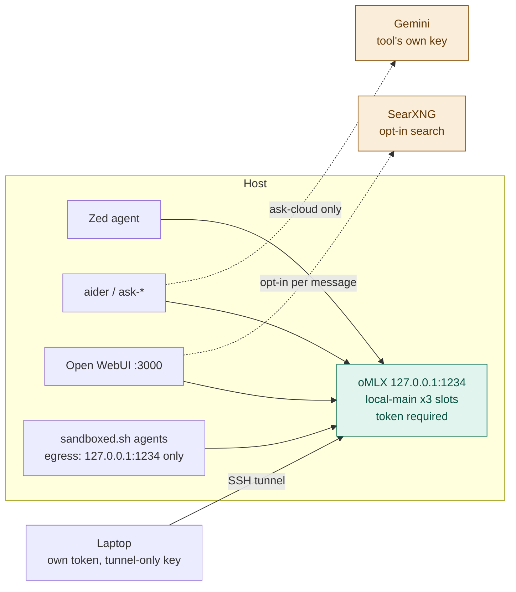

# Hearth

Local-first LLM serving for a single developer (or a small LAN).
Inference that still works when vendors get expensive, overloaded, or unavailable.

oMLX serves local models on `127.0.0.1:1234` from `~/.hearth/models`, with a
token required (ADR 0026). Cloud (Gemini) is reached by each tool directly
with its own key, never through the local server — so nothing sent to `:1234`
can leave the machine. What was tried before is in [`docs/HISTORY.md`](docs/HISTORY.md).

## Why

Model names change every few months. Hardcoding a model tag into shell
aliases, IDE settings, and laptop configs means every upgrade is a scavenger
hunt. This stack addresses **roles** instead:

```
local-main   cloud-cheap
```

Each local role is the model id oMLX serves, so clients ask for
`local-main`, never a model. Concrete models live in exactly two files —
[`config/roles.tsv`](config/roles.tsv) and [`docs/MODELS.md`](docs/MODELS.md).



## Three guarantees

1. **Privacy is structural.** oMLX holds only local models, so anything
   sent to `:1234` stays on the host by construction. Cloud needs a separate
   provider key in the calling tool; only `ask-cloud` has one. Sandboxed agents
   can reach `127.0.0.1:1234` and nothing else (`scripts/sandbox-probe.sh`).
2. **No silent route changes.** There is no router, so there is no fallback to
   leak through. If `local-main` is down, requests fail.
3. **Nothing is claimed without being measured.** Role and serving changes get
   an ADR and a bench (`bench/results/`, committed).

## Requirements

- macOS on Apple Silicon (the reference host is 64 GB)
- [oMLX](https://omlx.ai) — macOS app ([DMG releases](https://github.com/jundot/omlx/releases)) and/or a headless CLI; Hearth starts or attaches with `scripts/omlx.sh up`
- Role weights under `~/.hearth/models` (see [`docs/MODELS.md`](docs/MODELS.md))
- [Podman](https://podman.io) for Open WebUI / SearXNG

## Install oMLX (either order)

Hearth and oMLX share `~/.omlx/settings.json`. `scripts/omlx.sh up` **merges**
host policy into that file (loopback, CORS off, `auto_start_on_launch: false`,
RAM envelope, host token) and does **not** wipe app UI / aliases / MCP prefs.
If oMLX is already listening on `:1234`, `up` configures that process in place
and does not take it over.

Project: [omlx.ai](https://omlx.ai) · source: [github.com/jundot/omlx](https://github.com/jundot/omlx) ·
DMG: [Releases](https://github.com/jundot/omlx/releases).

### A — oMLX app first, then Hearth

1. Install the [oMLX DMG](https://github.com/jundot/omlx/releases) → Applications.
   Open the app once so it creates `~/.omlx/` and `~/.omlx/bin/omlx`.
2. Copy this repo, put role weights in `~/.hearth/models/…`, store the oMLX
   API key as `OMLX_HOST_TOKEN` in `~/.config/hearth/env` (mode 600).
3. `scripts/omlx.sh up` — attaches if the app is already serving `:1234`,
   otherwise starts the CLI under Hearth’s launchd agent. Sets
   `auto_start_on_launch: false` so the app does not fight for the port later.
4. Keep the Mac app as a settings / status panel. Ops: [`docs/RUNBOOK.md`](docs/RUNBOOK.md).

### B — Hearth first, then the oMLX app

1. Install a headless CLI (Homebrew formula below, or a venv under
   `~/.omlx/venv`), clone this repo, weights + `OMLX_HOST_TOKEN` as above.
2. `scripts/omlx.sh up` — starts oMLX on `127.0.0.1:1234` via launchd.
3. Later, install the [DMG](https://github.com/jundot/omlx/releases) if you want
   the menu-bar UI. Next `up` prefers `~/.omlx/bin/omlx` (app CLI), merges
   settings, and leaves an already-running server alone aside from policy.

### C — Headless only (no Mac app)

Native kernels need full Xcode, then the Metal toolchain. Current Xcode does
not ship that component in the base install. Homebrew’s `python@3.11` bottle
also needs Command Line Tools at `/Library/Developer/CommandLineTools`.

```bash
xcode-select --install
sudo xcode-select --switch /Applications/Xcode.app/Contents/Developer
xcodebuild -runFirstLaunch
xcodebuild -downloadComponent MetalToolchain

brew tap jundot/omlx https://github.com/jundot/omlx
brew trust --formula jundot/omlx/omlx
brew install jundot/omlx/omlx --with-custom-kernel
```

Then use Hearth’s agent, not `omlx start` alone:

```bash
scripts/omlx.sh up
```

`brew trust` is required before the formula installs. Metal download is also
Xcode → Settings → Components → Metal Toolchain. After `xcode-select --install`,
switch back to Xcode.app so `metal` is visible. Confirm with
`xcrun -sdk macosx metal --version`.

## Quick start

```bash
git clone <this-repo> hearth && cd hearth

# 0. oMLX — DMG and/or headless (sequences A–C above)
# 1. Weights named in config/roles.tsv → ~/.hearth/models/…
# 2. Token — the oMLX API key, mode 600
#    ~/.config/hearth/env:  OMLX_HOST_TOKEN=...

scripts/omlx.sh up

# 3. Shell aliases
echo "source $PWD/scripts/aliases.zsh" >> ~/.zshrc
```

Ops detail: [`docs/RUNBOOK.md`](docs/RUNBOOK.md). Architecture:
[`docs/ARCHITECTURE.md`](docs/ARCHITECTURE.md).

## Usage

### On the host

```bash
# Local models — all mean local-main (D1)
ask                # aider with openai/local-main
ask-big            # same
ask-arch           # aider architect mode (two local-main sides)
ask-deep           # aider on local-deep: slow, careful, loaded for the session only (ADR 0020)
ask-cloud          # Gemini via GOOGLE_API_KEY — the only alias that leaves the host

# Server management
ai-load            # scripts/omlx.sh up — start oMLX and load local-main
ai-loaded          # scripts/omlx.sh status
ai-restart         # stop and start oMLX on 127.0.0.1:1234
ai-log             # tail ~/Library/Logs/hearth-omlx.log
ai-status          # scripts/status.sh
ai-health          # scripts/healthcheck.sh
ai-boot            # scripts/boot.sh
```

### On a laptop

Source `~/.hearth-client.sh` (set by `scripts/client-setup.sh`): run
`ai-tunnel` first to open the SSH tunnel, then any of these — they all go
through the tunnel to the host's oMLX on `:1234`.

```bash
# Tunnel management
ai-tunnel          # open the SSH tunnel (needed once)
ai-tunnel-stop     # close the tunnel
ai-ping            # check tunnel + server health (up / DOWN / BAD TOKEN)
ai-models          # list models available through the tunnel

# Asking
ai-ask "question"  # one-shot question without aider
ask                # local-main. ask-big / ask-local / ask-chat / ask-fast are the same
ask-arch           # aider architect mode, local-main on both sides
ask-deep           # aider on local-deep — only while the host has it loaded
ask-cloud          # Gemini via THIS machine's own key — the only cloud alias

# Open WebUI through the tunnel
ai-webui           # open host's Open WebUI (http://127.0.0.1:3000)
```

Editors (aider + Zed): [`docs/IDES.md`](docs/IDES.md). Zed compacts an
agent thread at 110,000 tokens, under the 128K window. A longer prompt is
refused. `/compact` does it by hand.

Zed MCP tools are `context_servers`: Zed starts them as a stdio child on
the machine where it is running. A networked server is enabled only
in an agent profile named for where its traffic goes, and never in Write.
Coding threads that need search use Write + search. The query text leaves,
the same rule as web search. What is registered, and how to add one, is in
[`docs/MCP.md`](docs/MCP.md) and [`docs/IDES.md`](docs/IDES.md).

An incomplete directory name makes the agent retry `cd`. In
`~/.config/zed/settings.json`, set `ask_user` to `true` in the `write` and
`write-web` profiles, and set `agent.tool_permissions.tools.terminal.default`
to `confirm`. Personal agent instructions go in `~/.config/zed/AGENTS.md`
(create the file). Tell the agent: if a path does not resolve, call
`find_path` or `list_directory` once, then ask. Do not `cd` to a guessed
name, and do not repeat a command that just failed.

## Laptops

SSH tunnel only — the server never listens on the LAN. Each laptop gets its
own host token and an SSH key that can forward to `:1234` / `:3000` / `:8888` and
nothing else. `scripts/client-setup.sh <laptop-name>` prints the steps;
details in [`docs/LAPTOP.md`](docs/LAPTOP.md). Never port-forward `:22`,
`:1234`, `:3000` or `:8888`.

A laptop may also run its own oMLX for `local-edit` (edit prediction with
the tunnel down, ADR 0033; `client/edit-model.sh laptop-up`). Lock it the
same way as the host's: bound to `127.0.0.1`, an API key required, and
**CORS off**. oMLX's own default allows every origin (`"cors_origins":
["*"]`), which lets any web page you visit try requests against it. In
`~/.omlx/settings.json` set `"server": {"cors_origins": []}`, then:

```bash
brew services restart omlx
```

Check that a cross-site preflight gets no `access-control-allow-origin`
header back:

```bash
curl -s -o /dev/null -D - -X OPTIONS http://127.0.0.1:8000/v1/models -H 'Origin: https://example.com' -H 'Access-Control-Request-Method: GET' | grep -i access-control-allow-origin
```

No output means CORS is off. The host's `scripts/omlx.sh up` writes
`cors_origins: []` itself, and preflight fails if it is on.

## Using an AI assistant with this repo

Claude Code reads `CLAUDE.md`; Cursor reads `AGENTS.md` (a symlink to it) and
`CLAUDE.md`. Both pick the rules up from the repo root with no setup. The top
of `CLAUDE.md` tells the assistant which machine it is on, because the host and
a laptop get very different instructions.

### Setting up a laptop

On the laptop, clone the repo (it needs read access to the GitHub remote),
open it in Claude Code or Cursor, and paste:

> I'm on a laptop, setting it up to use the hearth host. Read the "Which
> machine are you on?" block in CLAUDE.md, then follow docs/LAPTOP.md →
> AI-assisted setup step by step. Never read, print or copy my key or token
> files, and never ask me to paste a secret into this chat — tell me the
> command and I'll run it myself. Stop whenever a step has to happen on the
> host.

The assistant does the plumbing (SSH key, `~/.ssh/config`, client script,
shell rc) and the checks; you type the secrets and do the two host-side steps.
Cursor can help with setup but **cannot use hearth as a model provider** — its
servers make the model calls, so they would need the host exposed publicly.
Use Zed or aider for `local-main` on the laptop.

### Changing this repo

Run it on the host, and start with:

> Read CLAUDE.md, and docs/ROUTING.md if this touches routing. Plan first and
> wait for my approval before changing anything. Before saying it's done, run
> scripts/preflight.sh (and scripts/healthcheck.sh if you touched the server)
> and show me the result: exit 0 pass, 1 real problem, 2 could not run.

The rules it must keep are in `CLAUDE.md`. The ones most often broken: model
names only in `config/roles.tsv` and `docs/MODELS.md`; nothing against the
removed gateway (`:4000`, `:11434`, LiteLLM); never read
`~/.config/hearth/env`; bash 3.2; Mermaid only.

## Security notes

- Web search via SearXNG is opt-in per message. The **search query leaves**
  even when the model stays local. See `docs/ROUTING.md`.
- `docs/MCP.md` includes a worked example of confining networked tools to a
  named Zed profile; the example server is not installed.
- Prompt-injection / agent containment: `docs/THREAT-MODEL.md`, ADR 0007.
- Every oMLX, host or laptop, binds `127.0.0.1`, requires a key, and has
  CORS off (see *Laptops*).

## Layout

```
CLAUDE.md / AGENTS.md   rules for coding agents in this repo
config/roles.tsv        role → model key, context, slots
docs/                   architecture, routing, models, runbook, history, ADRs
scripts/                omlx, benches, sandbox, client setup, …
client/                 laptop shims (bash/zsh + PowerShell), SSH-tunnel based
bench/tasks/            fixed prompts for comparing models
bench/results/          every bench run, committed
```

## License

MIT — see [LICENSE](LICENSE).
