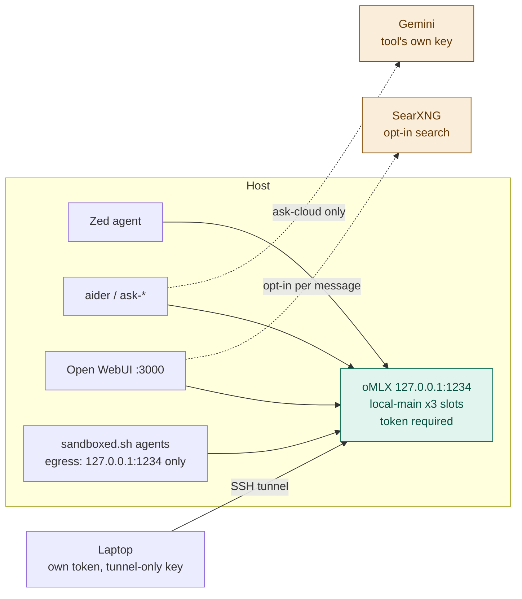

# Hearth

Local-first LLM serving for a single developer (or a small LAN).
Inference that still works when vendors get expensive, overloaded, or unavailable.

oMLX serves local models on `127.0.0.1:1234` from `~/.hearth/models`, with a
token required (ADR 0026). Cloud (Gemini) is reached by each tool directly
with its own key, never through the local server — so nothing sent to `:1234`
can leave the machine. What was tried before is in [`docs/HISTORY.md`](docs/HISTORY.md).

## Why

Model names change every few months. Hardcoding a model tag into shell
aliases, IDE settings, and laptop configs means every upgrade is a scavenger
hunt. This stack addresses **roles** instead:

```
local-main   cloud-cheap
```

Each local role is the model id oMLX serves, so clients ask for
`local-main`, never a model. Concrete models live in exactly two files —
[`config/roles.tsv`](config/roles.tsv) and [`docs/MODELS.md`](docs/MODELS.md).



## Three guarantees

1. **Privacy is structural.** oMLX holds only local models, so anything
   sent to `:1234` stays on the host by construction. Cloud needs a separate
   provider key in the calling tool; only `ask-cloud` has one. Sandboxed agents
   can reach `127.0.0.1:1234` and nothing else (`scripts/sandbox-probe.sh`).
2. **No silent route changes.** There is no router, so there is no fallback to
   leak through. If `local-main` is down, requests fail.
3. **Nothing is claimed without being measured.** Role and serving changes get
   an ADR and a bench (`bench/results/`, committed).

## Requirements

- macOS on Apple Silicon (the reference host is 64 GB)
- oMLX, started with `scripts/omlx.sh up`. Weights live in `~/.hearth/models`
- [Podman](https://podman.io) for Open WebUI / SearXNG

## Quick start

```bash
git clone <this-repo> hearth && cd hearth

# 1. Server. Weights are the directories named in config/roles.tsv,
#    under ~/.hearth/models. See docs/RUNBOOK.md.
scripts/omlx.sh up

# 2. Token — the oMLX API key, stored mode 600
#    ~/.config/hearth/env:  OMLX_HOST_TOKEN=...

# 3. Shell aliases
echo "source $PWD/scripts/aliases.zsh" >> ~/.zshrc
```

Ops detail: [`docs/RUNBOOK.md`](docs/RUNBOOK.md). Architecture:
[`docs/ARCHITECTURE.md`](docs/ARCHITECTURE.md).

## Usage

### On the host

```bash
# Local models — all mean local-main (D1)
ask                # aider with openai/local-main
ask-big            # same
ask-arch           # aider architect mode (two local-main sides)
ask-deep           # aider on local-deep: slow, careful, loaded for the session only (ADR 0020)
ask-cloud          # Gemini via GOOGLE_API_KEY — the only alias that leaves the host

# Server management
ai-load            # scripts/omlx.sh up — start oMLX and load local-main
ai-loaded          # scripts/omlx.sh status
ai-restart         # stop and start oMLX on 127.0.0.1:1234
ai-log             # tail ~/Library/Logs/hearth-omlx.log
ai-status          # scripts/status.sh
ai-health          # scripts/healthcheck.sh
ai-boot            # scripts/boot.sh
```

### On a laptop

Source `~/.hearth-client.sh` (set by `scripts/client-setup.sh`): run
`ai-tunnel` first to open the SSH tunnel, then any of these — they all go
through the tunnel to the host's oMLX on `:1234`.

```bash
# Tunnel management
ai-tunnel          # open the SSH tunnel (needed once)
ai-tunnel-stop     # close the tunnel
ai-ping            # check tunnel + server health (up / DOWN / BAD TOKEN)
ai-models          # list models available through the tunnel

# Asking
ai-ask "question"  # one-shot question without aider
ask                # local-main. ask-big / ask-local / ask-chat / ask-fast are the same
ask-arch           # aider architect mode, local-main on both sides
ask-deep           # aider on local-deep — only while the host has it loaded
ask-cloud          # Gemini via THIS machine's own key — the only cloud alias

# Open WebUI through the tunnel
ai-webui           # open host's Open WebUI (http://127.0.0.1:3000)
```

Editors (aider + Zed): [`docs/IDES.md`](docs/IDES.md). Zed compacts an
agent thread at 110,000 tokens, under the 128K window. A longer prompt is
refused. `/compact` does it by hand.

Zed MCP tools are `context_servers`: Zed starts them as a stdio child on
the machine where it is running. A networked server is enabled only
in an agent profile named for where its traffic goes, and never in Write.
Coding threads that need search use Write + search. The query text leaves,
the same rule as web search. What is registered, and how to add one, is in
[`docs/MCP.md`](docs/MCP.md) and [`docs/IDES.md`](docs/IDES.md).

## Laptops

SSH tunnel only — the server never listens on the LAN. Each laptop gets its
own host token and an SSH key that can forward to `:1234` / `:3000` / `:8888` and
nothing else. `scripts/client-setup.sh <laptop-name>` prints the steps;
details in [`docs/LAPTOP.md`](docs/LAPTOP.md). Never port-forward `:22`,
`:1234`, `:3000` or `:8888`.

## Using an AI assistant with this repo

Claude Code reads `CLAUDE.md`; Cursor reads `AGENTS.md` (a symlink to it) and
`CLAUDE.md`. Both pick the rules up from the repo root with no setup. The top
of `CLAUDE.md` tells the assistant which machine it is on, because the host and
a laptop get very different instructions.

### Setting up a laptop

On the laptop, clone the repo (it needs read access to the GitHub remote),
open it in Claude Code or Cursor, and paste:

> I'm on a laptop, setting it up to use the hearth host. Read the "Which
> machine are you on?" block in CLAUDE.md, then follow docs/LAPTOP.md →
> AI-assisted setup step by step. Never read, print or copy my key or token
> files, and never ask me to paste a secret into this chat — tell me the
> command and I'll run it myself. Stop whenever a step has to happen on the
> host.

The assistant does the plumbing (SSH key, `~/.ssh/config`, client script,
shell rc) and the checks; you type the secrets and do the two host-side steps.
Cursor can help with setup but **cannot use hearth as a model provider** — its
servers make the model calls, so they would need the host exposed publicly.
Use Zed or aider for `local-main` on the laptop.

### Changing this repo

Run it on the host, and start with:

> Read CLAUDE.md, and docs/ROUTING.md if this touches routing. Plan first and
> wait for my approval before changing anything. Before saying it's done, run
> scripts/preflight.sh (and scripts/healthcheck.sh if you touched the server)
> and show me the result: exit 0 pass, 1 real problem, 2 could not run.

The rules it must keep are in `CLAUDE.md`. The ones most often broken: model
names only in `config/roles.tsv` and `docs/MODELS.md`; nothing against the
removed gateway (`:4000`, `:11434`, LiteLLM); never read
`~/.config/hearth/env`; bash 3.2; Mermaid only.

## Security notes

- Web search via SearXNG is opt-in per message. The **search query leaves**
  even when the model stays local. See `docs/ROUTING.md`.
- `docs/MCP.md` includes a worked example of confining networked tools to a
  named Zed profile; the example server is not installed.
- Prompt-injection / agent containment: `docs/THREAT-MODEL.md`, ADR 0007.

## Layout

```
CLAUDE.md / AGENTS.md   rules for coding agents in this repo
config/roles.tsv        role → model key, context, slots
docs/                   architecture, routing, models, runbook, history, ADRs
scripts/                omlx, benches, sandbox, client setup, …
client/                 laptop shims (bash/zsh + PowerShell), SSH-tunnel based
bench/tasks/            fixed prompts for comparing models
bench/results/          every bench run, committed
```

## License

MIT — see [LICENSE](LICENSE).
