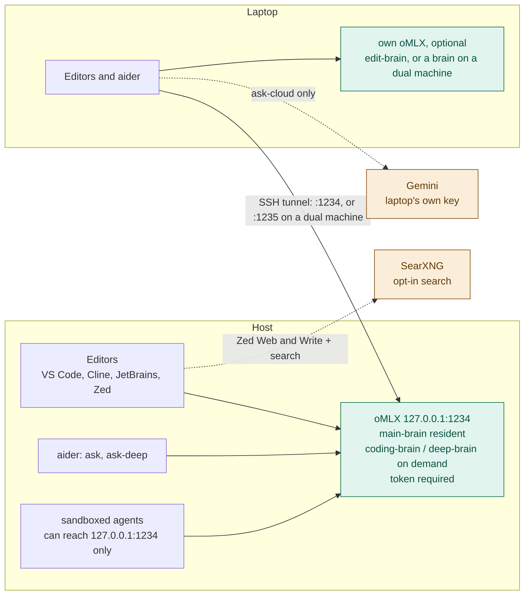

# Hearth

Hearth runs an AI coding assistant on a Mac you own. Your editors (VS Code,
Cline, JetBrains IDEs, Zed) and the terminal talk to it the same way they
would talk to a cloud AI service, but the model runs on your own hardware,
so your code never leaves it. It keeps working when cloud vendors get
expensive, overloaded or go down.

New here? Read *Words used here*, check *Before you start*, then follow
*Quick start*. What was tried before is in [`docs/HISTORY.md`](docs/HISTORY.md).

## What you get

- **A coding model on hardware you own.** `main-brain` stays loaded
  (256K × 3) on every host and serves agents in VS Code, Cline, JetBrains
  IDEs, Zed and aider (ADR 0048). On a 64 GB host, `coding-brain` (98K × 1)
  can take its place for a session.
- **A bigger model when you need one (optional).** `ask-deep` loads
  `deep-brain`, a slower, more careful model. It swaps the current agent out
  for the session and restores it afterwards. Skip it and everything else
  still works.
- **Another host's brain (optional).** A laptop can use a more powerful
  Mac's brain over an SSH tunnel, with a key that can only open the tunnel
  and a token you can cancel on its own. A machine can run its own brain and
  use a bigger host too (ADR 0040).
- **The same names everywhere.** Editors and commands ask for a role such as
  `main-brain`, never a specific model, so upgrading a model changes no
  editor setting or command.
- **Edit prediction on a laptop.** `edit-brain` is a small model that
  suggests your next edit, on the laptop's own oMLX (ADR 0033).
- **Cloud only when you ask.** `ask-cloud` runs on a laptop with that
  laptop's own key. The host holds no cloud key, so nothing sent to `:1234`
  leaves your hardware (ADR 0038).
- **Agents that cannot loop forever.** A loop guard refuses the third
  identical tool call in a row and stops a run at its call budget (ADR 0036).
- **No silent fallback.** If a brain is down you get an error, never a quiet
  switch to the cloud.

## Words used here

| Word | Meaning |
|---|---|
| model, weights | The AI itself is a set of large files called weights, 16–22 GB each here, kept under `~/.hearth/models` |
| oMLX | The free Mac program that loads the weights and answers requests, in the same format as cloud AI services ([omlx.ai](https://omlx.ai)) |
| role, brain | A job name such as `main-brain`. Editors ask for the role; [`config/roles.tsv`](config/roles.tsv) says which model fills it. A *brain* is a role running on hardware you own |
| host | The Mac that runs oMLX and serves a brain |
| laptop, client | A machine that uses a host's brain over the network |
| `127.0.0.1:1234` | "This machine, port 1234": where oMLX answers. Nothing else on the network can reach it |
| tunnel | An SSH connection that makes the host's oMLX appear at `127.0.0.1` on the laptop, so it is never open on the network |
| token | A password every request must carry. Each laptop and editor gets its own, so you can cancel one without touching the others |
| RAM tier | Settings tested for one memory size. 8 GB is always held back for macOS and your apps |
| context, 98K / 256K | How much text a role reads at once. `main-brain` is 256K (262,144); `coding-brain` is 98K; `deep-brain` stays at 64K |
| slots | How many requests the model works on at the same time (3 under `main-brain`, 1 under `coding-brain`) |
| aider | A terminal coding assistant. `ask`, `coding-brain` and `ask-deep` start it |
| ADR | A short decision record in [`docs/decisions/`](docs/decisions/). "ADR 0040" is number 40 |

## Local brain or remote brain

A machine can serve its own brain, use another host's brain through the
tunnel, or both (ADR 0040).

| | **hearth** (this machine) | **hearth-remote** (another host) | **cloud-cheap** |
|---|---|---|---|
| Address | `127.0.0.1:1234` | `127.0.0.1:1235` on a dual machine; `:1234` on a plain laptop | Gemini |
| Commands | `ask`, `ask-deep`; `coding-brain` on 64 GB | `ask-remote`, `coding-brain-remote`, `ask-deep-remote`, `hearth-load` (no suffix on a plain laptop) | `ask-cloud` |
| Needs | 24 GB RAM or more; 48 GB tested (*Before you start*) | network, host awake | laptop's own key |
| Works offline | yes | no | no |
| Sensitive code | yes | yes: your hardware, your tunnel | **never** |
| Cost to this machine | about 34 GB on a short turn, 40 GB measured for a 200k prompt, plus battery and heat | almost none | none |
| Best when | travelling, no network, host asleep | on battery, long agent runs, RAM needed for other work | throwaway, non-sensitive questions |
| Fails when | not enough free RAM | tunnel down or host asleep (`ai-ping` says which) | no key or no network |

Both brains answer to the same role names. Each machine serves the model
benched for its RAM tier, so on a bigger host the same role can be a bigger
model.

## Before you start

- **A Mac with Apple Silicon** (M1 or later).
- **Memory.** Hearth holds back 8 GB for macOS and your apps, so a brain
  needs at least 24 GB of RAM. Only 48 GB and up is tested today:

  | RAM (usable) | Resident | Swap | State |
  |---|---|---|---|
  | 64 GB (56) | `main-brain` 256K × 3 | `coding-brain` 98K × 1; `deep-brain` 64K | **tested**: reference host (ADR 0048) |
  | 48 GB (40) | `main-brain` 256K × 3 | `deep-brain` 64K | **tested** on short turns. No `coding-brain` (40 GB ceiling) |
  | 32 GB (24) | ~26B MoE, ~4B active, 1 slot | dense 27B, swaps in | candidate, not tested |
  | 24 GB (16) | dense ~12B, 1 slot | none | candidate, not tested |
  | under 24 GB | none: use another host (*Laptops*) | — | — |

  On 24 or 32 GB, `scripts/install-host.sh` prints the suggested model and
  stops. A tier gets settings only after it is benched on that hardware
  (rule 5). Which models these are, with measurements and sources:
  [`docs/MODELS.md`](docs/MODELS.md) → *Candidates by RAM*.
- **Disk.** About 25 GB free for `main-brain`, about 40 GB with
  `deep-brain` (the 48 GB tier's weights).
- **Software.** [Homebrew](https://brew.sh), git, `jq`, oMLX, and the
  Hugging Face CLI for downloads (*Quick start* installs the last two).
  [Podman](https://podman.io) only if you want SearXNG web search for Zed.

## Quick start

The default is one Mac running `main-brain`. `coding-brain` (64 GB only),
`deep-brain` and a remote host are optional extras.
Every Hearth script here is safe to re-run, says what is left to do, and
never reads your token.

### 1. Your own resident brain

1. **Get the code.** Clone this repo (you need read access to it on
   GitHub) and open a terminal in it:

   ```bash
   git clone git@github.com:ouster/hearth.git ~/hearth
   ```

   ```bash
   cd ~/hearth
   ```

2. **Install oMLX.** The easiest way: download the DMG from
   [oMLX releases](https://github.com/jundot/omlx/releases), drag it to
   Applications and open it once. Other ways: *Install oMLX*, below.

3. **Download the weights.** Install the Hugging Face CLI:

   ```bash
   brew install huggingface-cli
   ```

   In [`docs/MODELS.md`](docs/MODELS.md) → *Live*, find the `main-brain`
   row. Its *Source* column gives a repo and a revision. Download it into a
   folder with the same name as the repo:

   ```bash
   hf download <source> --revision <revision> --local-dir ~/.hearth/models/<source>
   ```

   The revision pins the exact files, so Hearth can tell later if they
   change (rule 6). If the short revision is refused, use the full commit
   hash from the model page's history.

4. **Make the token.** This creates a random password and stores it
   without showing it on screen:

   ```bash
   openssl rand -hex 32 | pbcopy
   ```

   ```bash
   mkdir -p ~/.config/hearth && umask 077 && printf 'OMLX_HOST_TOKEN=%s\n' "$(pbpaste)" >> ~/.config/hearth/env && chmod 600 ~/.config/hearth/env && pbcopy </dev/null
   ```

   Editors and laptops get their own tokens later (*Editors*, *Laptops*).

5. **Run the installer.** First see what is missing, then let it set
   things up:

   ```bash
   scripts/install-host.sh --check
   ```

   ```bash
   scripts/install-host.sh
   ```

   It checks the steps above, starts oMLX with `main-brain`, sets it to
   start at login, and adds the `ask` commands to your shell. It prints one
   step for you to run yourself (`scripts/iogpu-wired.sh`, which asks for
   your password to let the GPU use more memory).

6. **Try it.** Open a new terminal window and run `ask`. You are talking to
   `main-brain` in aider. Then connect an editor (*Editors*).

### 2. Optional: `deep-brain`

On 48 GB and up, download the `deep-brain` row from `docs/MODELS.md` the
same way as step 3, then use `ask-deep`. It swaps `main-brain` out for the
session, so editors and laptops wait until you exit. Without the weights,
`ask-deep` cannot start and nothing else changes.

### 3. Optional: a remote host

| This machine is | Run |
|---|---|
| a **client** only (no brain of its own; tunnel on `127.0.0.1:1234`) | `client/install-client.sh --host you@studio.local` |
| **both** (its own brain, plus a bigger host on `127.0.0.1:1235`) | `client/install-client.sh --dual`, then section 1 |

The client side, keys and tokens: *Laptops* and [`docs/LAPTOP.md`](docs/LAPTOP.md).
What happens at each step, and how to fix things: [`docs/RUNBOOK.md`](docs/RUNBOOK.md).

## Community benches

[Performance](https://omlx.ai/benchmarks) and [Intelligence](https://omlx.ai/benchmarks/intelligence) are runs people uploaded from the oMLX app (boards read 2026-11-09). Use them to see whether a model is even plausible on a Mac like yours. They do not make it a Hearth role. That still takes `bench/tasks` and `scripts/concurrency-bench.sh` on your machine, then a row in `config/roles.tsv` (rule 5). The names to try first are in [`docs/MODELS.md`](docs/MODELS.md) → *Candidates by RAM*.

Filter **Performance** to your chip and your RAM. A row is prefill tok/s, generation tok/s, and a context length on that machine. Open the run and read peak memory. It has to land under your ceiling, RAM minus 8. A fast row from a 128 GB or 256 GB Mac does not mean the model loads on a 24 GB or 32 GB Mac.

**Intelligence** is a different test on every row, often a short sample. The order is not a ranking. Treat a high score as "someone ran that test", then go back to Performance for speed and memory.

Run your own. The [DMG](https://github.com/jundot/omlx/releases) is the handy way to experiment: menu bar, model list, chat, and a bench you can share to those boards from the dashboard (oMLX 0.2.6 and later). The bench uses the app's prompts, not your files. A candidate that fits there is worth Hearth's bench. One that blows the ceiling is not.

### App server vs Hearth server

Hearth starts `omlx-server` with `scripts/omlx.sh up` (or login boot). The
Mac app starts its own server with **Start Server**. Both use
`127.0.0.1:1234` and share `~/.omlx/settings.json`. They are not the same
process. The app tracks the server *it* started. It does not treat a
Hearth-started process as Running (seen on oMLX 0.7.3, 2026-11-14).

While Hearth owns `:1234`:

- The app Server page often shows **Stopped** and Models stays empty.
- Security login can return **401** (wrong session key).
- Pasting into first-time setup returns **400**: `API key is already configured`.
- Do **not** press Start. That starts a second server on the same port.

Editors, the tunnel, and `hearth-load` use the Hearth server. That path is
fine while the app looks empty.

### When the app should start the server

Use the app server for Downloads, the Models list, chat in the app, and
Throughput / Intelligence benches you will upload to omlx.ai.

```bash
scripts/omlx.sh down          # nothing on 127.0.0.1:1234
# oMLX.app → Start Server → Models / benches
# oMLX.app → Stop
scripts/omlx.sh up            # Hearth takes :1234 again
```

`scripts/omlx.sh status` must show nothing on `:1234` before Start. A fresh
app can bind port 8000 until Hearth merges settings. Stop the app server
before `up`.

### When it should not

Once `scripts/omlx.sh up` or login boot (`com.hearth.boot`) is serving
`127.0.0.1:1234`, leave the app closed or open only as a viewer. Do not
Start. `up` sets `auto_start_on_launch: false` so opening the app does not
bind the port again.

`scripts/omlx.sh down` stops a Hearth-started server. It does not stop one
you started from the app. Stop that one in the app, then run `up`. If the
app is already serving `:1234`, `up` attaches and does not replace the
process.

Keep the bind on loopback. Do not turn on Serve on Local Network. A
client-only laptop has no local `hearth` and does not start a server.

## Install oMLX

Quick start step 2 covers the usual way. These are all three, in detail.
Hearth and oMLX share `~/.omlx/settings.json`. `scripts/omlx.sh up` **merges**
host policy into that file (loopback, CORS off, `auto_start_on_launch: false`,
RAM envelope, host token) and does **not** wipe app UI / aliases / MCP prefs.
If oMLX is already listening on `:1234`, `up` configures that process in place
and does not take it over.

Project: [omlx.ai](https://omlx.ai) · source: [github.com/jundot/omlx](https://github.com/jundot/omlx) ·
DMG: [Releases](https://github.com/jundot/omlx/releases).

### A — oMLX app first, then Hearth

1. Install the [oMLX DMG](https://github.com/jundot/omlx/releases) → Applications.
   Open the app once so it creates `~/.omlx/` and `~/.omlx/bin/omlx`.
2. Copy this repo, put role weights in `~/.hearth/models/…`, store the oMLX
   API key as `OMLX_HOST_TOKEN` in `~/.config/hearth/env` (mode 600).
3. `scripts/omlx.sh up` — attaches if the app is already serving `:1234`,
   otherwise starts the CLI under Hearth’s launchd agent. Sets
   `auto_start_on_launch: false` so the app does not fight for the port later.
4. For day-to-day serving, use Hearth on `:1234`. For app Models / benches,
   hand the port to the app (see *App server vs Hearth server* above).
   Ops: [`docs/RUNBOOK.md`](docs/RUNBOOK.md).

### B — Hearth first, then the oMLX app

1. Install a headless CLI (Homebrew formula below, or a venv under
   `~/.omlx/venv`), clone this repo, weights + `OMLX_HOST_TOKEN` as above.
2. `scripts/omlx.sh up` — starts oMLX on `127.0.0.1:1234` via launchd.
3. Later, install the [DMG](https://github.com/jundot/omlx/releases) if you want
   the menu-bar UI. Next `up` prefers `~/.omlx/bin/omlx` (app CLI), merges
   settings, and leaves an already-running server alone aside from policy.

### C — Headless only (no Mac app)

Native kernels need full Xcode, then the Metal toolchain. Current Xcode does
not ship that component in the base install. Homebrew’s `python@3.11` bottle
also needs Command Line Tools at `/Library/Developer/CommandLineTools`.

```bash
xcode-select --install
sudo xcode-select --switch /Applications/Xcode.app/Contents/Developer
xcodebuild -runFirstLaunch
xcodebuild -downloadComponent MetalToolchain

brew tap jundot/omlx https://github.com/jundot/omlx
brew trust --formula jundot/omlx/omlx
brew install jundot/omlx/omlx --with-custom-kernel
```

Then use Hearth’s agent, not `omlx start` alone:

```bash
scripts/omlx.sh up
```

`brew trust` is required before the formula installs. Metal download is also
Xcode → Settings → Components → Metal Toolchain. After `xcode-select --install`,
switch back to Xcode.app so `metal` is visible. Confirm with
`xcrun -sdk macosx metal --version`.

## Usage

### On the host

```bash
# Brains (ADR 0039)
ask                # aider with openai/main-brain (resident)
main-brain         # same as ask (ask-main also still works)
coding-brain       # 64 GB only: swap coding-brain in, aider, restore main-brain (ADR 0048)
ask-arch           # aider architect mode (resident on both sides)
ask-deep           # aider on deep-brain: slow, careful, loaded for the session only (ADR 0020)
deep-brain         # same as ask-deep
# No cloud alias on the host: ask-cloud is laptop-only (ADR 0038)

# Server management
ai-load            # scripts/omlx.sh up — start oMLX and load main-brain
ai-loaded          # scripts/omlx.sh status
ai-restart         # stop and start oMLX on 127.0.0.1:1234
ai-log             # tail ~/Library/Logs/hearth-omlx.log
ai-status          # scripts/status.sh
ai-health          # scripts/healthcheck.sh
ai-boot            # scripts/boot.sh
```

### On a laptop

Source `~/.hearth-client.sh` (set by `client/install-client.sh`). On macOS,
`ai-tunnel` once to accept the host fingerprint, then `ai-tunnel-install`:
launchd restarts the forwards when they drop and at login. Linux stays on
`ai-tunnel`. Everything below goes through the tunnel to the host's oMLX.
On a machine that is both (ADR 0040), the same commands end in `-remote`
(`ask-remote`, `ask-deep-remote`) and the tunnel is on `:1235`.

```bash
# Tunnel management
ai-tunnel-install  # macOS: LaunchAgent keeps the tunnel up
ai-tunnel          # open it now (kickstarts the agent if installed)
ai-tunnel-stop     # unload the agent and close the tunnel
ai-ping            # check tunnel + server health (up / DOWN / BAD TOKEN)
ai-models          # list models available through the tunnel

# Asking
ai-ask "question"  # one-shot question without aider
ask                # aider with main-brain (also: main-brain)
ask-arch           # aider architect mode, resident on both sides
coding-brain       # aider on the host's coding-brain (64 GB host only)
ask-deep           # aider on the host's deep-brain (also: deep-brain)
                   # Both load via hearth-swapd on :1236 (ADR 0049), then restore.
                   # HEARTH_SSH_ADMIN is fallback (docs/LAPTOP.md)
hearth-load <role> up|down   # load or unload a host swap role (swapd, else SSH)
ask-cloud          # Gemini via THIS machine's own key — the only cloud alias

```

aider and `ask-*` are in [`docs/IDES.md`](docs/IDES.md).

## Editors

Every editor defaults to the role `main-brain` at
`http://127.0.0.1:1234/v1` (ADR 0048): directly on the host, through
`ai-tunnel` on a laptop. `coding-brain` (64 GB host) and `deep-brain` are
swap roles: pick one only after `scripts/demand-load.sh <role> up` on the
host, or `hearth-load <role> up` from a laptop, and switch back to
`main-brain` after `down`. Authenticate with a token:
your laptop's token, or a per-editor token you can revoke on its own
(`scripts/omlx.sh sub-key add <editor>-<machine>` on the host; names are
letters, digits, `-` and `_`). **No editor gets a cloud provider on the
host** (rule 3). On a dual machine (ADR 0040), add a second provider,
`hearth-remote`, at `http://127.0.0.1:1235/v1` for the bigger host. Full
detail: [`docs/IDES.md`](docs/IDES.md).

**Loops.** `scripts/loop-guard.sh` runs before every tool call in VS Code,
Cline, and OpenCode (ADR 0036, 0043). It refuses the third identical call
in a row, and stops the run after 80 calls in one session. Run
`scripts/install-loop-guard.sh` once per machine to cover every repo; this
one is wired already (`.github/hooks/`, `.clinerules/hooks/`,
`.opencode/plugins/`). Refusals are logged to
`~/Library/Logs/hearth-loop-guard.log`. Zed has no hooks; see below.

**Check any client in a few steps** (hearth folder open):

1. Point the base URL at `http://127.0.0.1:1299/v1`, a port where nothing
   answers, and send a prompt. It must fail with an error, which proves the
   editor has no hidden cloud fallback. Then set it back.
2. "Create `scratch-smoke.sh` containing `if [[ $x < 1 ]]; then echo hi; fi`,
   read it back, then delete it." Keeps the `<`.
3. "Read `AGENTS.md` three times in a row with the read tool. Don't change
   anything." The third call is refused, and a line appears in the log.

### VS Code (1.122+, trial, ADR 0036)

Two files in `~/Library/Application Support/Code/User/`. Check both with
`scripts/vscode-check.sh` (exit 0 = clean). `--show` prints the settings.

Chat and the agent default to `main-brain`. Inline completions and next
edit suggestions are Microsoft's: they need a GitHub sign-in, and the
text around the cursor goes to GitHub's servers (ADR 0041). A sensitive
repo turns both off in its own `.vscode/settings.json`
(`scripts/vscode-check.sh --show-sensitive`).

Copilot Free, Student, and Pro all do that. Allowances below are from
GitHub's billing docs and plans page, and from the GitHub Education
post of 1 June 2026, read 2026-11-09. One AI credit is $0.01 of model
use. Completions and next edit suggestions are not billed as credits
on paid plans. Chat, the Copilot agent, and the Copilot CLI are.

| Plan | Inline suggestions | Credits for chat and agent |
|---|---|---|
| Free | 2,000 a month | an allowance GitHub does not publish; auto model selection only; no extra credits for sale |
| Student (verified) | unlimited | 200 a month; auto model selection only |
| Pro ($10 a month) | unlimited | 1,000 base plus a 500 flex allotment, 1,500 today; GitHub says the flex part can change |

A request is not one credit. A round that sends about 30,000 tokens and
receives 1,000 back costs about 0.7 credits on MAI-Code-1.1-Flash, about
3.5 on Claude Haiku 4.5, and about 17.5 on Claude Opus 5, before cache
writes (GitHub's model price table, 2026-11-09). An agent task is many
rounds and the prompt grows, so eight rounds at the Haiku size are on
the order of 30 credits, and more once the transcript lengthens. That
is a handful of tasks on the student allowance and a few dozen on Pro.
`main-brain` spends none of those credits, so the long sessions belong
on Hearth. Ghost text on the Free plan still stops at 2,000 for the month.

`settings.json` (JSONC, so comments are allowed). Completions are on;
code search stays off, and agent requests are capped:

```jsonc
"github.copilot.enable": { "*": true },                // ghost text, via Microsoft
"github.copilot.nextEditSuggestions.enabled": true,   // next edit, via Microsoft
"github.copilot.chat.codesearch.enabled": false,      // GitHub embeddings stay off
"telemetry.telemetryLevel": "off",
"chat.agent.maxRequests": 40,                          // pauses and asks to continue
"chat.tools.global.autoApprove": false,
"chat.mcp.discovery.enabled": {                        // object form in 1.144
    "claude-desktop": false, "windsurf": false,
    "cursor-global": false, "cursor-workspace": false
},
"chat.useHooks": true,                                 // runs the loop guard
"chat.useAgentsMdFile": true,
"chat.planAgent.defaultModel": "main-brain (customendpoint)"
```

`chatLanguageModels.json` holds the model. Give it no provider-level
`url`: that would list every role oMLX reports.

```jsonc
[
  {
    "name": "hearth",
    "vendor": "customendpoint",
    "apiKey": "${input:…}",          // written by VS Code, see below
    "apiType": "chat-completions",
    "models": [
      {
        "id": "main-brain",
        "name": "main-brain",
        "url": "http://127.0.0.1:1234/v1",
        "toolCalling": true,
        "vision": false,
        "thinking": true,
        "streaming": true,
        "maxInputTokens": 245760,
        "maxOutputTokens": 16384
      },
      {
        "id": "coding-brain",
        "name": "coding-brain",
        "url": "http://127.0.0.1:1234/v1",
        "toolCalling": true,
        "vision": false,
        "thinking": true,
        "streaming": true,
        "maxInputTokens": 90000,
        "maxOutputTokens": 16384
      }
    ]
  }
]
```

Leave `apiKey` out when writing the file. Then set the key in **Chat:
Manage Language Models** → `hearth`. VS Code keeps it in its secret store
and writes the `${input:…}` reference itself. A placeholder typed by hand
has no secret behind it, so requests fail with "API key required" (1.144).
Never paste the key itself into the file. `vscode-check.sh` fails if a
literal key sits in a file other users can read. Then, in Chat, pick
`main-brain` and the **Local** session target. List `coding-brain` on a
64 GB host only, and demand-load before picking it.

### Cline (Desktop, VS Code, JetBrains, CLI — trial, ADR 0036)

Cline's first screens push **Sign in** / Cline Pass. Skip them. Hearth is
BYOK OpenAI Compatible only — Sign in, Cline Pass, and Usage-Billing send
the prompt to Cline's cloud.

**0. Past Sign in (Desktop first run)**

1. **Get started**
2. Skip the purple **Sign in** / **Sign up** card (marked Recommended)
3. Open **Use your own API key** (key icon, under the Sign-in card)
4. **Choose a provider** → **OpenAI Compatible** (scroll; not OpenAI)
5. Fill the table below → **Connect**

Already past onboarding? Settings → Provider → BYOK → Add Provider →
OpenAI Compatible. Same fields.

**1. Provider fields**

| Field | Value |
|---|---|
| Provider ID | `hearth` |
| Base URL | `http://127.0.0.1:1234/v1` |
| Model Source URL | leave empty (do not fetch a remote model list) |
| API key | paste your hearth token (host key or `cline-<machine>` sub-key) |
| Capabilities | streaming, tools, reasoning |
| Prompt cache | off (oMLX already caches; no client flag) |

**Models** — add all three roles by hand (empty Model Source URL). Default
selection: `main-brain`.

| Model id | Context | When to pick it |
|---|---|---|
| `main-brain` | `262144` | Default. Resident on every host; always up after boot |
| `coding-brain` | `98304` | 64 GB host only. After `scripts/demand-load.sh coding-brain up` on the host |
| `deep-brain` | `65536` | After `scripts/demand-load.sh deep-brain up` on the host |

Cline only **selects** a role. It does not load or unload weights. On the
host, `demand-load.sh <role> up` / `down` (or `coding-brain` / `ask-deep`)
swaps RAM; from a laptop, `hearth-load <role> up` / `down` posts to
hearth-swapd on `:1236` with the laptop sub-key (ADR 0049; `docs/LAPTOP.md`).
`coding-brain` and `deep-brain` each evict `main-brain` for the session
(ADR 0048). Pick a swap role in Cline only while it is loaded; after `down`,
switch the model picker back to `main-brain`. There is no cloud fallback,
but a call to a role that is not loaded can be answered by the role that
is, without saying so.

**2. Privacy** — Settings → General: turn off usage and error reporting.
Connectors / Composio: off. If a Slack (or other) auth link appears, do
not authorise it. Sign out of a Cline account if there is no switch;
Hearth needs only the key above.

**3. Hooks** — Feature settings → Enable Hooks, then run
`scripts/install-loop-guard.sh` once (verified 2026-11-08 in Desktop and
PyCharm).

Cline reads `AGENTS.md` and `.clinerules/`. Detail and SearXNG notes:
`docs/IDES.md`.

### OpenCode (trial, ADR 0043)

Agent harness (CLI / TUI / desktop) on `main-brain`. Install from
[opencode.ai](https://opencode.ai), then on the host
`scripts/omlx.sh sub-key add opencode-<machine>`. On a laptop, `ai-tunnel`
must be up first.

`~/.config/opencode/opencode.json` (mode 600 if it holds the key). Provider
id `hearth`, default `main-brain`. Shape matches what oMLX's OpenCode
writer uses today:

```jsonc
{
  "$schema": "https://opencode.ai/config.json",
  "model": "hearth/main-brain",
  "websearch": false,
  "provider": {
    "hearth": {
      "npm": "@ai-sdk/openai-compatible",
      "name": "hearth",
      "options": {
        "baseURL": "http://127.0.0.1:1234/v1",
        "apiKey": "opencode-<machine> token"
      },
      "models": {
        "main-brain": {
          "name": "main-brain",
          "limit": { "context": 262144, "output": 16384 }
        },
        "coding-brain": {
          "name": "coding-brain",
          "limit": { "context": 98304, "output": 16384 }
        },
        "deep-brain": {
          "name": "deep-brain",
          "limit": { "context": 65536, "output": 16384 }
        }
      }
    }
  }
}
```

Type the sub-key yourself; never commit it. Add the SearXNG MCP server and the `webfetch` deny from `docs/IDES.md` (ADR 0045). Do not set `SEARXNG_URL`. No cloud / OpenRouter provider
on the host for sensitive work (rule 3). Dual machine (ADR 0040): add
`hearth-remote` the same way at `http://127.0.0.1:1235/v1`.

Run `scripts/install-loop-guard.sh` once, then restart OpenCode so it loads
`~/.config/opencode/plugins/hearth-loop-guard/`. This repo already has
`.opencode/plugins/hearth-loop-guard/`. OpenCode reads `AGENTS.md`.

T3 Code can drive OpenCode from a phone later; it does not support local
models today, so that path is deferred (`docs/MOBILE.md`).

### JetBrains IDEs (AI Assistant)

1. Settings → Tools → AI Assistant → Providers & API keys → **OpenAI
   Compatible**. Base URL `http://127.0.0.1:1234/v1`, your key (kept in
   the IDE's password store). **Test Connection**.
2. **Assign `main-brain` by hand** to chat and every feature you use. A
   feature with no local model assigned can fall back to JetBrains' cloud
   if a subscription is signed in. Demand-load before picking a swap role.
3. **Offline mode on** for sensitive repos. No JetBrains AI cloud model on
   the host.

AI Assistant has no hooks.

### Cline in JetBrains

Cline is the option when you want the loop guard inside a JetBrains IDE.
Install Marketplace plugin 28247, then View → Tool Windows → Cline. The
provider is the same `hearth` BYOK setup as Cline above: base URL
`http://127.0.0.1:1234/v1`, model `main-brain`, Model Source URL empty.
Run `scripts/install-loop-guard.sh` once. On 2026-11-08 the global hook
stopped the third identical read in PyCharm. Cline's servers and Cline
Pass are the same choice as elsewhere: available, and not private.

### Zed

`~/.config/zed/settings.json`, provider `hearth` (OpenAI-compatible) →
`main-brain` in every default model slot. `scripts/zed-sync.sh` writes
labels with context × slots from `roles.tsv`. Tool calls ask first
(`agent.tool_permissions.default: "confirm"`). Threads on `main-brain`
compact at 170,000 tokens; a `coding-brain` thread needs about 80,000.

**Zed loops, and Hearth cannot stop it there.** Zed has no tool hooks and
no per-turn request cap, so the loop guard does not cover it. Two shapes
show up with local models: the same tool call repeated, and the same
reasoning passage repeated. The ADR 0024 loop, where the old server
silently trimmed long prompts, is gone, because oMLX refuses instead. What
helps today:

- Keep `confirm`: a loop cannot run unattended, it just becomes tedious to
  click through. Setting read tools to `allow` lets a read loop run unasked.
- An incomplete directory name makes the agent retry `cd`. Set `ask_user`
  to `true` in the `write` and `write-web` profiles, and set
  `agent.tool_permissions.tools.terminal.default` to `confirm`. In
  `~/.config/zed/AGENTS.md`, tell the agent: if a path does not resolve,
  call `find_path` or `list_directory` once, then ask. Do not repeat a
  command that just failed.
- Run Cline as an ACP agent inside Zed for the guard. Hooks under ACP are
  not yet tested.
- Upstream: [zed-industries/zed#66686](https://github.com/zed-industries/zed/pull/66686)
  stops a turn on the third repeated tool call or reasoning passage. A
  per-turn request cap is proposed in
  [discussion #66689](https://github.com/zed-industries/zed/discussions/66689).

Zed MCP tools are `context_servers`, started as a stdio child where Zed
runs. A networked server goes only in an agent profile named for where
its traffic goes, never in Write. See [`docs/MCP.md`](docs/MCP.md).

## Laptops

SSH tunnel only — the server never listens on the LAN. Each laptop gets its
own host token and an SSH key that can forward to `:1234` and
nothing else. SearXNG stays on the laptop (ADR 0045). The token name is `laptop-` plus a short name, for example
`laptop-m5-air`:

```bash
scripts/omlx.sh sub-key add laptop-m5-air    # new: host user types the token
scripts/client-setup.sh m5-air               # prints both paths
```

`m5-air` and `laptop-m5-air` are the same machine. When `laptop-m5-air` is
already in `scripts/omlx.sh sub-key list`, skip add. The laptop uses the
token already in `~/.hearth-key`. The list prints names only, so a lost token
is replaced with revoke, then add. Details in [`docs/LAPTOP.md`](docs/LAPTOP.md).
Never port-forward `:22`, `:1234` or `:8888`.

A laptop may also run its own oMLX for `edit-brain` (edit prediction with
the tunnel down, ADR 0033; `client/edit-model.sh laptop-up`). Lock it the
same way as the host's: bound to `127.0.0.1`, an API key required, and
**CORS off**. oMLX's own default allows every origin (`"cors_origins":
["*"]`), which lets any web page you visit try requests against it. In
`~/.omlx/settings.json` set `"server": {"cors_origins": []}`, then:

```bash
brew services restart omlx
```

Check that a cross-site preflight gets no `access-control-allow-origin`
header back:

```bash
curl -s -o /dev/null -D - -X OPTIONS http://127.0.0.1:8000/v1/models -H 'Origin: https://example.com' -H 'Access-Control-Request-Method: GET' | grep -i access-control-allow-origin
```

No output means CORS is off. The host's `scripts/omlx.sh up` writes
`cors_origins: []` itself, and preflight fails if it is on.

## One machine, both roles

A laptop with the RAM for a benched tier can run its own brain and still
reach a bigger host (ADR 0040). Its own oMLX is always `127.0.0.1:1234`, the
port the sandbox, scripts and editors use. The tunnel moves aside:

| | This machine | The bigger host, through the tunnel |
|---|---|---|
| oMLX | `127.0.0.1:1234` | `127.0.0.1:1235` |
| SearXNG | `:8888` on this machine | its own `:8888`. The tunnel does not forward it |
| Shell | `ask`, `ask-deep`; `coding-brain` on 64 GB | `ask-remote`, `coding-brain-remote`, `ask-deep-remote`, `hearth-load` |
| Editor provider | `hearth` | `hearth-remote` |

Both are your own hardware, so both are brains (rule 3). To convert a laptop:

1. `client/install-client.sh --dual`
2. in a new shell, `ai-tunnel-stop && ai-tunnel-install`, which moves the
   tunnel to 1235
3. `brew services stop omlx`, if a brew-run oMLX serves `edit-brain` on 8000
4. `scripts/install-host.sh`. Under 48 GB it prints the matching candidate from `docs/MODELS.md` and stops. That line is not installed; a row waits on a bench on this machine (rule 5)
5. `client/edit-model.sh laptop-up`, to serve `edit-brain` from the new oMLX

## How it works

### Roles, not model names

Model names change every few months. Writing one into shell commands,
editor settings and laptop configs makes every upgrade a hunt. Hearth uses
**roles** instead: `main-brain`, `coding-brain`, `deep-brain` and `edit-brain` run on your
own hardware, and `cloud-cheap` is the laptop-only cloud role. Concrete
models appear in exactly two files, [`config/roles.tsv`](config/roles.tsv)
and [`docs/MODELS.md`](docs/MODELS.md). oMLX advertises each model under its
role name (ADR 0034).



### Three guarantees

1. **Privacy is structural.** oMLX holds only local models, so anything
   sent to `:1234` stays on the machine by construction. The host holds no
   cloud key at all; only a laptop's `ask-cloud` has one (ADR 0038).
   Sandboxed agents can reach `127.0.0.1:1234` and nothing else
   (`scripts/sandbox-probe.sh`).
2. **No silent route changes.** There is no router, so there is no fallback
   to leak through. If the resident role is down, requests fail.
3. **Nothing is claimed without being measured.** Role and serving changes
   get an ADR and a bench (`bench/results/`, committed).

## Using an AI assistant with this repo

Claude Code reads `CLAUDE.md`; Cursor reads `AGENTS.md` (a symlink to it) and
`CLAUDE.md`. Both pick the rules up from the repo root with no setup. The top
of `CLAUDE.md` tells the assistant which machine it is on, because the host and
a laptop get very different instructions.

**Portable user rules** (every project, not only Hearth): run
`scripts/install-global-rules.sh`. It installs `rules/global-rules.md` and
`rules/user-bootstrap.md` into Claude, Cursor (`~/.cursor/rules/hearth-*.mdc`),
Cline, OpenCode and Zed. Marker blocks and those `hearth-*` filenames update
in place; text outside markers and Cursor Settings → User Rules are left
alone. Legacy `ai-stack` markers migrate to `hearth`. Check without writing:
`scripts/install-global-rules.sh --check`. VS Code Chat, JetBrains AI
Assistant, aider and Xcode use the repo `AGENTS.md` / `CLAUDE.md` inside this
checkout instead.

Three setup skills live in `.claude/skills/`. Claude Code, VS Code (Agent
Skills) and Cline all load them from there. Ask in plain words, for example
"set up this laptop for hearth", and the matching one loads:

| Skill | For |
|---|---|
| `hearth-host-setup` | first-time host setup or repair: oMLX, weights, token, autostart, preflight, registering a laptop or editor key |
| `hearth-laptop-setup` | a laptop's tunnel, client script and token, then proving `ai-ping` and that the key is tunnel-only |
| `hearth-editor-setup` | VS Code, Cline, JetBrains or Zed on `main-brain`, plus the three checks (no fallback, tool loop, loop guard) |

Each one first checks which machine it is on, and stops on the wrong one.
None of them reads a key or token file. The docs stay the source of truth;
the skills only give the order, the stops and the checks.

### Setting up a laptop

On the laptop, clone the repo (it needs read access to the GitHub remote),
open it in Claude Code or Cursor, and paste:

> I'm on a laptop, setting it up to use the hearth host. Read the "Which
> machine are you on?" block in CLAUDE.md, then follow docs/LAPTOP.md →
> AI-assisted setup step by step. Never read, print or copy my key or token
> files, and never ask me to paste a secret into this chat — tell me the
> command and I'll run it myself. Stop whenever a step has to happen on the
> host.

The assistant does the plumbing (SSH key, `~/.ssh/config`, client script,
shell rc) and the checks; you type the secrets and do the two host-side steps.
Cursor can help with setup but **cannot use hearth as a model provider** — its
servers make the model calls, so they would need the host exposed publicly.
Use VS Code, Cline, a JetBrains IDE, Zed or aider for `main-brain` on the
laptop (*Editors* above).

### Changing this repo

Run it on the host, and start with:

> Read CLAUDE.md, and docs/ROUTING.md if this touches routing. Plan first and
> wait for my approval before changing anything. Before saying it's done, run
> scripts/preflight.sh (and scripts/healthcheck.sh if you touched the server)
> and show me the result: exit 0 pass, 1 real problem, 2 could not run.

The rules it must keep are in `CLAUDE.md`. The ones most often broken: model
names only in `config/roles.tsv` and `docs/MODELS.md`; nothing against the
removed gateway (`:4000`, `:11434`, LiteLLM); never read
`~/.config/hearth/env`; bash 3.2; Mermaid only.

## Security notes

- Web search via SearXNG is opt-in per message. The **search query leaves**
  even when the model stays local. See `docs/ROUTING.md`.
- `docs/MCP.md` includes a worked example of confining networked tools to a
  named Zed profile; the example server is not installed.
- Prompt-injection / agent containment: `docs/THREAT-MODEL.md`, ADR 0007.
- Every oMLX, host or laptop, binds `127.0.0.1`, requires a key, and has
  CORS off (see *Laptops*).

## Layout

```
CLAUDE.md / AGENTS.md   rules for coding agents in this repo
config/roles.tsv        role → model key, context, slots
docs/                   architecture, routing, models, runbook, history, ADRs
scripts/                omlx, benches, sandbox, client setup, …
client/                 laptop shims (bash/zsh + PowerShell), SSH-tunnel based
bench/tasks/            fixed prompts for comparing models
bench/results/          every bench run, committed
```

## License

MIT — see [LICENSE](LICENSE).
