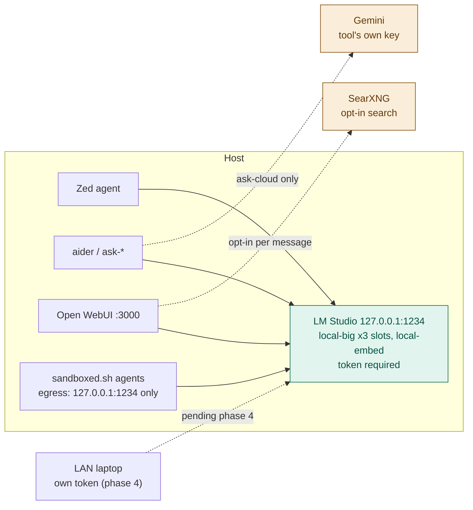

# Hearth

Local-first LLM serving for a single developer (or a small LAN).
Inference that still works when vendors get expensive, overloaded, or unavailable.

LM Studio serves local models on `127.0.0.1:1234` with a token required. The
LM Studio app owns the server (D6, changed 2026-10-31 from headless `llmster`). Cloud (Gemini) is reached by each tool directly with its own
key, never through the local server — so nothing sent to `:1234` can leave the
machine. ADR 0016 replaced the earlier LiteLLM + Ollama gateway; what was tried
before is in [`docs/HISTORY.md`](docs/HISTORY.md).

## Why

Model names change every few months. Hardcoding a model tag into shell
aliases, IDE settings, and laptop configs means every upgrade is a scavenger
hunt. This stack addresses **roles** instead:

```
local-big   local-embed   cloud-cheap
```

Each local role is an LM Studio `--identifier`, so clients ask for
`local-big`, never a model. Concrete models live in exactly two files —
[`config/roles.tsv`](config/roles.tsv) and [`docs/MODELS.md`](docs/MODELS.md).



## Three guarantees

1. **Privacy is structural.** LM Studio holds only local models, so anything
   sent to `:1234` stays on the host by construction. Cloud needs a separate
   provider key in the calling tool; only `ask-cloud` has one. Sandboxed agents
   can reach `127.0.0.1:1234` and nothing else (`scripts/sandbox-probe.sh`).
2. **No silent route changes.** There is no router, so there is no fallback to
   leak through. If `local-big` is down, requests fail.
3. **Nothing is claimed without being measured.** Role and serving changes get
   an ADR and a bench (`bench/results/`, committed).

## Requirements

- macOS on Apple Silicon (the reference host is 64 GB)
- The LM Studio app (0.4.28 here) — it owns the server and is where auth and
  tokens are set; there is no CLI for either (lmstudio-ai/lms#489)
- The `lms` CLI at `~/.lmstudio/bin/lms` (installed by the app, or by the
  llmster installer with `--no-modify-path`)
- [Podman](https://podman.io) for Open WebUI / SearXNG

## Quick start

```bash
git clone <this-repo> hearth && cd hearth

# 1. Server and models (see docs/RUNBOOK.md for the settings to set in the app)
#    LM Studio app open, "Enable Local LLM Service (headless)" on
~/.lmstudio/bin/lms server start --bind 127.0.0.1 -p 1234
scripts/lms-load.sh                 # loads exactly what config/roles.tsv lists

# 2. Token — created in the LM Studio app, stored mode 600
#    ~/.config/hearth/env:  LMSTUDIO_HOST_TOKEN=...

# 3. Shell aliases
echo "source $PWD/scripts/aliases.zsh" >> ~/.zshrc
```

Ops detail: [`docs/RUNBOOK.md`](docs/RUNBOOK.md). Architecture:
[`docs/ARCHITECTURE.md`](docs/ARCHITECTURE.md). Migration status:
[`docs/MIGRATION-LMSTUDIO.md`](docs/MIGRATION-LMSTUDIO.md).

## Usage

```bash
ask                # local-big. ask-big / ask-local / ask-chat / ask-fast are the same
ask-arch           # aider architect mode, local-big on both sides
ask-cloud          # Gemini, with GOOGLE_API_KEY — the only alias that leaves the host

ai-load            # scripts/lms-load.sh — load roles.tsv, report drift
ai-loaded          # lms ps
ai-restart         # restart the server on 127.0.0.1:1234
ai-log             # lms log stream
```

Editors (aider + Zed): [`docs/IDES.md`](docs/IDES.md).

## LAN clients

**Pending phase 4.** The server is localhost-only today. The plan: serve on
the LAN with authentication on, one token per machine, never port-forward
`:1234`, and an SSH tunnel off-LAN. Until then `docs/LAPTOP.md` and `client/`
still describe the retired gateway.

## Security notes

- Web search via SearXNG is opt-in per message. The **search query leaves**
  even when the model stays local. See `docs/ROUTING.md`.
- Zed's `auslaw` MCP tools send queries to AustLII; they are enabled only in
  Zed's Research profile. See `docs/MCP.md`.
- Prompt-injection / agent containment: `docs/THREAT-MODEL.md`, ADR 0007.

## Layout

```
CLAUDE.md / AGENTS.md   rules for coding agents in this repo
config/roles.tsv        role → LM Studio model key, context, slots
docs/                   architecture, routing, models, runbook, history, ADRs
scripts/                lms-load, benches, sandbox, client setup, …
client/                 shims for other machines (rewritten in phase 4)
bench/tasks/            fixed prompts for comparing models
bench/results/          every bench run, committed
```

## License

MIT — see [LICENSE](LICENSE).
