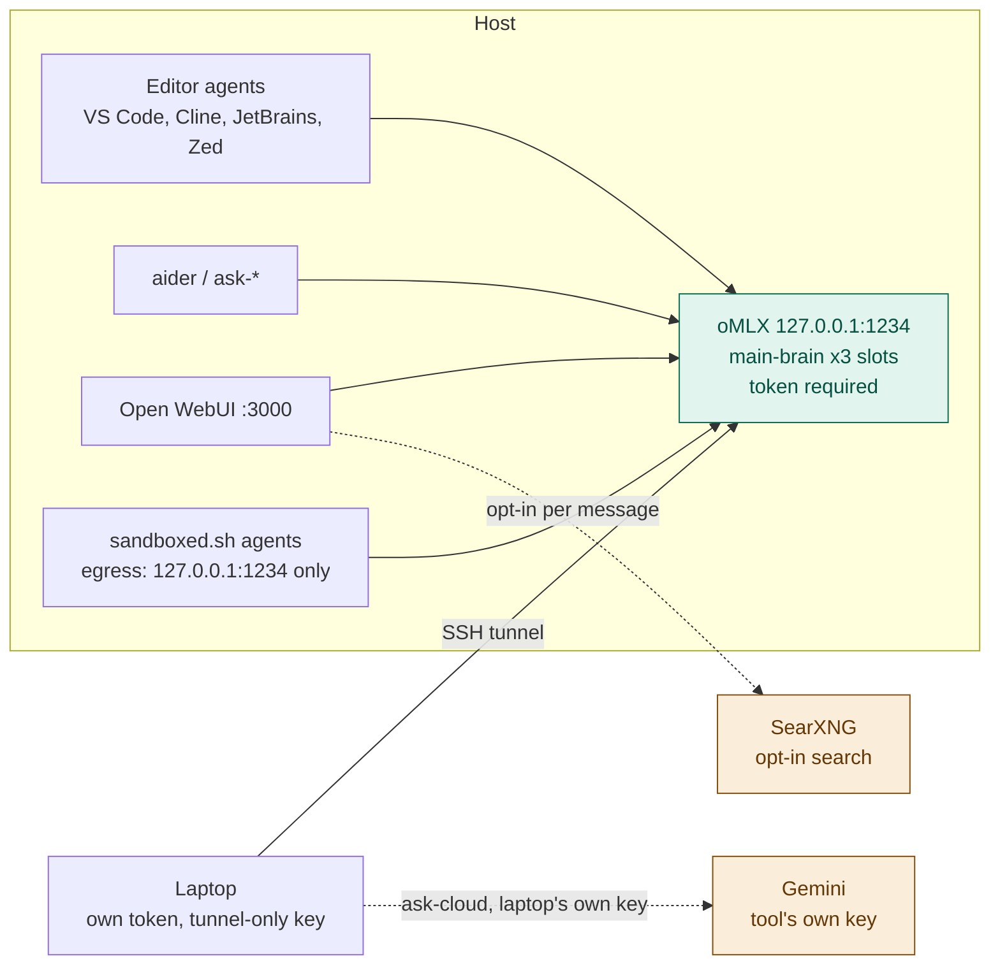

# Hearth

Local-first LLM serving for a single developer (or a small LAN).
Inference that still works when vendors get expensive, overloaded, or unavailable.

oMLX serves local models on `127.0.0.1:1234` from `~/.hearth/models`, with a
token required (ADR 0026). Cloud (Gemini) is reached by each tool directly
with its own key, never through the local server — so nothing sent to `:1234`
can leave the machine. What was tried before is in [`docs/HISTORY.md`](docs/HISTORY.md).

## Why

Model names change every few months. Hardcoding a model tag into shell
aliases, IDE settings, and laptop configs means every upgrade is a scavenger
hunt. This stack addresses **roles** instead:

```
main-brain   cloud-cheap (client-only)
```

`cloud-cheap` is reached only from a laptop's `ask-cloud`, with that
laptop's own key. The host holds no cloud key (ADR 0038).

Each local role is what clients ask for (`main-brain`), never a concrete
tag in aliases or IDE config. Concrete models live in exactly two files —
[`config/roles.tsv`](config/roles.tsv) and [`docs/MODELS.md`](docs/MODELS.md).
oMLX discovers the weights leaf (for omlx.ai benches and Zed’s
`display_name`); `/v1` still advertises the role via `model_alias`
(ADR 0034).



## Three guarantees

1. **Privacy is structural.** oMLX holds only local models, so anything
   sent to `:1234` stays on the host by construction. The host holds no
   cloud key at all; only a laptop's `ask-cloud` has one (ADR 0038). Sandboxed agents
   can reach `127.0.0.1:1234` and nothing else (`scripts/sandbox-probe.sh`).
2. **No silent route changes.** There is no router, so there is no fallback to
   leak through. If `main-brain` is down, requests fail.
3. **Nothing is claimed without being measured.** Role and serving changes get
   an ADR and a bench (`bench/results/`, committed).

## Requirements

- macOS on Apple Silicon (the reference host is 64 GB; see *Model size by RAM*)
- [oMLX](https://omlx.ai) — macOS app ([DMG releases](https://github.com/jundot/omlx/releases)) and/or a headless CLI; Hearth starts or attaches with `scripts/omlx.sh up`
- Role weights under `~/.hearth/models` (see [`docs/MODELS.md`](docs/MODELS.md))
- [Podman](https://podman.io) for Open WebUI / SearXNG

### Model size by RAM

The ceiling is RAM minus 8 GB (ADR 0031). Only benched tiers get a row in
`config/roles.tsv` (rule 5). `scripts/install-host.sh` stops on a machine
without one. Candidates for other sizes are a starting point for a bench,
not a recommendation to run untested. Which models these are, and the
sources: [`docs/MODELS.md`](docs/MODELS.md) → *Candidates by RAM* (rule 1
keeps model names there). Editor provider `hearth` is this machine's oMLX.
`hearth-remote` is optional: another host, and only on a machine that also
runs its own brain (ADR 0040).

| RAM (usable) | `main-brain` | `deep-brain` | State |
|---|---|---|---|
| 64 GB (56) | 35B-A3B MoE, 128K × 3 | dense 27B, swaps in | **benched**: reference host |
| 48 GB (40) | same rows; peak 34.0 GB at 128K × 3 | same, swaps in | **benched**. On a daily-use laptop that leaves about 14 GB for apps. A 1-slot laptop tier is open (ADR 0040) |
| 32 GB (24) | ~26B MoE, ~4B active, 4-bit (~15 GB). Laptop c3 peak 22 GB fits; 3 × 128K peaked 25.2 GB here, so one slot. A 35B-A3B at 4-bit (20.4 GB) is the one-slot alternative | dense 27B, swaps in. A dense 31B (~20.5 GB) is short-context only | candidate. `install-host.sh` prints the Qwen/Gemma line from `docs/MODELS.md` |
| 24 GB (16) | dense ~12B at 4-bit (about 12 GB with the runtime). A dense ~9B is the other fit. The 26B MoE and the 27B/35B working sets do not | none | candidate. Same: the script prints the line, then stops |

Below 24 GB there is no local `hearth`. The machine stays a client, and the tunnel is its only endpoint (*Laptops*).

## Install oMLX (either order)

Hearth and oMLX share `~/.omlx/settings.json`. `scripts/omlx.sh up` **merges**
host policy into that file (loopback, CORS off, `auto_start_on_launch: false`,
RAM envelope, host token) and does **not** wipe app UI / aliases / MCP prefs.
If oMLX is already listening on `:1234`, `up` configures that process in place
and does not take it over.

Project: [omlx.ai](https://omlx.ai) · source: [github.com/jundot/omlx](https://github.com/jundot/omlx) ·
DMG: [Releases](https://github.com/jundot/omlx/releases).

### A — oMLX app first, then Hearth

1. Install the [oMLX DMG](https://github.com/jundot/omlx/releases) → Applications.
   Open the app once so it creates `~/.omlx/` and `~/.omlx/bin/omlx`.
2. Copy this repo, put role weights in `~/.hearth/models/…`, store the oMLX
   API key as `OMLX_HOST_TOKEN` in `~/.config/hearth/env` (mode 600).
3. `scripts/omlx.sh up` — attaches if the app is already serving `:1234`,
   otherwise starts the CLI under Hearth’s launchd agent. Sets
   `auto_start_on_launch: false` so the app does not fight for the port later.
4. Keep the Mac app as a settings / status panel. Ops: [`docs/RUNBOOK.md`](docs/RUNBOOK.md).

### B — Hearth first, then the oMLX app

1. Install a headless CLI (Homebrew formula below, or a venv under
   `~/.omlx/venv`), clone this repo, weights + `OMLX_HOST_TOKEN` as above.
2. `scripts/omlx.sh up` — starts oMLX on `127.0.0.1:1234` via launchd.
3. Later, install the [DMG](https://github.com/jundot/omlx/releases) if you want
   the menu-bar UI. Next `up` prefers `~/.omlx/bin/omlx` (app CLI), merges
   settings, and leaves an already-running server alone aside from policy.

### C — Headless only (no Mac app)

Native kernels need full Xcode, then the Metal toolchain. Current Xcode does
not ship that component in the base install. Homebrew’s `python@3.11` bottle
also needs Command Line Tools at `/Library/Developer/CommandLineTools`.

```bash
xcode-select --install
sudo xcode-select --switch /Applications/Xcode.app/Contents/Developer
xcodebuild -runFirstLaunch
xcodebuild -downloadComponent MetalToolchain

brew tap jundot/omlx https://github.com/jundot/omlx
brew trust --formula jundot/omlx/omlx
brew install jundot/omlx/omlx --with-custom-kernel
```

Then use Hearth’s agent, not `omlx start` alone:

```bash
scripts/omlx.sh up
```

`brew trust` is required before the formula installs. Metal download is also
Xcode → Settings → Components → Metal Toolchain. After `xcode-select --install`,
switch back to Xcode.app so `metal` is visible. Confirm with
`xcrun -sdk macosx metal --version`.

## Quick start

Two installers. Each one is safe to re-run, reports what is left, and never
reads a key or token (ADR 0040).

| This machine is | Run |
|---|---|
| a **host** (its own brain on `127.0.0.1:1234`) | `scripts/install-host.sh --check`, then `scripts/install-host.sh` |
| a **client** of another host (tunnel on `127.0.0.1:1234`) | `client/install-client.sh --host you@studio.local` |
| **both** (its own brain, plus a bigger host through the tunnel) | `client/install-client.sh --dual`, then `scripts/install-host.sh` |

`install-host.sh` runs the steps below in order. It starts oMLX only once
nothing needs you:

```bash
git clone <this-repo> hearth && cd hearth

# 0. oMLX — DMG and/or headless (sequences A–C above)
# 1. Weights named in config/roles.tsv → ~/.hearth/models/…
# 2. Token — the oMLX API key, mode 600
#    ~/.config/hearth/env:  OMLX_HOST_TOKEN=...

scripts/omlx.sh up

# 3. Shell aliases
echo "source $PWD/scripts/aliases.zsh" >> ~/.zshrc
```

Ops detail: [`docs/RUNBOOK.md`](docs/RUNBOOK.md). Architecture:
[`docs/ARCHITECTURE.md`](docs/ARCHITECTURE.md).

## Usage

### On the host

```bash
# Brains (ADR 0039)
ask                # aider with openai/main-brain
main-brain         # same as ask
ask-arch           # aider architect mode (two main-brain sides)
ask-deep           # aider on deep-brain: slow, careful, loaded for the session only (ADR 0020)
deep-brain         # same as ask-deep
# No cloud alias on the host: ask-cloud is laptop-only (ADR 0038)

# Server management
ai-load            # scripts/omlx.sh up — start oMLX and load main-brain
ai-loaded          # scripts/omlx.sh status
ai-restart         # stop and start oMLX on 127.0.0.1:1234
ai-log             # tail ~/Library/Logs/hearth-omlx.log
ai-status          # scripts/status.sh
ai-health          # scripts/healthcheck.sh
ai-boot            # scripts/boot.sh
```

### On a laptop

Source `~/.hearth-client.sh` (set by `client/install-client.sh`). On macOS,
`ai-tunnel` once to accept the host fingerprint, then `ai-tunnel-install`:
launchd restarts the forwards when they drop and at login. Linux stays on
`ai-tunnel`. Everything below goes through the tunnel to the host's oMLX
on `:1234`.

```bash
# Tunnel management
ai-tunnel-install  # macOS: LaunchAgent keeps the tunnel up
ai-tunnel          # open it now (kickstarts the agent if installed)
ai-tunnel-stop     # unload the agent and close the tunnel
ai-ping            # check tunnel + server health (up / DOWN / BAD TOKEN)
ai-models          # list models available through the tunnel

# Asking
ai-ask "question"  # one-shot question without aider
ask                # aider with main-brain (also: main-brain)
ask-arch           # aider architect mode, main-brain on both sides
ask-deep           # aider on deep-brain — only while the host has it loaded
deep-brain         # same as ask-deep
ask-cloud          # Gemini via THIS machine's own key — the only cloud alias

# Open WebUI through the tunnel
ai-webui           # open host's Open WebUI (http://127.0.0.1:3000)
```

aider and `ask-*` are in [`docs/IDES.md`](docs/IDES.md).

## Editors

Every editor calls the role `main-brain` at `http://127.0.0.1:1234/v1`:
directly on the host, through `ai-tunnel` on a laptop. It authenticates
with a key: your laptop key, or a per-editor sub-key you can revoke on its
own (`scripts/omlx.sh sub-key add <editor>-<machine>` on the host; names
are letters, digits, `-` and `_`). **No editor gets a cloud provider on the
host** (rule 3). On a dual machine (ADR 0040), add a second provider,
`hearth-remote`, at `http://127.0.0.1:1235/v1` for the bigger host. Full detail and what is not yet verified:
[`docs/IDES.md`](docs/IDES.md).

**Loops.** `scripts/loop-guard.sh` runs before every tool call in VS Code
and Cline. It refuses the third identical call in a row, and stops the run
after 80 calls in one session. Run `scripts/install-loop-guard.sh` once
per machine to cover every repo; this one is wired already
(`.github/hooks/`, `.clinerules/hooks/`). Refusals are logged to
`~/Library/Logs/hearth-loop-guard.log`. Zed has no hooks; see below.

**Check any client in a few steps** (hearth folder open):

1. Point the base URL at `http://127.0.0.1:1299/v1` and send a prompt. It
   must fail. Then set it back.
2. "Create `scratch-smoke.sh` containing `if [[ $x < 1 ]]; then echo hi; fi`,
   read it back, then delete it." Keeps the `<`.
3. "Read `AGENTS.md` three times in a row with the read tool. Don't change
   anything." The third call is refused, and a line appears in the log.

### VS Code (1.122+, trial, ADR 0036)

Two files in `~/Library/Application Support/Code/User/`. Check both with
`scripts/vscode-check.sh` (exit 0 = clean). `--show` prints the settings.

`settings.json` (JSONC, so comments are allowed). These keep code off
GitHub's servers and cap agent requests:

```jsonc
"github.copilot.enable": { "*": false },               // inline completions go to GitHub
"github.copilot.nextEditSuggestions.enabled": false,  // so do next edit suggestions
"github.copilot.chat.codesearch.enabled": false,      // GitHub embeddings
"telemetry.telemetryLevel": "off",
"chat.agent.maxRequests": 40,                          // pauses and asks to continue
"chat.tools.global.autoApprove": false,
"chat.mcp.discovery.enabled": {                        // object form in 1.144
    "claude-desktop": false, "windsurf": false,
    "cursor-global": false, "cursor-workspace": false
},
"chat.useHooks": true,                                 // runs the loop guard
"chat.useAgentsMdFile": true,
"chat.planAgent.defaultModel": "main-brain (customendpoint)"
```

`chatLanguageModels.json` holds the model. Give it no provider-level
`url`: that would list every role oMLX reports, `deep-brain` included.

```jsonc
[
  {
    "name": "hearth",
    "vendor": "customendpoint",
    "apiKey": "${input:…}",          // written by VS Code, see below
    "apiType": "chat-completions",
    "models": [
      {
        "id": "main-brain",
        "name": "main-brain",
        "url": "http://127.0.0.1:1234/v1",
        "toolCalling": true,
        "vision": false,
        "thinking": true,
        "streaming": true,
        "maxInputTokens": 114688,
        "maxOutputTokens": 16384
      }
    ]
  }
]
```

Leave `apiKey` out when writing the file. Then set the key in **Chat:
Manage Language Models** → `hearth`. VS Code keeps it in its secret store
and writes the `${input:…}` reference itself. A placeholder typed by hand
has no secret behind it, so requests fail with "API key required" (1.144).
Never paste the key itself into the file. `vscode-check.sh` fails if a
literal key sits in a file other users can read. Then, in Chat, pick
`main-brain` and the **Local** session target.

### Cline (Desktop, VS Code, JetBrains, CLI — trial, ADR 0036)

1. **Provider → BYOK → Add Provider** (OpenAI Compatible). ID `hearth`.
   Base URL `http://127.0.0.1:1234/v1`. **Leave Model Source URL empty**,
   and type `main-brain` as the model. Your key. Capabilities: streaming,
   tools, reasoning. Prompt cache off, because oMLX's KV cache needs no
   client flag. Context window 131072.
2. **Never pick Cline Usage-Billing or ClinePass**: prompts sent through
   them go to Cline's servers.
3. **General:** clear usage and error reporting.
4. **Connectors off.** A signed-in account can receive Cline's Composio
   beta, which lets the agent connect to Slack and other services through
   Composio's cloud. Never authorise a connection. Sign out if there is no
   switch: Hearth needs only the key.
5. **Enable Hooks**, then run `scripts/install-loop-guard.sh` once. This
   was verified 2026-11-08 in Cline Desktop and PyCharm.

Cline reads `AGENTS.md` and `.clinerules/`.

### JetBrains IDEs (AI Assistant)

1. Settings → Tools → AI Assistant → Providers & API keys → **OpenAI
   Compatible**. Base URL `http://127.0.0.1:1234/v1`, your key (kept in
   the IDE's password store). **Test Connection**.
2. **Assign `main-brain` by hand** to chat and every feature you use. A
   feature with no local model assigned can fall back to JetBrains' cloud
   if a subscription is signed in.
3. **Offline mode on** for sensitive repos. No JetBrains AI cloud model on
   the host.

AI Assistant has no hooks. For agent work in a JetBrains IDE with the loop
guard, use the Cline plugin (above).

### Zed

`~/.config/zed/settings.json`, provider `hearth` (OpenAI-compatible) →
`main-brain`, in every model slot. `scripts/zed-sync.sh` writes the labels
and context from `roles.tsv`. Tool calls ask first
(`agent.tool_permissions.default: "confirm"`). Threads compact at 110,000
tokens, under the 128K window; a longer prompt is refused, and `/compact`
compacts by hand.

**Zed loops, and Hearth cannot stop it there.** Zed has no tool hooks and
no per-turn request cap, so the loop guard does not cover it. Two shapes
show up with local models: the same tool call repeated, and the same
reasoning passage repeated. The ADR 0024 loop, where the old server
silently trimmed long prompts, is gone, because oMLX refuses instead. What
helps today:

- Keep `confirm`: a loop cannot run unattended, it just becomes tedious to
  click through. Setting read tools to `allow` lets a read loop run unasked.
- An incomplete directory name makes the agent retry `cd`. Set `ask_user`
  to `true` in the `write` and `write-web` profiles, and set
  `agent.tool_permissions.tools.terminal.default` to `confirm`. In
  `~/.config/zed/AGENTS.md`, tell the agent: if a path does not resolve,
  call `find_path` or `list_directory` once, then ask. Do not repeat a
  command that just failed.
- Run Cline as an ACP agent inside Zed for the guard. Hooks under ACP are
  not yet tested.
- Upstream: [zed-industries/zed#66686](https://github.com/zed-industries/zed/pull/66686)
  stops a turn on the third repeated tool call or reasoning passage. A
  per-turn request cap is proposed in
  [discussion #66689](https://github.com/zed-industries/zed/discussions/66689).

Zed MCP tools are `context_servers`, started as a stdio child where Zed
runs. A networked server goes only in an agent profile named for where
its traffic goes, never in Write. See [`docs/MCP.md`](docs/MCP.md).

## Laptops

SSH tunnel only — the server never listens on the LAN. Each laptop gets its
own host token and an SSH key that can forward to `:1234` / `:3000` / `:8888` and
nothing else. The token name is `laptop-` plus a short name, for example
`laptop-m5-air`:

```bash
scripts/omlx.sh sub-key add laptop-m5-air    # new: host user types the token
scripts/client-setup.sh m5-air               # prints both paths
```

`m5-air` and `laptop-m5-air` are the same machine. When `laptop-m5-air` is
already in `scripts/omlx.sh sub-key list`, skip add. The laptop uses the
token already in `~/.hearth-key`. The list prints names only, so a lost token
is replaced with revoke, then add. Details in [`docs/LAPTOP.md`](docs/LAPTOP.md).
Never port-forward `:22`, `:1234`, `:3000` or `:8888`.

A laptop may also run its own oMLX for `edit-brain` (edit prediction with
the tunnel down, ADR 0033; `client/edit-model.sh laptop-up`). Lock it the
same way as the host's: bound to `127.0.0.1`, an API key required, and
**CORS off**. oMLX's own default allows every origin (`"cors_origins":
["*"]`), which lets any web page you visit try requests against it. In
`~/.omlx/settings.json` set `"server": {"cors_origins": []}`, then:

```bash
brew services restart omlx
```

Check that a cross-site preflight gets no `access-control-allow-origin`
header back:

```bash
curl -s -o /dev/null -D - -X OPTIONS http://127.0.0.1:8000/v1/models -H 'Origin: https://example.com' -H 'Access-Control-Request-Method: GET' | grep -i access-control-allow-origin
```

No output means CORS is off. The host's `scripts/omlx.sh up` writes
`cors_origins: []` itself, and preflight fails if it is on.

## One machine, both roles

A laptop with the RAM for a benched tier can run its own brain and still
reach a bigger host (ADR 0040). Its own oMLX is always `127.0.0.1:1234`, the
port the sandbox, scripts and editors use. The tunnel moves aside:

| | This machine | The bigger host, through the tunnel |
|---|---|---|
| oMLX | `127.0.0.1:1234` | `127.0.0.1:1235` |
| Open WebUI, SearXNG | `:3000`, `:8888` | `:3001`, `:8889` |
| Shell | `ask`, `main-brain`, `ask-deep`, `deep-brain` | `ask-remote`, `main-brain-remote`, `ask-deep-remote`, `deep-brain-remote` |
| Editor provider | `hearth` | `hearth-remote` |

Both are your own hardware, so both are brains (rule 3). To convert a laptop:

1. `client/install-client.sh --dual`
2. in a new shell, `ai-tunnel-stop && ai-tunnel-install`, which moves the
   tunnel to 1235
3. `brew services stop omlx`, if a brew-run oMLX serves `edit-brain` on 8000
4. `scripts/install-host.sh`. Under 48 GB it prints the matching candidate from `docs/MODELS.md` and stops. That line is not installed; a row waits on a bench on this machine (rule 5)
5. `client/edit-model.sh laptop-up`, to serve `edit-brain` from the new oMLX

## Using an AI assistant with this repo

Claude Code reads `CLAUDE.md`; Cursor reads `AGENTS.md` (a symlink to it) and
`CLAUDE.md`. Both pick the rules up from the repo root with no setup. The top
of `CLAUDE.md` tells the assistant which machine it is on, because the host and
a laptop get very different instructions.

Three setup skills live in `.claude/skills/`. Claude Code, VS Code (Agent
Skills) and Cline all load them from there. Ask in plain words, for example
"set up this laptop for hearth", and the matching one loads:

| Skill | For |
|---|---|
| `hearth-host-setup` | first-time host setup or repair: oMLX, weights, token, autostart, preflight, registering a laptop or editor key |
| `hearth-laptop-setup` | a laptop's tunnel, client script and token, then proving `ai-ping` and that the key is tunnel-only |
| `hearth-editor-setup` | VS Code, Cline, JetBrains or Zed on `main-brain`, plus the three checks (no fallback, tool loop, loop guard) |

Each one first checks which machine it is on, and stops on the wrong one.
None of them reads a key or token file. The docs stay the source of truth;
the skills only give the order, the stops and the checks.

### Setting up a laptop

On the laptop, clone the repo (it needs read access to the GitHub remote),
open it in Claude Code or Cursor, and paste:

> I'm on a laptop, setting it up to use the hearth host. Read the "Which
> machine are you on?" block in CLAUDE.md, then follow docs/LAPTOP.md →
> AI-assisted setup step by step. Never read, print or copy my key or token
> files, and never ask me to paste a secret into this chat — tell me the
> command and I'll run it myself. Stop whenever a step has to happen on the
> host.

The assistant does the plumbing (SSH key, `~/.ssh/config`, client script,
shell rc) and the checks; you type the secrets and do the two host-side steps.
Cursor can help with setup but **cannot use hearth as a model provider** — its
servers make the model calls, so they would need the host exposed publicly.
Use VS Code, Cline, a JetBrains IDE, Zed or aider for `main-brain` on the
laptop (*Editors* above).

### Changing this repo

Run it on the host, and start with:

> Read CLAUDE.md, and docs/ROUTING.md if this touches routing. Plan first and
> wait for my approval before changing anything. Before saying it's done, run
> scripts/preflight.sh (and scripts/healthcheck.sh if you touched the server)
> and show me the result: exit 0 pass, 1 real problem, 2 could not run.

The rules it must keep are in `CLAUDE.md`. The ones most often broken: model
names only in `config/roles.tsv` and `docs/MODELS.md`; nothing against the
removed gateway (`:4000`, `:11434`, LiteLLM); never read
`~/.config/hearth/env`; bash 3.2; Mermaid only.

## Security notes

- Web search via SearXNG is opt-in per message. The **search query leaves**
  even when the model stays local. See `docs/ROUTING.md`.
- `docs/MCP.md` includes a worked example of confining networked tools to a
  named Zed profile; the example server is not installed.
- Prompt-injection / agent containment: `docs/THREAT-MODEL.md`, ADR 0007.
- Every oMLX, host or laptop, binds `127.0.0.1`, requires a key, and has
  CORS off (see *Laptops*).

## Layout

```
CLAUDE.md / AGENTS.md   rules for coding agents in this repo
config/roles.tsv        role → model key, context, slots
docs/                   architecture, routing, models, runbook, history, ADRs
scripts/                omlx, benches, sandbox, client setup, …
client/                 laptop shims (bash/zsh + PowerShell), SSH-tunnel based
bench/tasks/            fixed prompts for comparing models
bench/results/          every bench run, committed
```

## License

MIT — see [LICENSE](LICENSE).
