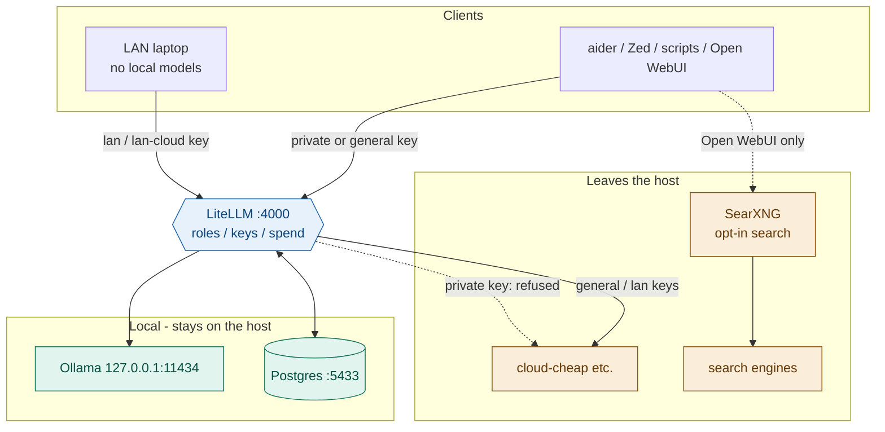

# Hearth

Local-first LLM gateway for a single developer (or a small LAN).
Inference that still works when vendors get expensive, overloaded, or unavailable.

Ollama serves local models. LiteLLM is the only front door. Cloud providers
(Gemini, optionally Claude / OpenRouter / Moonshot / Fireworks) sit behind the
same OpenAI-compatible API. Privacy is enforced by **virtual key scope**, not
by remembering to be careful.

## Why

Model names change every few months. Hardcoding `qwen2.5-coder:32b` into shell
aliases, IDE settings, and laptop configs means every upgrade is a scavenger
hunt. This stack addresses **roles** instead:

```
local-chat   local-code   local-big   local-embed   cloud-cheap
```

Concrete models live in exactly two files — [`litellm/config.yaml`](litellm/config.yaml)
and [`docs/MODELS.md`](docs/MODELS.md). Swap a model once; every client keeps working.



## Three guarantees

1. **Privacy is structural.** The `private` key can only reach `local-*` roles.
   Ollama binds to localhost, so the LAN cannot bypass the gateway.
   `scripts/healthcheck.sh` proves both halves (positive control + refusal).
2. **Local roles never fall back to cloud.** A timeout that silently ships a
   prompt to Google is a leak. `scripts/audit-fallbacks.sh` fails the build if
   that reappears.
3. **Nothing is claimed without being measured.** Role changes get an ADR and a
   bench. Digests are recorded so silent `ollama pull` drift is detectable.

## Requirements

- macOS (Apple Silicon recommended) or Linux host
- [Ollama](https://ollama.com)
- [LiteLLM](https://docs.litellm.ai) (pipx works well)
- [Podman](https://podman.io) for Postgres / Open WebUI / SearXNG
- Enough RAM for your resident model set (see `docs/MODELS.md`)

## Quick start

**Laptop only?** Skip the host bootstrap — see [`docs/LAPTOP.md`](docs/LAPTOP.md).

```bash
git clone <this-repo> hearth && cd hearth

# 1. Secrets
cp litellm/.env.example litellm/.env
cp litellm/service-env.example ~/.config/litellm/env   # if you don't have one
# Edit both: LITELLM_MASTER_KEY, DATABASE_URL / POSTGRES_PASSWORD, GOOGLE_API_KEY, …

# 2. Database + gateway
brew install podman   # once
podman machine init --cpus 2 --memory 2048 --disk-size 20 && podman machine start
scripts/db.sh up
scripts/deploy.sh           # symlink config, restart, verify
scripts/create-keys.sh      # paste private/general/lan/lan-cloud into litellm/.env
scripts/healthcheck.sh

# 3. Shell aliases on the host
echo "source $PWD/scripts/aliases.zsh" >> ~/.zshrc
```

Point LiteLLM's launchd agent at this repo's config (or use whatever process
supervisor you prefer). Default label is `com.hearth.litellm`; scripts also
discover an already-installed personal label. Override with
`HEARTH_LITELLM_LABEL` if needed.

Full ops detail: [`docs/RUNBOOK.md`](docs/RUNBOOK.md). Architecture:
[`docs/ARCHITECTURE.md`](docs/ARCHITECTURE.md).

## Usage

```bash
source scripts/aliases.zsh

ask                # local-code, private key — default
ask-chat           # local-chat, general questions
ask-big            # local-big, reasoning
ask-cloud          # cloud-cheap, explicit reach
ask-arch           # architect mode: local-big plans, local-code edits

ai-health          # every role + leak test
ai-audit           # fallback leak check
ai-restart         # kick the launchd agent
```

Editors (aider + Zed): [`docs/IDES.md`](docs/IDES.md).

## LAN clients

Laptops need **no Ollama and no model downloads**. Run this on the
**gateway host** (it refuses on a laptop clone):

```bash
scripts/provision-client.sh lan              # prints copy-paste instructions
scripts/provision-client.sh lan --install user@laptop
scripts/provision-client.sh lan --windows    # PowerShell path
scripts/provision-client.sh lan --example    # placeholders (safe on a laptop clone)
```

Clients must set `HEARTH_GATEWAY` (there is no hardcoded host IP). Details:
[`docs/LAPTOP.md`](docs/LAPTOP.md).

Preferred on a laptop: permanent SSH tunnel to localhost, then
`HEARTH_GATEWAY=http://127.0.0.1:4000`:

```bash
scripts/install-client-tunnel.sh --apply
```

One-shot without launchd:

```bash
ssh -N -L 4000:127.0.0.1:4000 USER@HOST
export HEARTH_GATEWAY=http://127.0.0.1:4000
```

Never port-forward `:4000` to the internet.

## Keys

| Key | Reaches | Use for |
|---|---|---|
| `private` | `local-*` only | sensitive work, Open WebUI default |
| `general` | everything live | this machine, non-sensitive repos |
| `lan` | `local-*` + `cloud-cheap` | everyday laptop access |
| `lan-cloud` | everything live | laptop when it needs frontier / Claude |

Dollar caps are **fuses**, not billing — they stop a leaked key or runaway agent
loop from draining your provider account.

## Security notes

- Web search via SearXNG is opt-in per message. The **search query leaves** even
  when the model stays local. See `docs/ROUTING.md`.
- Prompt-injection / agent containment: `docs/THREAT-MODEL.md`, ADR 0007.
- Untrusted MCP servers need their own audit before an agent can call them.

## Layout

```
CLAUDE.md / AGENTS.md   rules for coding agents in this repo
docs/                   architecture, routing, models, runbook, ADRs
litellm/config.yaml     the only file that names concrete models
scripts/                deploy, healthcheck, bench, client setup, …
client/                 shims for other machines (bash + PowerShell)
bench/tasks/            fixed prompts for comparing models
pins/digests.tsv        recorded Ollama digests for drift detection
```

## License

MIT — see [LICENSE](LICENSE).
