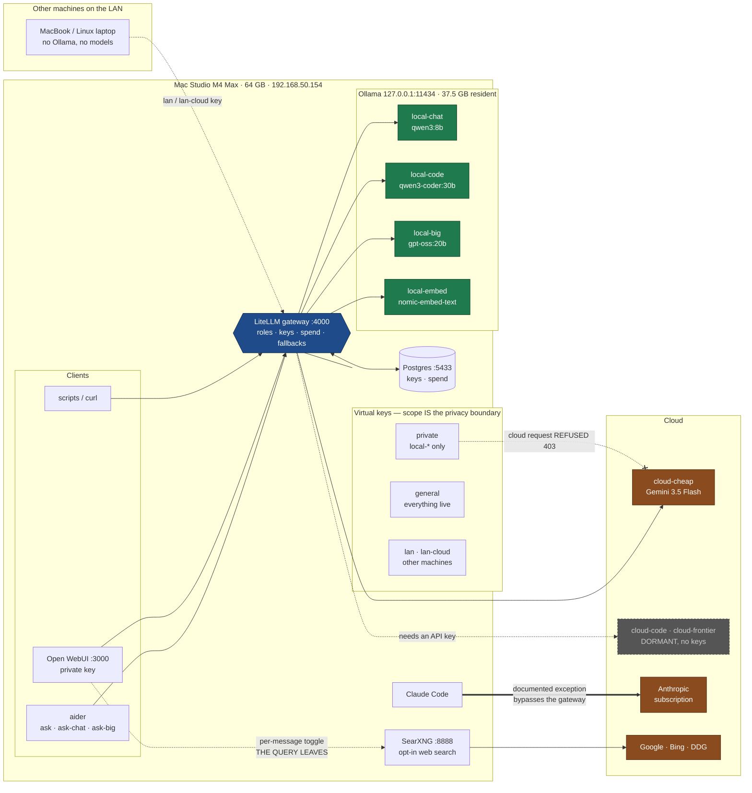
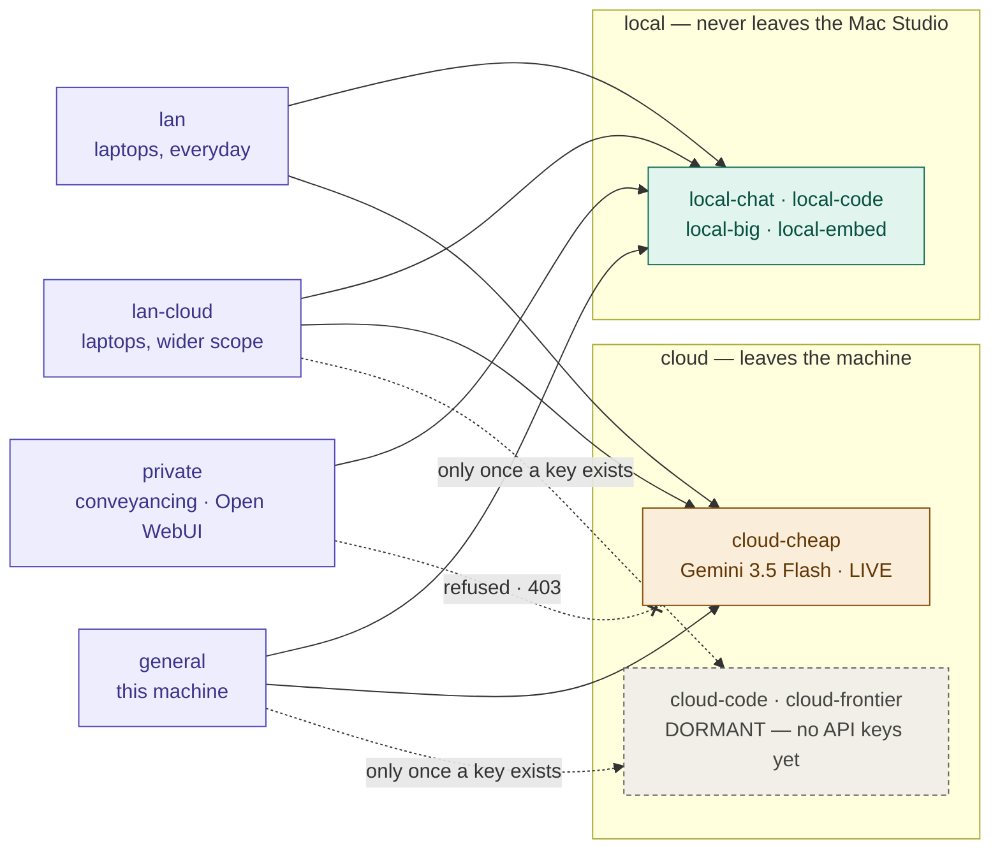

# ai-stack

Private-first LLM gateway for a single developer. Ollama and LiteLLM locally,
Gemini/Claude/OpenRouter as cloud tiers, with the privacy boundary enforced by
key scope rather than by remembering to be careful.

Host: Mac Studio M4 Max, 64 GB, macOS 26.

## The idea

Clients address **roles**, never model names:

```
local-chat   local-code   local-big   local-embed   cloud-cheap
```

Concrete models live in exactly two files — `litellm/config.yaml` and
`docs/MODELS.md`. Swapping the model behind a role is one config change; no
alias, script, or IDE setting moves. That is the answer to a field where the
best local coding model changes every few months.



Reading it: **everything funnels through the gateway** except Claude Code, which
is a recorded exception. The `private` key physically cannot reach a cloud role.
Ollama listens on localhost only, so the LAN cannot route around any of it. The
one line that leaves without touching a model is SearXNG — web search is opt-in
per message, and the query leaves even though the conversation does not.

## Three guarantees

**Privacy is structural.** The `private` virtual key's model list contains no
cloud roles, so a cloud request with it is refused by the gateway. Ollama binds
to localhost, so nothing on the LAN can route around it. `healthcheck.sh` proves
both halves — the key must *succeed* on a local role and be *refused* on a live
cloud one, because a merely broken key refuses everything and looks identical.

**Local roles never fall back to cloud.** The inherited config had
`local-ollama → gemini`, so any Ollama timeout silently shipped the prompt to
Google. Across a privacy boundary a fallback is a leak, not resilience.
`audit-fallbacks.sh` fails the build if it reappears.

**Nothing is claimed without being measured.** Retiring `llama3.3:70b` came from
a timed probe — 440 s to first reply, because 42 GB could not stay resident
alongside the coding model. The replacement answers in 5 s. That was a capacity
measurement, not an opinion about quality. See `docs/decisions/0004`.

## Usage

```bash
source scripts/aliases.zsh

ask                # local-code, private — the default
ask-chat           # local-chat, general questions
ask-fast           # alias for local-chat, the fastest local model
ask-big            # local-big, reasoning
ask-cloud          # cloud-cheap, explicit reach

ai-health          # every role + the leak test
ai-audit           # fallback leak check
ai-restart
```

## Operations

| Script | Purpose |
|---|---|
| `preflight.sh` | Read-only. Exit 2 = check couldn't run, 1 = real problem |
| `deploy.sh` | Cut over, verify, auto-rollback. Never touches launchd |
| `healthcheck.sh` | Every live role + the two-part leak test |
| `audit-fallbacks.sh` | Fails if a local role can reach cloud |
| `swap-role.sh` | Repoint a role: pull, edit, verify, then delete old weights |
| `bench.sh` | Compare candidates on real tasks before promoting |
| `db.sh` | Postgres under Podman: `up`, `migrate`, `psql`, `destroy` |
| `lock-ollama.sh` | Bind Ollama to localhost, verify LAN is closed |
| `diagnose.sh` | What the gateway actually loaded, when it disagrees with you |
| `bisect-config.sh` | Find which config section breaks model loading |
| `webui.sh` | Open WebUI chat surface, private-scoped by default |
| `usage.sh` | Which role, which model, local or cloud, tokens and cost |

Start with `docs/ARCHITECTURE.md`, then `docs/ROUTING.md` and `docs/RUNBOOK.md`.
`docs/decisions/` records why things are the way they are, including the
rejected alternatives.

## What each key can actually reach



### Today — only `private` is actually different

| Key | local roles (4) | `cloud-cheap` | `cloud-code`, `cloud-frontier` |
|---|---|---|---|
| `private` | yes | **blocked** | **blocked** |
| `lan` | yes | yes | blocked |
| `lan-cloud` | yes | yes | nothing to reach |
| `general` | yes | yes | nothing to reach |

### After you add an OpenRouter or Anthropic key

| Key | local roles (4) | `cloud-cheap` | `cloud-code`, `cloud-frontier` |
|---|---|---|---|
| `private` | yes | **blocked** | **blocked** |
| `lan` | yes | yes | blocked |
| `lan-cloud` | yes | yes | **yes — now it differs** |
| `general` | yes | yes | **yes** |

**`private` is the only key that is genuinely different today.** It reaches the
four local roles and is refused — HTTP 403 — on anything cloud. That refusal is
the privacy boundary, and `healthcheck.sh` proves it on every run, with a
positive control so a merely broken key can't pass as a well-scoped one.

`lan`, `lan-cloud` and `general` currently grant **identical** access, because
`cloud-cheap` is the only live cloud role — there is nothing extra for a wider
key to reach. `lan-cloud` is not broken; it is pointed at a shelf that is still
empty. It diverges the day you add a provider key and add the role to
`CLOUD_ALL` in `scripts/create-keys.sh`.

Until then use `lan` for laptops. `scripts/usage.sh --keys` shows the live scope
of every key, and `private` must always read `LOCAL ONLY`.

## Other machines (macOS and Linux)

Laptops need **no Ollama, no models, no Podman** — they point at the gateway and
the Studio does the work. Nothing is downloaded; nothing is duplicated.

On the Studio, generate the instructions with the key filled in:

```bash
scripts/client-setup.sh lan     # local roles + cloud-cheap
scripts/client-setup.sh lan-cloud    # laptop key, reaches all live cloud roles
```

Or push it straight to a machine you can ssh to:

```bash
scripts/client-setup.sh lan-cloud --install colin@macbook
```

Manually, it is three steps on the client:

```bash
# 1. the shim (plain shell, works in bash and zsh, macOS and Linux)
scp colin@192.168.50.154:~/dev/ai-stack/client/ai-stack-client.sh ~/.ai-stack-client.sh

# 2. the key, readable only by you
printf '%s' 'sk-...' > ~/.ai-stack-key && chmod 600 ~/.ai-stack-key

# 3. wire it in  (~/.zshrc on macOS, ~/.bashrc on Linux)
echo 'export AI_STACK_GATEWAY=http://192.168.50.154:4000' >> ~/.zshrc
echo 'source ~/.ai-stack-client.sh'                       >> ~/.zshrc
```

Then in a new shell:

```bash
ai-ping                  # is the gateway reachable
ai-models                # which roles this key may use
ai-ask "say hello"       # one-shot, no aider needed
ask "explain this repo"  # aider on local-code, running on the Studio
```

Clients use the same **role** names, so swapping the model behind `local-code`
never requires touching a laptop.

Two things to be clear-eyed about:

- **If the Studio is asleep, the laptops have nothing.** That is the trade for
  not copying 37 GB of weights onto every device.
- **LAN traffic is plain HTTP.** Fine at home, wrong on cafe or hotel wifi. Off
  your own network, tunnel instead:

  ```bash
  ssh -N -L 4000:127.0.0.1:4000 colin@192.168.50.154
  export AI_STACK_GATEWAY=http://127.0.0.1:4000
  ```

  Never port-forward `:4000` to the internet. Key auth is not hardening, and a
  public LiteLLM holding your provider keys becomes somebody else's budget.

Lost a laptop? `scripts/create-keys.sh --force` on the Studio rotates everything,
then re-run `client-setup.sh` for the machines you still have.

## Secrets

Two environment files, deliberately:

- `~/.config/litellm/env` — the only one launchd reads. Provider keys,
  master key, `DATABASE_URL`. Template: `litellm/service-env.example`
- `litellm/.env` — scripts only. `POSTGRES_PASSWORD`, virtual keys. Gitignored

launchd reads neither the repo `.env` nor `~/.zshrc`. `preflight.sh` checks the
service environment specifically, because a variable set in your shell will look
fine and then fail at runtime.

## Status

Gateway live, four scoped keys, leak test passing, Ollama localhost-only.
Outstanding: digest pinning, a chat UI, and an approval-gated model auto-updater.
See `docs/PLAN.md`.
