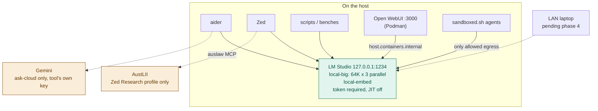

# Architecture

Reference host: Apple Silicon Mac, 64 GB unified memory, macOS. One local
inference server, the LM Studio app (0.4.28), on `127.0.0.1:1234`. D6 changed
from headless `llmster` to the app on 2026-10-31: the two cannot share
`~/.lmstudio`, and the app keeps settings and tokens in one place. ADR
0016; the gateway era (LiteLLM + Ollama + Postgres) is in `docs/HISTORY.md`.

## Shape

Everything addresses **roles**, never model names. Concrete models appear in
exactly two files: `config/roles.tsv` and `docs/MODELS.md`.

## Roles

| Role | Backend | What |
|---|---|---|
| `local-big` | LM Studio | the only local chat/agent model. 64K context, 3 concurrent predictions |
| `local-embed` | LM Studio | embeddings, resident beside `local-big` |
| `cloud-cheap` | Gemini | reached directly by `ask-cloud`; never loaded into LM Studio |

`local-code` and `local-chat` were collapsed into `local-big` (D1): two heavy
models cannot both stay resident with 3 × 64K slots, and evicting the agent
model was failure F2. The old alias names still work and mean `local-big`.

`scripts/lms-load.sh` makes the loaded set match `config/roles.tsv`: it
unloads anything unlisted, loads each `lmstudio` row with
`--identifier <role> -c <ctx> --gpu max --parallel <slots>`, then re-reads
`lms ps` to confirm. No `--ttl`, so a role never auto-unloads.

## The privacy boundary

There is no router and no key scope. The boundary is where models live:

- **LM Studio holds only local models.** Anything sent to `:1234` stays on
  the host by construction. Rule: no script adds a cloud backend to
  `config/roles.tsv` except as an explicit cloud row (`gemini`).
- **Cloud needs a provider key in the calling tool.** Only `ask-cloud` passes
  one, per invocation. Host Zed has no cloud provider (D3).
- **Sandboxed agents can reach `127.0.0.1:1234` only**, so they cannot reach
  cloud at all.

What this does **not** do, stated plainly: tokens are not scoped to models
(any valid token reaches every loaded model — fine while all are local), and
there is no spend cap or per-request log. A Gemini quota in the Google Cloud
console is the cap.

## Server settings

Set once in the LM Studio app (llmster has no CLI for auth or tokens) and
honoured by llmster — verified 2026-10-31: no token → 401, wrong token → 401,
host token → 200.

| Setting | Value |
|---|---|
| Port | 1234 |
| Require Authentication | on |
| Serve on Local Network | off (phase 4 turns it on) |
| CORS | off |
| Just-in-Time model loading | off |
| Allow per-request MCPs / calling servers from mcp.json | off |
| Log sensitive data | off |

Stored in `~/.lmstudio/.internal/http-server-config.json` (auth and tokens
are not in that file).

## Process supervision

The LM Studio app owns the daemon, with "Enable Local LLM Service
(headless)" on. `lms` drives whichever daemon is running, so the server is
still started with `lms server start --bind 127.0.0.1 -p 1234` and roles are
loaded with `scripts/lms-load.sh`. The app's GUI costs ~1.1 GB of footprint
over headless llmster. **Do not also run llmster**: whichever starts first owns
`~/.lmstudio`. Start-at-login is a phase 5 item (`install-autostart.sh`).
Until then, after a reboot: open the app, `lms server start …`,
`scripts/lms-load.sh`.

### Environment files

| File | Read by | Contains |
|---|---|---|
| `~/.config/hearth/env` (mode 600) | aliases (`_hearth_var`), scripts | `LMSTUDIO_HOST_TOKEN`; `GOOGLE_API_KEY` moves here in phase 5 |
| `~/.config/litellm/env` | aliases fall back to it for `GOOGLE_API_KEY` | retired gateway env, until phase 5 |

The aliases read single values from these files and inject them per command;
they never `source` them into the interactive shell.

## Verification

| Check | Answers |
|---|---|
| `scripts/lms-load.sh --check` | Is exactly the roles.tsv set loaded, with the right context and slots? |
| `scripts/tool-smoke.sh openai http://127.0.0.1:1234/v1 local-big` | Does a Zed-like read → write tool loop work? |
| `scripts/concurrency-bench.sh` | TTFT, tool-call validity and footprint under N concurrent agent turns |
| `scripts/sandbox-probe.sh` | Sandboxed agents reach `:1234` and nothing else (incl. the old `:4000`) |
| `curl` without a token | Must be 401 |

`healthcheck.sh`, `preflight.sh` and `status.sh` still check the retired
gateway; they are rewritten in phase 5 (server up, each role answers,
no-token 401, LAN only with token, nothing else on 1234, JIT off).

## Measured (2026-10-31)

| | Ollama via LiteLLM | llmster |
|---|---|---|
| c1 TTFT p95, 28K prompt | 21.0 s | 19.9 s |
| c3 TTFT p95 | 65.8 s | 59.9 s |
| c3 total p50 | 40.3 s | 61.0 s |
| Peak footprint | 37.0 GB (1 slot) | 29.7 GB (3 slots) |

Prefill is still serialised on llmster's MLX engine; `--parallel` batches
decode, so all three requests in a round finish together. The wins are
memory, no evictions and no gateway hop, not concurrency.
`bench/results/2026-10-31-phase0`, `…-phase1`.

## The second boundary: containment

The local/cloud split governs **where data goes on purpose**. It has no
jurisdiction over a compromised agent — an injected aider that `curl`s a
stolen key to an attacker never touches the model server.

`scripts/sandboxed.sh` closes that channel by denying egress to everything
except `127.0.0.1:1234`. Verified by `scripts/sandbox-probe.sh` (11/11 on
2026-10-31, including a deny check on the old `:4000`). Reads are
deliberately unrestricted; see `docs/THREAT-MODEL.md` and ADR 0007.

| Threat | Model placement | Sandbox |
|---|---|---|
| A prompt sends client data to a cloud model | **caught** unless you run `ask-cloud` | not caught |
| An injected agent exfiltrates a key via curl | not caught | **caught** |

## Known gaps

- **LAN access** — phase 4 (tokens per machine, serve on network with auth).
- **Boot supervision and the health scripts** — phase 5.
- **Digest drift detection** — the Ollama digest pins no longer apply; D4
  (hash the model directory) is undecided.
- **Untrusted MCP servers are unaudited** — `docs/THREAT-MODEL.md` §3.
- **Zed's built-in `fetch` and `search_web` tools** reach the internet in the
  Write and Ask profiles; that predates this migration.
