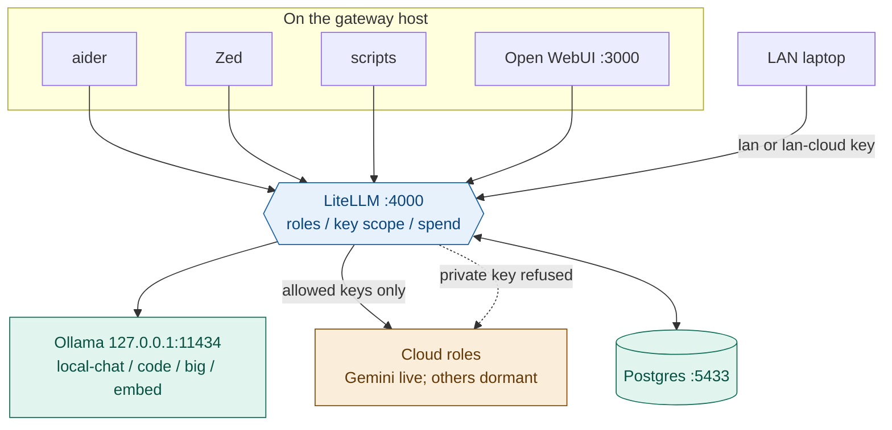

# Architecture

Reference host shape: Apple Silicon Mac, 64 GB unified memory, macOS. LAN clients
reach the gateway; Ollama stays on localhost.

## Shape

Everything addresses **roles**, never model names. Concrete models appear in
exactly two files: `litellm/config.yaml` and `docs/MODELS.md`.

## Why a gateway at all

Before this, aider talked to Ollama directly and other tools talked to cloud
providers directly. That meant several places to edit when a model changed, no
spend visibility, no request log, and no way to enforce that client data stayed
local. One gateway gives a single swap point, one audit trail, and — most
importantly — a place where the privacy boundary can be *structural* rather than
a rule you remember.

## The three layers

**1. Roles.** `local-chat`, `local-code`, `local-big`, `local-embed`, `cloud-cheap`,
plus dormant `cloud-code` and the three `cloud-frontier*` variants. Clients ask for a
role. Swapping the model behind a role is one config edit and a restart; no alias,
script, or IDE setting changes. See `docs/MODELS.md`.

**2. Keys.** Four virtual keys, each scoped to a model list:

| Key | Reaches | Used by |
|---|---|---|
| `private` | `local-*` only | sensitive work, Open WebUI default |
| `general` | everything live | this machine — aider, Zed, scripts |
| `lan` | `local-*` + `cloud-cheap` | other machines, everyday |
| `lan-cloud` | everything live | laptop, when it needs real cloud models |

A request for a cloud role with the `private` key is refused by the gateway. There
is no prompt that gets around it, which is the entire point — see `docs/ROUTING.md`.

**3. Fallbacks.** Local roles degrade to *other local roles* and never to cloud.
`local-big` has none at all — if it is down, fail loudly rather than quietly
answer with a weaker model.
The inherited config had `local-ollama → gemini`, so any Ollama timeout silently
shipped the prompt to Google. Across a privacy boundary a fallback is a leak, not
resilience. `scripts/audit-fallbacks.sh` fails the build if that reappears.

## Process supervision

LiteLLM runs under launchd (default label `com.hearth.litellm`; existing
installs may keep a personal label — scripts resolve via `ai_litellm_label` in
`scripts/lib.sh`). The agent executes `~/.config/litellm/run-litellm.sh`, which
sources `~/.config/litellm/env` and starts LiteLLM with
`--config ~/.config/litellm/config.yaml`.

`~/.config/litellm/config.yaml` is a **symlink** into this repo. That is the whole
deployment mechanism: the plist and wrapper script are never modified, so rollback
is one `mv` (`scripts/deploy.sh --rollback`).

Postgres runs as a Podman container, bound to `127.0.0.1:5433` — the LAN can reach
the gateway but never the database. Port 5433 avoids collision with any other
Postgres.

### Two environment files, deliberately

| File | Read by | Contains |
|---|---|---|
| `~/.config/litellm/env` | launchd, via `run-litellm.sh` | provider keys, `LITELLM_MASTER_KEY`, `DATABASE_URL` |
| `~/dev/hearth/litellm/.env` | `scripts/*.sh` only | `POSTGRES_PASSWORD`, virtual keys, a copy of `DATABASE_URL` |

**launchd does not read the repo's `.env`, and it does not read `~/.zshrc`.** A
variable exported in your shell will look fine to a naive check and then fail at
runtime. `scripts/preflight.sh` checks the service's environment specifically, and
reports "set in your shell but NOT in ~/.config/litellm/env" as a failure.

## Verification

| Script | Answers |
|---|---|
| `preflight.sh` | Is it safe to deploy? Read-only. Exit 2 = check couldn't run, 1 = real problem |
| `audit-fallbacks.sh` | Can any local role reach cloud? |
| `deploy.sh` | Cut over, verify, auto-rollback on failure |
| `healthcheck.sh` | Is every live role responding, and is the private key actually scoped? |
| `bench.sh` | Does a candidate model beat the incumbent? |

The leak test in `healthcheck.sh` has two halves: the private key must **succeed**
on a local role (otherwise a merely broken key looks like perfect scoping) and must
be **refused** on a live cloud role (probing a dormant role proves nothing, since
"model not found" is also a 4xx).

## The second boundary: containment

The key scoping above governs **where data goes on purpose**. It has no
jurisdiction over a compromised agent, which does not use that path at all — an
injected aider that `curl`s a stolen key to an attacker never touches LiteLLM.

`scripts/sandboxed.sh` closes that channel by denying egress to everything
except the gateway, so an agent that reads a secret has nowhere to send it.
Verified on macOS 26.4 by `scripts/sandbox-probe.sh`. Reads are deliberately
unrestricted; the full reasoning and the accepted residual risk are in
`docs/THREAT-MODEL.md` and ADR 0007.

| Threat | Key scope | Sandbox |
|---|---|---|
| A prompt sends client data to a cloud model | **caught** | not caught |
| An injected agent exfiltrates a key via curl | not caught | **caught** |

## Known gaps

- ~~Ollama open on the LAN~~ — **closed 2026-08-02**. Bound to 127.0.0.1, verified
  unreachable from the LAN address. See ADR 0003.
- ~~No agent sandboxing~~ — **closed 2026-08-02** for aider and Zed. Egress and
  write confinement verified. See ADR 0007.
- **Untrusted MCP servers are unaudited** — unknown tool surface, adjacent to real client
  data. Now the largest unknown; see `docs/THREAT-MODEL.md` §3.
- **Roles are not digest-pinned yet.** Ollama tags are mutable pointers, so a pull
  can change the weights behind a role. Pinning lands with the bench harness.
- **Resident set** is 37.5 GB of a ~48 GB GPU ceiling — all four local models stay
  loaded, so switching roles evicts nothing. This replaced a set needing 65.7 GB.
- **No auto-updater yet.** Discovery and benching are meant to be automatic;
  promotion stays manual by choice.
