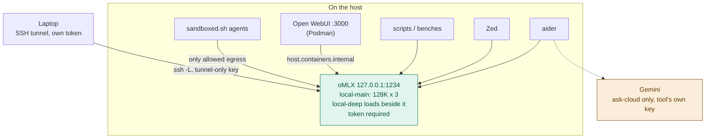

# Architecture

Reference host: Apple Silicon Mac, 64 GB unified memory, macOS. oMLX serves
local roles on `127.0.0.1:1234` from `~/.hearth/models` (ADR 0026).
`scripts/omlx.sh down` stops oMLX and does not start LM Studio (ADR 0028).
Do not also run headless `llmster`. The gateway era is in `docs/HISTORY.md`.

## Shape

Everything addresses **roles**, never model names. Concrete models appear in
exactly two files: `config/roles.tsv` and `docs/MODELS.md`.

## Roles

| Role | Backend | What |
|---|---|---|
| `local-main` | oMLX | the resident local model. 128K context, 3 concurrent predictions (ADR 0017, 0024) |
| `local-deep` | oMLX | slower, more careful model for hard one-off questions. Loaded **beside** `local-main` (ADR 0028). `ask-deep` unloads it on the way out and leaves `local-main` loaded. Zed and laptops can use it only while the host has it in (`scripts/demand-load.sh local-deep up`) |
| `cloud-cheap` | Gemini | reached directly by `ask-cloud`; never loaded into LM Studio |

`local-code` and `local-chat` were collapsed into `local-main` (D1): two heavy
models cannot both stay resident with 3 × 128K slots, and evicting the agent
model was failure F2. The old alias names still work and mean `local-main`.

`scripts/lms-load.sh` makes the loaded set match `config/roles.tsv`: it
unloads anything unlisted, loads each `lmstudio` row with
`--identifier <role> -c <ctx> --gpu max --parallel <slots>`, then re-reads
`lms ps` to confirm. No `--ttl`, so a role never auto-unloads.

## The privacy boundary

There is no router and no key scope. The boundary is where models live:

- **LM Studio holds only local models.** Anything sent to `:1234` stays on
  the host by construction. Rule: no script adds a cloud backend to
  `config/roles.tsv` except as an explicit cloud row (`gemini`).
- **Cloud needs a provider key in the calling tool.** Only `ask-cloud` passes
  one, per invocation. Host Zed has no cloud provider (D3).
- **Sandboxed agents can reach `127.0.0.1:1234` only**, so they cannot reach
  cloud at all.

What this does **not** do, stated plainly: tokens are not scoped to models
(any valid token reaches every loaded model — fine while all are local), and
there is no spend cap or per-request log. A Gemini quota in the Google Cloud
console is the cap.

## Server settings

Set once in the LM Studio app (llmster has no CLI for auth or tokens) and
honoured by llmster — verified 2026-10-31: no token → 401, wrong token → 401,
host token → 200.

| Setting | Value |
|---|---|
| Port | 1234 |
| Require Authentication | on |
| Serve on Local Network | off — laptops use an SSH tunnel (phase 4 decision) |
| CORS | off |
| Just-in-Time model loading | off |
| Allow per-request MCPs / calling servers from mcp.json | off |
| Log sensitive data | off |

Stored in `~/.lmstudio/.internal/http-server-config.json` (auth and tokens
are not in that file).

## Process supervision

oMLX serves `local-main` on `127.0.0.1:1234` from `~/.hearth/models` (ADR 0026).
`ask-deep` loads `local-deep` from the same tree beside it (ADR 0028).
Login runs `scripts/boot.sh`, which runs `scripts/omlx.sh up`, then starts
Podman, SearXNG and Open WebUI. `scripts/omlx.sh down` stops oMLX and
does not start LM Studio. **Do not also run llmster**: whichever starts first
owns `~/.lmstudio`.

### Environment files

| File | Read by | Contains |
|---|---|---|
| `~/.config/hearth/env` (mode 600) | aliases (`_hearth_var`), scripts | `LMSTUDIO_HOST_TOKEN`, `GOOGLE_API_KEY` (moved from `~/.zshenv.local` 2026-10-31, where it was exported into every shell) |

The aliases read single values from these files and inject them per command;
they never `source` them into the interactive shell. Do not export a provider
key from `~/.zshenv` or `~/.zshrc`: every process, including local aider and
anything an agent spawns, would then hold it.

## Verification

| Script | Answers | Exit |
|---|---|---|
| `healthcheck.sh` | host token 200 (positive control), no/wrong token 401, each role answers, only LM Studio on :1234, LAN silent or token-only, no CORS, an unlisted model never loads | 0 / 1 / 2 |
| `preflight.sh` | roles.tsv well-formed and local-only on lmstudio, keys downloaded and in MODELS.md, rule 1, saved server settings, secrets placement, weight drift, autostart, bash 3.2 / CRLF | 0 / 1 / 2 |
| `status.sh` | one glance, no model calls | — |
| `diagnose.sh` | evidence dump — run before restarting anything | — |
| `lms-load.sh --check` | exactly roles.tsv loaded, right context and slots | 0 / 1 / 2 |
| `pin-digests.sh --check [--deep]` | weights unchanged since recorded (D4) | 0 / 1 / 2 |
| `tool-smoke.sh` | Zed-like read → write tool loop | 0 / 1 |
| `concurrency-bench.sh`, `bench.sh` | load behaviour; quality tasks | — |
| `sandbox-probe.sh` | sandboxed agents reach :1234 and nothing else | 0 / 1 |

Exit 2 always means "could not run", never "found a problem".

Known behaviour: with JIT off, LM Studio answers a request for an **unknown
model name with the loaded LLM** rather than refusing. Nothing new loads (so
nothing is evicted), but a typo'd model id silently gets `local-main`.
`healthcheck.sh` reports it as a warning.

## Measured (2026-10-31)

| | Ollama via LiteLLM (phase 0) | llmster, 64K × 3 (phase 1) |
|---|---|---|
| c1 TTFT p95, 28K prompt | 21.0 s | 19.9 s |
| c3 TTFT p95 | 65.8 s | 59.9 s |
| c3 total p50 | 40.3 s | 61.0 s |
| Peak footprint | 37.0 GB (1 slot) | 29.7 GB (3 slots) |

Prefill was still serialised on that MLX engine; `--parallel` batches
decode, so all three requests in a round finish together. The wins are
memory, no evictions and no gateway hop, not concurrency.
`bench/results/2026-10-31-phase0`, `…-phase1`. The live server is the LM
Studio app (D6), loaded at 128K × 3 (ADR 0017). Those rows are the 64K
measurement, not a claim that llmster is still running. The current
`local-main` (ADR 0024) at 128K × 3: c1 TTFT p95 25.0 s, c3 total p95 75.2 s,
peak 25.2 GB (`bench/results/2026-11-01-gemma-concurrency`). The resident
from ADR 0023, same day, was c1 TTFT p95 21.8 s, c3 total p95 65.5 s,
peak 29.7 GB (`bench/results/2026-11-01-128k`).

## The second boundary: containment

The local/cloud split governs **where data goes on purpose**. It has no
jurisdiction over a compromised agent — an injected aider that `curl`s a
stolen key to an attacker never touches the model server.

`scripts/sandboxed.sh` closes that channel by denying egress to everything
except `127.0.0.1:1234`. Verified by `scripts/sandbox-probe.sh` (11/11 on
2026-10-31, including a deny check on the old `:4000`). Reads are
deliberately unrestricted; see `docs/THREAT-MODEL.md` and ADR 0007.

| Threat | Model placement | Sandbox |
|---|---|---|
| A prompt sends client data to a cloud model | **caught** unless you run `ask-cloud` | not caught |
| An injected agent exfiltrates a key via curl | not caught | **caught** |

## Known gaps

- **Host SSH accepts passwords** (macOS default). `docs/LAPTOP.md` gives the
  key-only override; not applied automatically.
- **LM Studio's saved settings can change under you** (bind and CORS did
  once). `boot.sh` resets them at login; `healthcheck.sh` checks the live
  listener and CORS header, not the file.
- **Untrusted MCP servers are unaudited** — `docs/THREAT-MODEL.md` §3.
- **Zed's built-in `fetch` and `search_web` tools** reach the internet in the
  Write and Ask profiles; that predates this migration.
