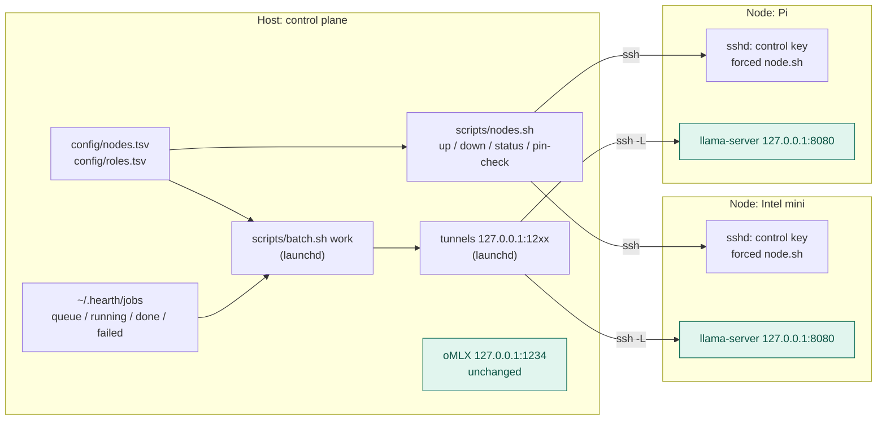
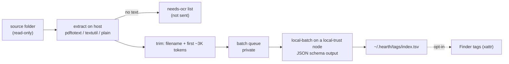

# Distributing Hearth across hosts — draft plan

**Status:** draft for operator review, revised 2026-11-08. Nothing here is
built or approved. Each phase that lands gets its own ADR (rule 8). No model
names here (rule 1): candidates go into `docs/MODELS.md` once benched.

## Decided so far (operator, 2026-11-08)

- Nodes run **llama.cpp** (`llama-server`). oMLX stays the host's only engine.
- Nodes do **background batch work with small models**: never interactive,
  never in Zed's or aider's path.
- Hearth needs a **node registry** and a way to run and watch nodes.

## Why not more

None of the old boxes can serve `local-main` or `local-deep`. Splitting one
model across nodes (llama.cpp RPC, exo) is slower than one box whenever the
model fits on one, and llama.cpp RPC has no authentication. Rejected.

Expected speeds come from web research (2026-11-08) and are unbenched:
Intel Mac mini 2018 at about 4–8 t/s for 4B Q4 (estimated from memory
bandwidth), Pi 5 at about 2–6 t/s for 3B Q4. Prefill is slow, so a job with
a long input takes minutes. That is fine in a queue and useless in an editor.

## Shape



The host is the whole control plane. Nodes run only `llama-server` and sshd.
They never call the host, and there is no daemon or agent of Hearth's own on
them. That keeps a node as dumb as possible and the attack surface where it
already is.

## 1. Registry

**`config/nodes.tsv`** (new; holds no model names):

| Column | Example | Meaning |
|---|---|---|
| `node` | `mini` | short name, used in keys and logs |
| `ssh` | `hearth-mini` | `~/.ssh/config` alias on the host |
| `os` | `macos` / `linux` | which service manager `node.sh` uses |
| `ram_gb` | `16` | picks the role row, like `min_ram` on the host |
| `trust` | `local` / `public-only` | `local` = operator owns it, disk encrypted, operator's network. Anything else is `public-only` |
| `port` | `1241` | host-side tunnel port for this node's llama-server |
| `state` | `active` / `drained` | `drained` = worker sends nothing new |

**`config/roles.tsv`** gains a role with `backend` `llamacpp` and a tenth
column, `nodes` (comma-separated, or `-` for host rows). Example:
`local-batch llamacpp <model_key> 8192 2 <weights.gguf> - resident 8 mini,pi`.
`min_ram` is checked against each node's `ram_gb`. `preflight.sh` fails
if a `llamacpp` row names an unknown node, or if any `omlx` row names a node.

Several nodes may serve one role only if they run **the same pinned weights**
and share **the same trust**. Then spreading jobs between them is load
balancing, not a fallback.

## 2. Control plane

**Keys.** Each node gets two host-side keys, both restricted in the node's
`authorized_keys`:

- *tunnel key*: `command="/usr/bin/false",restrict,port-forwarding,permitopen="127.0.0.1:8080"`
  (the `docs/LAPTOP.md` pattern, the other way round).
- *control key*: `command="~/hearth-node/node.sh --ssh",restrict`. `node.sh`
  reads `SSH_ORIGINAL_COMMAND` and accepts only `up`, `down`, `status`,
  `pin-check`, `logs`. No shell.

**`node/node.sh`** (new top-level `node/` directory, like `client/`; not in
`scripts/`, which stays host-only) runs on the node. It manages llama-server
under launchd (mini) or systemd (Linux), binds `127.0.0.1` only, sets
`--api-key` from a mode-600 file, `--metrics`, `--slots` off (slot state can
contain prompts), and turns off logging of prompts. It is bash 3.2-safe so one
copy works on both.

**`scripts/nodes.sh`** (host):

| Command | Does |
|---|---|
| `nodes.sh status` | per node: ssh reachable, tunnel up, `/health`, 401 without token, loopback-only listener, loaded weights, metrics (tokens/s, requests), queue depth |
| `nodes.sh up/down <node>` | `node.sh up/down` over the control key |
| `nodes.sh push <node>` | copies pinned GGUF from host `~/.hearth/models` after a sha256 check. The node never downloads weights itself |
| `nodes.sh pin-check` | node hashes its GGUF and the host compares with `pins/digests.tsv` (rule 6) |
| `nodes.sh drain/resume <node>` | flips `state` |

`healthcheck.sh`, `preflight.sh` and `status.sh` call into `nodes.sh status`.

**Tunnels.** One launchd agent on the host (alongside the existing
`com.hearth.tunnel`) keeps `ssh -N -L 127.0.0.1:<port>:127.0.0.1:8080` up per
active node.

**Dashboard.** Phase A is a CLI: `nodes.sh status` and `batch.sh status`.
If you want a page later, `status.sh --html` writes a static page under
`~/.hearth/` (mode 600) that you open locally. It is generated, has no server
and no write actions. A web control plane with buttons is its own decision,
because it would be a new listener that can start and stop things.

## 3. Batch queue

**Submitting** (host):

```bash
scripts/batch.sh submit local-batch --template prompts/tag.txt docs/inbox/*.md
scripts/batch.sh submit local-batch --public --jsonl items.jsonl
```

Each input becomes `~/.hearth/jobs/queue/<id>.json` (dir 700, files 600)
holding role, template, input path, `max_tokens`, `sensitivity`. Sensitivity
defaults to **private**. `--public` is explicit, the same stance as `ask-cloud`.

**Worker:** `scripts/batch.sh work` runs under launchd, in Python as other scripts already do.

- Picks each role's active nodes from the registry. Keeps at most `slots`
  jobs in flight per node (llama-server answers 503 or "no slot" rather than
  queueing, so the worker does the queueing).
- `queue → running → done | failed`, using an atomic `mv`. Output is written
  next to the job. On start, jobs stuck in `running` past a timeout go back
  to the queue.
- Retries twice with backoff on a connection error or 503, on the same role.
  It **never** reroutes to `local-main`, another role or cloud. A role with
  no healthy node leaves its jobs queued, and `batch.sh status` says so.
- Refuses to send a private job to a `public-only` node. Checked at submit
  and again at dispatch.

**Not in v1:** agents submitting jobs. Sandboxed agents keep reaching
`127.0.0.1:1234` only, so the sandbox is not widened (`docs/THREAT-MODEL.md`
§5). Allowing it later is its own ADR.

**Batch jobs that fit:** tagging and classifying documents, short summaries,
extracting fields to JSON (llama.cpp grammar / JSON schema), renaming
files, and embeddings for a document index if a caller appears (ADR 0018).

## 4. First job: document tagging (operator pick, 2026-11-08)



`scripts/tag-docs.sh <folder>` submits a folder to `batch.sh`. That is the
whole job interface.

| Step | Design |
|---|---|
| Extract | On the host, with tools already installed: `pdftotext -layout` for PDF, `textutil -convert txt` for doc/docx/rtf, as-is for md/txt. A PDF with no text layer goes on a `needs-ocr` list and is not sent. OCR is a later job |
| Trim | Filename + page count + the first ~3K tokens. Prefill is the slow part on CPU, so the cap gets tuned in Phase 0 to a per-document time target (proposed ≤ 60 s on the mini) |
| Vocabulary | Closed set in `config/tags.tsv` (`tag`, one-line description), plus `other`. A small model picks from a list far more reliably than it invents tags |
| Output | Constrained by llama-server's JSON-schema support (verify on the Phase 0 build): `{"doc_type": <enum>, "tags": [<enum>, ≤3], "confidence": "low"\|"medium"\|"high"}`. No free-text summary in v1: decode is slow, and free text is where small models drift |
| Store | `~/.hearth/tags/index.tsv` (mode 600): path, file sha256, doc_type, tags, confidence, role, weights digest, date. Source files are **never modified**. Finder tags are an opt-in `--finder` flag that writes only the xattr |
| Re-runs | Skip a file whose sha256 and weights digest both match the index. A new model re-tags everything; a changed file re-tags itself |
| Low confidence | `low` rows are listed by `tag-docs.sh review` for a person to check. They are not dropped |
| Privacy | Jobs are private, so only `trust=local` nodes. Extracted text lives in the job files (mode 600) and is deleted when the job reaches `done` |

**Gate (rule 5):** a new `bench/tasks/05-tagging/` with about 30 labelled
documents. The committed set is **synthetic or public only**. If real
documents are used to check accuracy, their labels and paths stay outside git.
Score: doc_type accuracy and tag F1 per candidate model, `local-main` on the
host as the reference ceiling, plus seconds per document on each node. The
operator sets pass marks after seeing the first run.

## Rules this plan keeps

| Rule | How |
|---|---|
| 2: `:1234` local-only | untouched. Node roles have their own backend and ports |
| 3: privacy by placement | `trust` in the registry and private-by-default jobs. A VPS is cloud and never gets a `local` row |
| 5: bench first | no `llamacpp` row before Phase 0 numbers for that node class |
| 6: drift | `nodes.sh pin-check`. As on the host, llama-server loads whatever is on disk; drift is detected, not prevented |
| 7: RAM | per node, through `ram_gb` and `min_ram` |
| 9: bash 3.2 | `node.sh`, `nodes.sh`. Worker logic in Python |
| No fallbacks | jobs wait. They are never rerouted |

## Phases

| Phase | Work | Gate |
|---|---|---|
| 0 | `llama-bench -ngl 0` plus one `bench/tasks`-style batch task on each box (1B / 3–4B / 8B Q4), recording build commit and threads | numbers in `docs/MODELS.md` *Candidates*. Go/no-go per box |
| A | `nodes.tsv`, `node/node.sh`, `scripts/nodes.sh`, keys, tunnels, checks. One node, one role | `nodes.sh status` all green. Checks see 401 without a token and nothing on the LAN |
| B | `batch.sh` queue and worker | 100-job run: none lost, none duplicated, a node pulled mid-run leaves jobs queued and rerouted nowhere |
| C | second node, and SearXNG moved to a node (optional) | — |
| D | off-LAN node over Tailscale/Headscale: grants `tag:hearth-node` `tcp:22` only, SSH on top, no port forwards | ADR |

## Risks

- **Intel mini end of life:** Sequoia is its last macOS. Once its security
  updates stop, drop it to `public-only` or move it to Linux.
- **Pi disk:** an unencrypted SD card. Encrypt it with LUKS or mark the node
  `public-only`. Keep prompt logging off.
- **Upkeep:** every node adds two keys, a service, a tunnel and a drift
  check. Start with one node.

## Open questions

1. Which folder or folders, and which file types (PDF, docx, email, scans)?
   Roughly how many documents, and how many new ones a week?
2. The tag vocabulary: do you already have categories (document types,
   matter stages, …), or should a first pass with `local-main` over a sample
   propose a list for you to edit?
3. Index only, or also Finder tags?
4. Exact boxes: Pi model and RAM, any old PC with a GPU?
5. Static HTML status page in Phase A, or CLI only?

## Sources (searched 2026-11-08)

- Pi 5 speeds: specpicks.com Pi 5 16 GB review; bestllmfor.com
- Old x86: mgroeber.de "Benchmarking llama.cpp on legacy hardware"
- Split inference: localaimaster.com distributed inference
- llama-server router mode, `--api-key`, public `/health`, `/metrics`, `/slots` holds prompts: glukhov.org router mode; mvysny.github.io llama-server endpoints
- Slots and 503 on full: dev.to "slot unavailable under load"; llama.cpp server README
- macOS support: mac.install.guide compatibility
- Tailscale grants: tailscale.com/kb/1324/acl-grants
