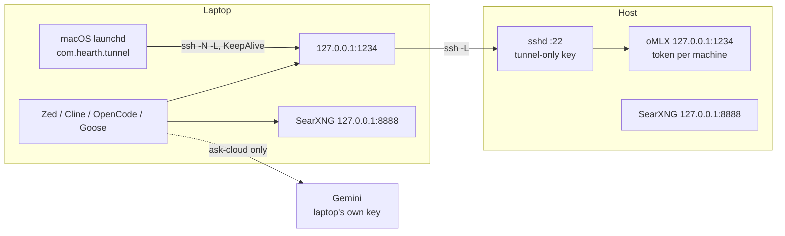

# Laptop access

**SSH tunnel only.** The host's oMLX stays
bound to `127.0.0.1:1234`; a laptop forwards a local port to it over SSH. Same
setup on the LAN and away from it, traffic encrypted, nothing on the host
exposed to the network.



The host's SearXNG is for the host's own editors. The tunnel does not
forward it (ADR 0045).

## What each laptop gets

| Thing | Where | Why |
|---|---|---|
| API key `laptop-m5-air` | laptop `~/.hearth-key` (mode 600) | the `sub-key add` argument. Revoke one machine without touching the others |
| `edit-brain` on the laptop's own oMLX (optional) | `~/.hearth/models`, linked into `~/.omlx/models` by `client/edit-model.sh laptop-up` | local edit prediction; host does not serve it. Paid Zed Zeta is the cloud alternative (`docs/IDES.md`, ADR 0033) |
| API keys `jetbrains-<name>`, `xcode-<name>` (optional) | typed into the IDE's own key field | revoke one editor without touching the laptop's key (`docs/IDES.md`) |
| SSH key `hearth_tunnel` | laptop `~/.ssh/hearth_tunnel`; host `authorized_keys` with `command="/usr/bin/false",restrict,port-forwarding,permitopen=…,permitlisten="none:1"` | the key can `-L` to `127.0.0.1:1234` only — no shell, no commands, no `-R`, no SearXNG, no other ports (ADR 0045) |
| Google API key (optional) | laptop `~/.hearth-gemini-key` (mode 600) | `ask-cloud` with the laptop's own key; the host holds no Google key (ADR 0038) |
| `client/hearth-client.sh` / `.ps1` | laptop `~/.hearth-client.sh` | `ai-tunnel`, `ai-tunnel-install` (macOS), `ai-ping`, `ai-models`, `ai-ask`, `ask*`, `ask-deep`, `ask-cloud` |

Secrets are read from files per command and never exported into the
laptop's shell. A world-readable key file is refused.

## Names

`scripts/client-setup.sh` takes the short name. `m5-air` and `laptop-m5-air`
are the same machine. The short name is letters, digits, `-` and `_`.

| | Example |
|---|---|
| `sub-key add` argument | `laptop-m5-air` |
| SSH `authorized_keys` comment | `hearth-tunnel-m5-air` |

`scripts/omlx.sh sub-key list` prints names, not tokens. The argument is that
name (`laptop-m5-air`). A model id or a display name is rejected with
`name must be letters, digits, hyphen, or underscore`.

## Setup

On the host, `scripts/client-setup.sh m5-air` prints every step with this
host's name and user filled in (`--windows` for PowerShell). Ask which path
applies, then follow that path only.

### New machine

`laptop-m5-air` is absent from `scripts/omlx.sh sub-key list`.

1. **Host user**, with oMLX listening (`scripts/omlx.sh status`):
   `scripts/omlx.sh sub-key add laptop-m5-air`. The prompt says
   `paste the token for laptop-m5-air` and does not echo. The command does
   not invent a token. The same string is stored on the laptop as
   `~/.hearth-key`. A reboot runs `scripts/omlx.sh up`, which keeps sub-keys
   already registered.
2. **Laptop:** `ssh-keygen -t ed25519 -f ~/.ssh/hearth_tunnel -C hearth-tunnel-m5-air`.
3. **Host:** `scripts/client-setup.sh m5-air --authorize hearth_tunnel.pub`.
   It refuses a key that is already authorized without restrictions.
4. **Laptop:** `client/install-client.sh --host you@studio.local` from a clone
   of this repo. It copies the client, writes `Host hearth`, and one marked
   rc block (`HEARTH_CLOUD_MODEL` comes from `config/roles.tsv`). Store the
   token and (optionally) a Google key in your own terminal. Do not append
   loose `HEARTH_*` lines to the rc.
5. **Laptop:** `ai-tunnel` once, so the host fingerprint can be accepted.
   On macOS, then `ai-tunnel-install`. Then `ai-ping && ai-models`.

### Already registered

`laptop-m5-air` is already in `sub-key list`. Skip `sub-key add`. A second
add with a different token fails: `sub-key laptop-m5-air already exists`.

The laptop user:

1. Keep the existing `~/.hearth-key` (mode 600). That file is the token for
   `laptop-m5-air`. When the file is missing, ask the host user to
   `scripts/omlx.sh sub-key revoke laptop-m5-air` and then
   `scripts/omlx.sh sub-key add laptop-m5-air` with a new token. `sub-key list`
   cannot show the old one.
2. Keep `~/.ssh/hearth_tunnel` when the host's `--authorize` prints
   `already authorized`. Skip `ssh-keygen`. When the private key is gone,
   generate a new one and authorize that `.pub`.
3. Re-run `client/install-client.sh` (same as New machine step 4). It
   refreshes `~/.hearth-client.sh` and the rc block.
4. On macOS, `ai-tunnel` once if the host fingerprint is new, then
   `ai-tunnel-install`. Login starts the tunnel after that. On Linux,
   `ai-tunnel`.

`ai-ping` answers: `up`, `BAD TOKEN` (revoked or wrong token), `NO ANSWER`
(tunnel up but host asleep or oMLX down — on the host, `scripts/boot.sh`),
or `DOWN` (no tunnel — `ai-tunnel`).
If something else is already listening on `127.0.0.1:1234`, the client refuses and does not send the token.

## Installer

`client/install-client.sh --host you@studio.local` does the laptop-side
plumbing of *New machine* or *Already registered* in one go:

- copies the client script
- adds the `Host hearth` entry
- writes one marked block in your shell rc, commenting out loose lines from
  older setups (backup kept)
- picks the tunnel port

`--check` reports without writing anything. It never reads a key; the
secret and host-side steps are listed for you to do (ADR 0040).

### A laptop that is also a host

With RAM for a benched tier, a laptop can run its own brain on
`127.0.0.1:1234` and keep the bigger host on `127.0.0.1:1235`. Use
`client/install-client.sh --dual`, then `scripts/install-host.sh`. The
client's aider commands become `ask-remote`, `main-brain-remote` and
`ask-deep-remote`, and the plain names mean this machine's brain. Steps:
README → *One machine, both roles*.

## Keeping the tunnel up

`ai-tunnel` alone is one `ssh -f`. When that session drops, nothing restarts
it. On macOS, `ai-tunnel-install` writes
`~/Library/LaunchAgents/com.hearth.tunnel.plist`: `ssh -N` with the same
`-L` forwards, `KeepAlive`, and `RunAtLoad`. launchd restarts it after a
drop and at login. Later `ai-tunnel` kickstarts that job. `ai-tunnel-stop`
unloads it (`launchctl bootout`) and also stops a one-shot `ssh -f`. Linux
and Windows stay on `ai-tunnel`. Logs:
`~/Library/Logs/hearth-tunnel.error.log`. Accept the host fingerprint with
one interactive `ai-tunnel` before install; launchd cannot prompt.

## AI-assisted setup

For an AI assistant (Claude Code, Cursor, …) running **on the laptop** in a
clone of this repo. The assistant is probably a cloud model: anything it reads
or prints goes to its vendor. That decides every rule below.

**Never:** read, print, grep, copy or edit `~/.hearth-key`,
`~/.hearth-gemini-key` or `~/.ssh/hearth_tunnel` (the private key); ask the
person to paste a token or key into the chat; run anything in `scripts/`
(host-only); add a router port-forward; suggest turning on Serve on Local
Network; configure hearth as a Cursor model provider (see below). Checking a
secret file's permissions with `ls -l` is fine.

**1. Ask the person which path, and for the short name.**

Example short name: `m5-air`. The host command is then
`scripts/omlx.sh sub-key add laptop-m5-air`. The SSH comment is
`hearth-tunnel-m5-air`. Letters, digits, `-`, `_`. Also ask for the host as
`user@host.local` (on the host: `id -un` and `scutil --get LocalHostName`)
and the shell: macOS / Linux (zsh or bash) or Windows PowerShell.

- **New.** `laptop-m5-air` is absent from the host's `scripts/omlx.sh sub-key list`.
  Ask the host user to run `sub-key add laptop-m5-air` and type a token.
- **Already registered.** That name is already in the list. Skip `sub-key add`.
  The laptop keeps its existing `~/.hearth-key`. When that file is missing,
  ask the host user to `sub-key revoke laptop-m5-air` and then
  `sub-key add laptop-m5-air` with a new token. The list cannot show the old one.

`client/install-client.sh` writes `HEARTH_CLOUD_MODEL` from the `cloud-cheap`
row of `config/roles.tsv`. Do not append that id to the rc by hand. Windows
has no installer: read column 3 of that row into `$env:HEARTH_CLOUD_MODEL`
only (see `client/hearth-client.ps1`).

**2. You may run** (macOS / Linux; Windows equivalents are in
`client/hearth-client.ps1`'s header). Skip `ssh-keygen` when
`~/.ssh/hearth_tunnel` already exists and the host will say
`already authorized`.

```bash
# Interactive (passphrase prompt) — ask the person to run it, or run it if your
# terminal is interactive. New tunnel key only:
ssh-keygen -t ed25519 -f ~/.ssh/hearth_tunnel -C hearth-tunnel-m5-air

# Client copy, Host hearth, marked rc block. Dual: add --dual.
client/install-client.sh --host you@studio.local
```

Showing the person `~/.ssh/hearth_tunnel.pub` is fine — it is public.

**3. Stop and hand over to the person** for each of these, then wait:

1. *On the host*, while oMLX is listening. New machine: the host user runs
   `scripts/omlx.sh sub-key add laptop-m5-air` and types the token.
   Already registered: they run `scripts/omlx.sh sub-key list` and confirm
   `laptop-m5-air` is there, and they skip add. Do not ask anyone to paste
   a token into the chat.
2. *On the host*, with the `.pub` file copied over:
   `scripts/client-setup.sh m5-air --authorize hearth_tunnel.pub`.
   `already authorized` means the laptop keeps the key it has.
3. *On the laptop, in their own terminal* (not through you). New token, or
   `~/.hearth-key` is missing:

   ```bash
   umask 077
   read -rs t && printf '%s' "$t" > ~/.hearth-key && unset t          # laptop-m5-air token
   read -rs t && printf '%s' "$t" > ~/.hearth-gemini-key && unset t   # optional: this laptop's OWN Google key
   ```

   Already registered and `~/.hearth-key` is already that token: skip the
   `read`. Then confirm with `ls -l ~/.hearth-key ~/.hearth-gemini-key`: mode
   `-rw-------`, non-zero size. Nothing more.

**4. Prove it** in a new shell. Both halves are required: the first shows the
key works, the second that it can do nothing else.

| Command | Expect |
|---|---|
| `ai-tunnel` | `tunnel: up` (the first run asks the person to confirm the host fingerprint) |
| `ai-tunnel-install` | macOS: `tunnel: installed com.hearth.tunnel`. Linux: skip this |
| `ai-ping` | `up` |
| `ai-models` | `main-brain`, and the host's swap roles (`deep-brain`; `coding-brain` on a 64 GB host). The list does not say which is loaded |
| `ai-ask "say ok"` | a short reply from `main-brain` |
| `ssh hearth true; echo $?` | **non-zero**, no shell: the key is tunnel-only |
| `ask-cloud` (optional) | aider on Gemini with the laptop's own key |
| `ask-deep`, `coding-brain` (optional) | with `HEARTH_SSH_ADMIN` set: loads the role on the host, runs aider, then restores `main-brain`. Without it: asks whether the host ran `scripts/demand-load.sh <role> up`. See *Swap roles from the laptop* |

If `ai-ping` says `BAD TOKEN`, the person re-runs the `read -rs` step with
the right token; `NO ANSWER` means the host is asleep or oMLX is down
(fix on the host); `DOWN` means no tunnel. If `ssh hearth true` **succeeds**,
stop: the key was authorized without restrictions — tell the person, and do
not continue.

**5. Editors.** Zed: the block in [Zed on the laptop](#zed-on-the-laptop),
with the laptop's token entered through Zed's UI by the person.

**Cursor cannot use hearth as its model provider.** Cursor's backend makes
the model call, not the laptop, so a `localhost` base URL never reaches the
tunnel; the only workaround is a public endpoint, which the *Never* list
forbids, and prompts would still pass through Cursor's servers (checked
2026-10-31). Use Zed, aider or `ask` for `main-brain` on the laptop; Cursor
with its own models only, and not on sensitive repos.

## Zed on the laptop

Same provider as the host, through the tunnel. Default is `main-brain`
(ADR 0048). List the host's swap roles too, and load one before you pick it
(*Swap roles from the laptop*). `coding-brain` exists on a 64 GB host only.
`scripts/zed-sync.sh` writes the labels.

```json
{
  "language_models": {
    "openai_compatible": {
      "hearth": {
        "api_url": "http://127.0.0.1:1234/v1",
        "available_models": [
          { "name": "main-brain", "display_name": "main-brain — 256K × 3", "max_tokens": 262144 },
          { "name": "coding-brain", "display_name": "coding-brain — 98K × 1 — load first", "max_tokens": 98304 },
          { "name": "deep-brain", "display_name": "deep-brain — 64K × 1 — load first", "max_tokens": 65536 }
        ]
      }
    }
  },
  "agent": { "default_model": { "provider": "hearth", "model": "main-brain" } }
}
```

Token through the UI (Agent panel → settings → `hearth` → API key): the
laptop's `laptop-m5-air` token. On macOS, `ai-tunnel-install` starts the
tunnel at login. Run `ai-tunnel` before Zed when that agent is not installed,
or Zed's models show as unavailable.

A Gemini provider **is allowed on the laptop** (D3), with the laptop's own
key. The host has none. Keep sensitive repos on a `hearth` brain.

### Swap roles from the laptop

The host's `coding-brain` (64 GB) and `deep-brain` load in place of
`main-brain` (ADR 0048). The tunnel key cannot run a command, so the laptop
uses your ordinary SSH login on the host for this one step. Put this above
the hearth block in your shell rc. The person types it; it holds no secret.

```bash
export HEARTH_SSH_ADMIN=you@your-host.local   # not the tunnel key
export HEARTH_REMOTE_ROOT=dev/hearth          # the repo on the host; this is the default
```

| Command | Does |
|---|---|
| `hearth-load coding-brain up` | loads it on the host. Prints `loaded` or `already` |
| `hearth-load coding-brain down` | unloads it and restores `main-brain` |
| `coding-brain`, `ask-deep` (`-remote` when dual) | `up`, aider on that role, then `down` if this call did the loading |

For an editor: `hearth-load <role> up`, pick the role in the editor, and
when you finish switch the editor back to `main-brain` and run `down`.
While a swap role is loaded, `main-brain` on that host has no model of its
own. Without `HEARTH_SSH_ADMIN`, run `scripts/demand-load.sh <role> up` on
the host.

If using the legal-research worked example from `docs/MCP.md`, install and
review its source on the laptop too; its stdio process runs beside Zed, not on
the host. The same "Write enables every server" trap applies.

## Web search on the laptop

Search runs on the laptop, not through the tunnel (ADR 0045). `scripts/searxng.sh up`
starts SearXNG on `127.0.0.1:8888`. Install the same pinned MCP server and
point Zed, Cline, OpenCode, and Goose at `scripts/searxng-mcp.mjs`
(`docs/MCP.md`, `docs/IDES.md`):

```bash
npm install --ignore-scripts --save-exact --prefix ~/.local/share/hearth/mcp-searxng mcp-searxng@2.9.0
```

The wrapper forces `http://127.0.0.1:8888` and advertises `searxng_web_search`
only. In Zed, enable that tool in `web` (no file tools, `default_model`
`hearth/main-brain`) and, for a coding thread, `write-web` (Write's tools,
no pinned model). Do not switch either profile to Gemini. Engines see this
laptop's ISP address. An agent that can read files can put personal
information from them into that query.

SearXNG has no login. Any process on the laptop can POST a query to
`127.0.0.1:8888`. A process on the host cannot, unless the host is searching
with its own SearXNG.

**Existing laptops:** follow [Already registered](#already-registered). On the
host, `scripts/client-setup.sh --update-keys` drops `:3000` (ADR 0044) and
`:8888` (ADR 0045). On the laptop, copy the new client
(`scripts/client-setup.sh m5-air --install user@laptop` from the host), then
`ai-tunnel-stop && ai-tunnel-install` (macOS) or `ai-tunnel` (Linux). Skip
`sub-key add` when `laptop-m5-air` is already listed. Until the agent is
reinstalled it still forwards the old ports, and `ai-tunnel` says so.
`ai-tunnel` refuses to send the token when `:1234` is open but the listener
is not this client's ssh.

## Revoking a laptop

1. While oMLX is up: `scripts/omlx.sh sub-key revoke laptop-m5-air`.
2. Host: delete the `hearth-tunnel-m5-air` line from `~/.ssh/authorized_keys`.

Removing the tunnel key cuts the path. Revoke the sub-key so a reboot does
not let it back in.

## Never

- Port-forward `:22`, `:1234` or `:8888` on the router.
- Turn on Serve on Local Network for a laptop — the tunnel makes it unnecessary,
  and it would put the token on the LAN in plain HTTP.
- Copy the host's token or Google key to a laptop.

## Host SSH hardening (recommended, not done for you)

macOS Remote Login accepts passwords by default. With keys in place:

```bash
echo 'PasswordAuthentication no
KbdInteractiveAuthentication no' | sudo tee /etc/ssh/sshd_config.d/100-hearth.conf
sudo launchctl kickstart -k system/com.openssh.sshd
```

Test a key login from the laptop **before** closing your current session.
