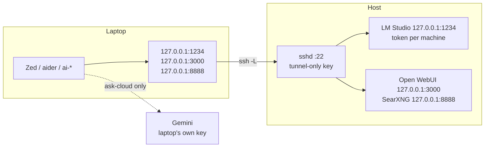

# Laptop access

ADR 0016, phase 4 decision: **SSH tunnel only.** The host's LM Studio stays
bound to `127.0.0.1:1234`; a laptop forwards a local port to it over SSH. Same
setup on the LAN and away from it, traffic encrypted, nothing on the host
exposed to the network.



## What each laptop gets

| Thing | Where | Why |
|---|---|---|
| LM Studio token `laptop-<name>` | laptop `~/.hearth-key` (mode 600) | revoke one machine without touching the others |
| SSH key `hearth_tunnel` | laptop `~/.ssh/hearth_tunnel`; host `authorized_keys` with `command="/usr/bin/false",restrict,port-forwarding,permitopen=…,permitlisten="none:1"` | the key can `-L` to `127.0.0.1:1234`, `:3000` and `:8888` only — no shell, no commands, no `-R`, no other ports |
| Google API key (optional) | laptop `~/.hearth-gemini-key` (mode 600) | `ask-cloud` with the laptop's own key; the host's key never leaves |
| `client/hearth-client.sh` / `.ps1` | laptop `~/.hearth-client.sh` | `ai-tunnel`, `ai-ping`, `ai-models`, `ai-ask`, `ai-webui`, `ask*`, `ask-deep`, `ask-cloud` |

Secrets are read from files per command and never exported into the
laptop's shell. A world-readable key file is refused.

## Setup

On the host, `scripts/client-setup.sh <laptop-name>` prints every step with
this host's name and user filled in (`--windows` for PowerShell). In short:

1. **Host, LM Studio app:** Developer → Server Settings → Manage Tokens →
   create `laptop-<name>`. Leave Serve on Local Network **off**.
2. **Laptop:** `ssh-keygen -t ed25519 -f ~/.ssh/hearth_tunnel`, and a `Host hearth`
   entry in `~/.ssh/config` pointing at the host with `IdentitiesOnly yes`.
3. **Host:** `scripts/client-setup.sh <name> --authorize hearth_tunnel.pub`.
   It refuses a key that is already authorized without restrictions.
4. **Laptop:** copy `client/hearth-client.sh` to `~/.hearth-client.sh`,
   store the token and (optionally) a Google key, add
   `HEARTH_SSH=hearth`, `HEARTH_CLOUD_MODEL=…` and `source ~/.hearth-client.sh`
   to the shell rc.
5. **Laptop:** `ai-tunnel && ai-ping && ai-models`.

`ai-ping` answers: `up`, `BAD TOKEN` (revoked or wrong token), `NO ANSWER`
(tunnel up but host asleep or LM Studio down — on the host, `scripts/boot.sh`),
or `DOWN` (no tunnel — `ai-tunnel`).
If something else is already listening on `127.0.0.1:1234`, the client refuses and does not send the token.

## AI-assisted setup

For an AI assistant (Claude Code, Cursor, …) running **on the laptop** in a
clone of this repo. The assistant is probably a cloud model: anything it reads
or prints goes to its vendor. That decides every rule below.

**Never:** read, print, grep, copy or edit `~/.hearth-key`,
`~/.hearth-gemini-key` or `~/.ssh/hearth_tunnel` (the private key); ask the
person to paste a token or key into the chat; run anything in `scripts/`
(host-only); add a router port-forward; suggest turning on Serve on Local
Network; configure hearth as a Cursor model provider (see below). Checking a
secret file's permissions with `ls -l` is fine.

**1. Ask the person for:**

- the host as `user@host.local` (on the host: `id -un` and
  `scutil --get LocalHostName`);
- the laptop's name for its token and key comment (letters, digits, `-`, `_`);
- shell: macOS / Linux (zsh or bash) or Windows PowerShell.

Read the Gemini model id yourself: the `cloud-cheap` row of
`config/roles.tsv`, column 3. Do not copy it anywhere except the
`HEARTH_CLOUD_MODEL` line.

**2. You may run** (macOS / Linux; Windows equivalents are in
`client/hearth-client.ps1`'s header):

```bash
# Interactive (passphrase prompt) — ask the person to run it, or run it if your
# terminal is interactive:
ssh-keygen -t ed25519 -f ~/.ssh/hearth_tunnel -C hearth-tunnel-<name>

# ~/.ssh/config — append only if there is no "Host hearth" entry already
printf 'Host hearth\n  HostName %s\n  User %s\n  IdentityFile ~/.ssh/hearth_tunnel\n  IdentitiesOnly yes\n' <host.local> <user> >> ~/.ssh/config

cp client/hearth-client.sh ~/.hearth-client.sh
printf 'export HEARTH_SSH=hearth\nexport HEARTH_CLOUD_MODEL=%s\nsource ~/.hearth-client.sh\n' <cloud-cheap id> >> ~/.zshrc   # or ~/.bashrc
```

Showing the person `~/.ssh/hearth_tunnel.pub` is fine — it is public.

**3. Stop and hand over to the person** for each of these, then wait:

1. *On the host*, LM Studio app → Developer → Server Settings → Manage Tokens →
   create `laptop-<name>`.
2. *On the host*, with the `.pub` file copied over:
   `scripts/client-setup.sh <name> --authorize hearth_tunnel.pub`.
3. *On the laptop, in their own terminal* (not through you), store the secrets:

   ```bash
   umask 077
   read -rs t && printf '%s' "$t" > ~/.hearth-key && unset t          # laptop-<name> token
   read -rs t && printf '%s' "$t" > ~/.hearth-gemini-key && unset t   # optional: this laptop's OWN Google key
   ```

Then confirm with `ls -l ~/.hearth-key ~/.hearth-gemini-key`: mode
`-rw-------`, non-zero size. Nothing more.

**4. Prove it** in a new shell. Both halves are required: the first shows the
key works, the second that it can do nothing else.

| Command | Expect |
|---|---|
| `ai-tunnel` | `tunnel: up` (the first run asks the person to confirm the host fingerprint) |
| `ai-ping` | `up` |
| `ai-models` | `local-main` (plus `local-deep` only while the host has it loaded) |
| `ai-ask "say ok"` | a short reply from local-main |
| `ssh hearth true; echo $?` | **non-zero**, no shell: the key is tunnel-only |
| `ask-cloud` (optional) | aider on Gemini with the laptop's own key |
| `ask-deep` (optional) | refuses with "not loaded on the host" unless the host ran `scripts/demand-load.sh local-deep up --evict`; the laptop cannot load it (tunnel-only key). While it is loaded the host has no `local-main`, and `local-main` requests are answered by `local-deep` |

If `ai-ping` says `BAD TOKEN`, the person re-runs the `read -rs` step with
the right token; `NO ANSWER` means the host is asleep or LM Studio is down
(fix on the host); `DOWN` means no tunnel. If `ssh hearth true` **succeeds**,
stop: the key was authorized without restrictions — tell the person, and do
not continue.

**5. Editors.** Zed: the block in [Zed on the laptop](#zed-on-the-laptop),
with the laptop's token entered through Zed's UI by the person.

**Cursor cannot use hearth as its model provider.** Cursor's backend makes
the model call, not the laptop, so a `localhost` base URL never reaches the
tunnel; the only workaround is a public endpoint, which the *Never* list
forbids, and prompts would still pass through Cursor's servers (checked
2026-10-31). Use Zed, aider or `ask` for local-main on the laptop; Cursor
with its own models only, and not on sensitive repos.

## Zed on the laptop

Same provider as the host, through the tunnel:

```json
{
  "language_models": {
    "openai_compatible": {
      "hearth": {
        "api_url": "http://127.0.0.1:1234/v1",
        "available_models": [
          { "name": "local-main", "display_name": "local-main", "max_tokens": 131072 }
        ]
      }
    }
  },
  "agent": { "default_model": { "provider": "hearth", "model": "local-main" } }
}
```

Token through the UI (Agent panel → settings → `hearth` → API key): the
**laptop's** token, not the host's. Start `ai-tunnel` before Zed, or Zed's
models show as unavailable.

A Gemini provider **is allowed on the laptop** (D3), with the laptop's own
key. The host has none. Keep sensitive repos on `hearth/local-main`.

If using the legal-research worked example from `docs/MCP.md`, install and
review its source on the laptop too; its stdio process runs beside Zed, not on
the host. The same "Write enables every server" trap applies.

## Open WebUI from the laptop

`ai-webui` opens `http://127.0.0.1:3000` through the tunnel — the host's own
instance, no login, same history. Nothing to install on the laptop.

## Web search in the laptop's Zed (optional)

The tunnel also forwards the host's SearXNG to `127.0.0.1:8888` (ADR 0022;
`HEARTH_SEARXNG_PORT` changes the laptop end, `0` leaves it out). To give the
laptop's Zed agent web search, install the same pinned MCP server there and
register it the way the host does (`docs/MCP.md`, `docs/IDES.md`):

```bash
npm install --ignore-scripts --save-exact --prefix ~/.local/share/hearth/mcp-searxng mcp-searxng@2.9.0
```

Then a `searxng` stdio context server in Zed with
`SEARXNG_URL=http://127.0.0.1:8888` (or your `HEARTH_SEARXNG_PORT`), tools
enabled only in a `web` profile with just `searxng_web_search`, no file
tools, and `default_model` `hearth/local-main`. Do not switch that profile
to Gemini. Run `ai-tunnel` before searching. Search queries go to public
search engines via the host, so never on client work.

SearXNG has no login. Once the tunnel is up, any process on the laptop can
POST a query to `127.0.0.1:8888` and the host will send it to the public
engines.

**Existing laptops:** the host's tunnel keys were widened with
`scripts/client-setup.sh --update-keys` (2026-11-01). On the laptop, copy the
new client (`scripts/client-setup.sh <name> --install user@laptop` from the
host), then `ai-tunnel-stop && ai-tunnel`. `ai-tunnel` refuses to report the
tunnel up when `:1234` is open and `:3000` or `:8888` is not, and when `:1234`
is open but the listener is not this client's ssh.

## Revoking a laptop

1. LM Studio app → Manage Tokens → delete `laptop-<name>`.
2. Host: delete the `hearth-tunnel-<name>` line from `~/.ssh/authorized_keys`.

Either one alone cuts it off; do both.

## Never

- Port-forward `:22`, `:1234`, `:3000` or `:8888` on the router.
- Turn on Serve on Local Network for a laptop — the tunnel makes it unnecessary,
  and it would put the token on the LAN in plain HTTP.
- Copy the host's token or Google key to a laptop.

## Host SSH hardening (recommended, not done for you)

macOS Remote Login accepts passwords by default. With keys in place:

```bash
echo 'PasswordAuthentication no
KbdInteractiveAuthentication no' | sudo tee /etc/ssh/sshd_config.d/100-hearth.conf
sudo launchctl kickstart -k system/com.openssh.sshd
```

Test a key login from the laptop **before** closing your current session.
