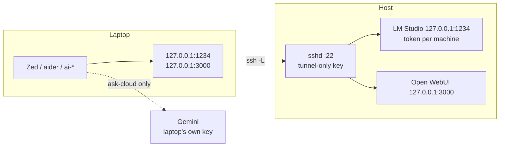

# Laptop access

ADR 0016, phase 4 decision: **SSH tunnel only.** The host's LM Studio stays
bound to `127.0.0.1:1234`; a laptop forwards a local port to it over SSH. Same
setup on the LAN and away from it, traffic encrypted, nothing on the host
exposed to the network.



## What each laptop gets

| Thing | Where | Why |
|---|---|---|
| LM Studio token `laptop-<name>` | laptop `~/.hearth-key` (mode 600) | revoke one machine without touching the others |
| SSH key `hearth_tunnel` | laptop `~/.ssh/hearth_tunnel`; host `authorized_keys` with `command="/usr/bin/false",restrict,port-forwarding,permitopen=…` | the key can forward to `127.0.0.1:1234` and `:3000` and nothing else — no shell, no commands, no other ports |
| Google API key (optional) | laptop `~/.hearth-gemini-key` (mode 600) | `ask-cloud` with the laptop's own key; the host's key never leaves |
| `client/hearth-client.sh` / `.ps1` | laptop `~/.hearth-client.sh` | `ai-tunnel`, `ai-ping`, `ai-models`, `ai-ask`, `ai-webui`, `ask*`, `ask-cloud` |

Secrets are read from files per command and never exported into the
laptop's shell. A world-readable key file is refused.

## Setup

On the host, `scripts/client-setup.sh <laptop-name>` prints every step with
this host's name and user filled in (`--windows` for PowerShell). In short:

1. **Host, LM Studio app:** Developer → Server Settings → Manage Tokens →
   create `laptop-<name>`. Leave Serve on Local Network **off**.
2. **Laptop:** `ssh-keygen -t ed25519 -f ~/.ssh/hearth_tunnel`, and a `Host hearth`
   entry in `~/.ssh/config` pointing at the host with `IdentitiesOnly yes`.
3. **Host:** `scripts/client-setup.sh <name> --authorize hearth_tunnel.pub`.
   It refuses a key that is already authorized without restrictions.
4. **Laptop:** copy `client/hearth-client.sh` to `~/.hearth-client.sh`,
   store the token and (optionally) a Google key, add
   `HEARTH_SSH=hearth`, `HEARTH_CLOUD_MODEL=…` and `source ~/.hearth-client.sh`
   to the shell rc.
5. **Laptop:** `ai-tunnel && ai-ping && ai-models`.

`ai-ping` answers: `up`, `BAD TOKEN` (revoked or wrong token), `NO ANSWER`
(tunnel up but host asleep or LM Studio down — on the host, `scripts/boot.sh`),
or `DOWN` (no tunnel — `ai-tunnel`).

## Zed on the laptop

Same provider as the host, through the tunnel:

```json
{
  "language_models": {
    "openai_compatible": {
      "hearth": {
        "api_url": "http://127.0.0.1:1234/v1",
        "available_models": [
          { "name": "local-big", "display_name": "local-big", "max_tokens": 65536 }
        ]
      }
    }
  },
  "agent": { "default_model": { "provider": "hearth", "model": "local-big" } }
}
```

Token through the UI (Agent panel → settings → `hearth` → API key): the
**laptop's** token, not the host's. Start `ai-tunnel` before Zed, or Zed's
models show as unavailable.

A Gemini provider **is allowed on the laptop** (D3), with the laptop's own
key. The host has none. Keep sensitive repos on `hearth/local-big`.

Copy the Write/Research profile block from `docs/IDES.md` too if the laptop
uses auslaw: the same "Write enables every server" trap applies.

## Open WebUI from the laptop

`ai-webui` opens `http://127.0.0.1:3000` through the tunnel — the host's own
instance, same login and history. Nothing to install on the laptop.

## Revoking a laptop

1. LM Studio app → Manage Tokens → delete `laptop-<name>`.
2. Host: delete the `hearth-tunnel-<name>` line from `~/.ssh/authorized_keys`.

Either one alone cuts it off; do both.

## Never

- Port-forward `:22`, `:1234` or `:3000` on the router.
- Turn on Serve on Local Network for a laptop — the tunnel makes it unnecessary,
  and it would put the token on the LAN in plain HTTP.
- Copy the host's token or Google key to a laptop.

## Host SSH hardening (recommended, not done for you)

macOS Remote Login accepts passwords by default. With keys in place:

```bash
echo 'PasswordAuthentication no
KbdInteractiveAuthentication no' | sudo tee /etc/ssh/sshd_config.d/100-hearth.conf
sudo launchctl kickstart -k system/com.openssh.sshd
```

Test a key login from the laptop **before** closing your current session.
