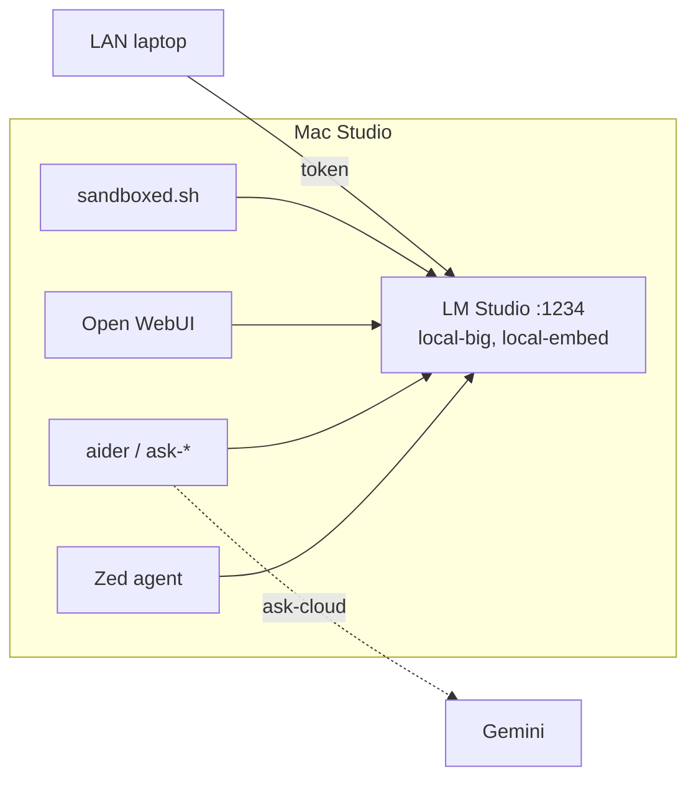

# Migration: LiteLLM + Ollama → LM Studio direct

**Status:** in progress — ADR 0016 accepted 2026-10-31.
**ADR:** `docs/decisions/0016-lmstudio-direct.md`
**Drafted:** 2026-10-31

## How to use this file (for Cursor, Claude Code, Zed, aider)

- Follow `CLAUDE.md` / `AGENTS.md`. Plan → operator refines → operator approves
  → build. **One phase at a time.** Do not start a phase until the operator says
  so in the conversation; do not start the next phase until the current gate
  passes and the operator confirms.
- **Stop at every `DECISION` and ask.** Do not pick for the operator.
- Every phase ends with a gate. Record gate output in
  `bench/results/<date>-<phase>/report.md` and tick the phase in the status
  table below in the same commit.
- LM Studio CLI flags below are written from documentation, not tested on this
  Mac. **Confirm each flag with `lms <cmd> --help` before using it**, and
  correct this file if it is wrong.
- Shell rules still apply: bash 3.2, LF only, no `declare -A` / `mapfile` /
  `${x^^}`. Preflight scans for these.
- No secrets in git. Tokens go in `~/.config/hearth/env` (host) and
  `~/.hearth-key` (clients), never in the repo.

## Status

| Phase | What | State |
|---|---|---|
| 0 | Baseline concurrency bench on the current stack | done 2026-10-31 — `bench/results/2026-10-31-phase0/report.md` |
| 1 | LM Studio beside the current stack, localhost only | not started |
| 2 | GPU wired-limit headroom | not started |
| 3 | Cut host clients over (Zed, aider, WebUI, sandbox, MCP) | not started |
| 4 | LAN access with tokens; laptop clients | not started |
| 5 | Stop the old stack; rewrite scripts and docs | not started |
| 6 | Soak one week, then delete old weights and services | not started |

## Decisions the operator must make

| ID | Question | Recommendation | Answer |
|---|---|---|---|
| D1 | Roles after migration: keep `local-code` and `local-chat` as separate models, or collapse to `local-big` + `local-embed`? | **Collapse.** Two heavy models cannot both stay resident with 3 × 64K slots inside the GPU limit, and evictions are failure F2. Keep the names as client-side aliases that resolve to `local-big` | **Collapse** (2026-10-31) |
| D2 | Slots and context for `local-big` | 3 slots × 64K. Lower to 2 if the phase 1 footprint exceeds the limit | **3 × 64K** (2026-10-31) |
| D3 | Does Zed **on the host** get a Gemini provider? | No on the host (keeps sensitive work local by default); yes on the laptop | |
| D4 | Digest drift detection | Keep: hash the model directory in `config/roles.tsv` and check it in preflight | |
| D5 | Keep Open WebUI? | Yes, pointed at `:1234`. It no longer needs the gateway's Postgres | |
| D6 | Headless runner: LM Studio app with "run server on login", or `llmster`? | `llmster` if it installs cleanly; the app otherwise | **`llmster`** (2026-10-31). Removing Ollama.app: ask the operator first |
| D7 | Soak length before phase 6 cleanup | Operator: one week is excessive. Proposal pending | |

## Target



---

## Phase 0 — Baseline

Purpose: numbers to beat, measured the same way before and after.

1. Write `scripts/concurrency-bench.sh` (bash wrapper) + `bench/concurrency.py`
   (stdlib only, `python3 -I`).
   - Args: `--base-url`, `--token-env NAME`, `--model ROLE`, `--concurrency N`
     (default 3), `--rounds R` (default 10), `--prompt-tokens T` (default
     30000).
   - Each request: a realistic agent turn — system prompt + 6 tool schemas
     (`read_file`, `write_file`, `edit_file`, `list_directory`, `grep`,
     `run_command`) + filler file content to reach T tokens, `stream: true`,
     asking for a `read_file` tool call.
   - Record per request: time to first byte, time to first token, total time,
     HTTP status, whether a valid tool call came back, finish reason.
   - Client-side timeout 180 s. A timeout is a recorded failure, not a crash.
   - Sample the inference process footprint every 2 s
     (`footprint -p <pid>` or `vmmap --summary`) and record the peak.
   - Output `raw.tsv` + `report.md` (p50/p95 TTFT, failures, peak footprint).
2. Run against the current stack: `--base-url http://127.0.0.1:4000/v1`,
   `--model local-big`, concurrency 1 then 3.

**Gate:** report committed. Failures at concurrency 3 are expected; they are
the baseline.

## Phase 1 — LM Studio beside the current stack

Localhost only. Nothing else changes yet.

1. Install LM Studio 0.4.x (or `llmster`, per D6). Record the version in
   `docs/MODELS.md`.
2. Download the MLX 4-bit build of the current `local-big` weights and the
   embedding model. Exact model keys go in `config/roles.tsv` and
   `docs/MODELS.md` only.
3. Create `config/roles.tsv` (tab-separated, `#` comments allowed):
   ```
   # role        backend    model_key                 ctx    slots
   local-big     lmstudio   <mlx model key>           65536  3
   local-embed   lmstudio   <embedding model key>     2048   1
   cloud-cheap   gemini     <gemini model id>         -      -
   ```
4. Write `scripts/lms-load.sh`: reads `config/roles.tsv`, unloads anything not
   listed, loads each `lmstudio` row with `--identifier <role>` and
   `--context-length <ctx>` and GPU offload max. Set concurrent predictions to
   `slots` (confirm whether that is a load flag or a server setting).
   Idempotent.
5. Server settings: port 1234, **serve on local network OFF** for now, require
   authentication **ON**, CORS **OFF**, JIT model loading **OFF**, auto-unload
   **OFF**, "allow calling servers from mcp.json" **OFF**.
6. Create a host token; store it as `LMSTUDIO_HOST_TOKEN` in
   `~/.config/hearth/env` (mode 600).
7. Run `scripts/tool-smoke.sh` and `scripts/concurrency-bench.sh` against
   `http://127.0.0.1:1234/v1` at concurrency 1 and 3.
8. Stop Ollama's runner while benching (`ollama stop` or unload) so both
   servers are not competing for GPU memory; note it in the report.

**Gate (all must hold):**
- tool-smoke passes.
- Concurrency 3 × 10 rounds: zero timeouts, zero invalid tool calls.
- p95 TTFT at concurrency 3 is better than the phase 0 baseline.
- Peak footprint stays at least 4 GB under the current wired limit. If not,
  drop to 2 slots (D2) and rerun.
- A request with no token gets 401.

## Phase 2 — GPU headroom (optional, measure)

1. Read the current limit: `sysctl iogpu.wired_limit_mb` (0 means the default,
   ~75% of RAM).
2. Try `sudo sysctl iogpu.wired_limit_mb=56000` and rerun the phase 1
   concurrency bench.
3. If it helps, add a root launchd daemon `com.hearth.wired-limit` that sets
   it at boot (`scripts/install-wired-limit.sh --apply/--check/--remove`). It
   resets on reboot otherwise.

**Gate:** bench numbers recorded with and without. Keep only if better and
the system stays responsive with Zed, a browser and the bench running.

## Phase 3 — Host clients

1. **Zed (`settings.json`)** — replace the `hearth` provider:
   ```json
   "language_models": {
     "openai_compatible": {
       "hearth": {
         "api_url": "http://127.0.0.1:1234/v1",
         "available_models": [
           { "name": "local-big", "display_name": "local-big", "max_tokens": 65536 }
         ]
       }
     }
   }
   ```
   Token goes in through the Zed UI (keychain). Set the agent default, thread
   summary model, commit message model and inline assistant model to
   `hearth/local-big` so nothing asks for another model. Remove `cloud-cheap`
   from the host per D3. Update `docs/IDES.md`.
2. **MCP** — move `auslaw` from `litellm/config.yaml` into Zed
   `context_servers` as a stdio server with the same allowed tools and without
   the jade cookie. Update `docs/MCP.md` (registry stays; "keys" column becomes
   "clients").
3. **aider / aliases** — rewrite `scripts/aliases.zsh`:
   - `HEARTH_LOCAL=http://127.0.0.1:1234/v1`, token from
     `LMSTUDIO_HOST_TOKEN`, injected per invocation (keep the no-export rule).
   - `ask`, `ask-local`, `ask-big`, `ask-chat`, `ask-fast` all →
     `openai/local-big` (D1). `ask-arch` becomes `--architect` with both models
     `local-big` (same model, no eviction).
   - `ask-cloud` reads the Gemini model id from `config/roles.tsv` and uses
     `GOOGLE_API_KEY` directly. It is the only alias that can leave the host.
   - `ai-loaded` → `lms ps`. `ai-restart` → restart LM Studio's server.
4. **Open WebUI** (`scripts/webui.sh`) — point at
   `http://host.containers.internal:1234/v1` with the host token. Confirm
   containers can reach the host port with "serve on local network" still off;
   if not, note it and revisit in phase 4.
5. **Sandbox** — `scripts/sandboxed.sh` and `scripts/sandbox-probe.sh`: egress
   allow-list changes from `127.0.0.1:4000` to `127.0.0.1:1234`. The probe must
   still prove that nothing else is reachable.

**Gate:** a real Zed agent session (≥ 20 tool calls, two threads at once)
completes with no stall; aider `ask` and `ask-cloud` work; sandbox-probe
passes; WebUI answers.

## Phase 4 — LAN

1. LM Studio: serve on local network **ON**. Authentication stays on.
2. One token per machine: `laptop-<name>`. Store on the laptop in
   `~/.hearth-key` (mode 600).
3. macOS firewall: allow LM Studio incoming. Never port-forward 1234.
4. Rewrite `client/hearth-client.sh`, `client/hearth-client.ps1`,
   `client/hearth-webui.sh`, `scripts/client-setup.sh`:
   - `HEARTH_GATEWAY` → `HEARTH_HOST` (e.g. `http://192.168.1.10:1234`); keep
     reading the old variable name for one release.
   - `ai-ping` checks `/v1/models` with the token (200 = up, 401 = bad token,
     no answer = host asleep).
   - `ai-models` lists identifiers from `/v1/models`.
   - `ask-cloud` on the laptop uses the laptop's own `GOOGLE_API_KEY`.
5. Off-LAN: document `ssh -N -L 1234:127.0.0.1:1234 USER@HOST`.
6. Rewrite `docs/LAPTOP.md` (Zed block, aider block, tunnel).

**Gate:** from the laptop — `ai-ping` up, request without token refused,
Zed agent session works, `ask-cloud` works with the laptop's key. From the
host — `nc -z <lan-ip> 1234` answers and an unauthenticated request is 401.

## Phase 5 — Retire the old stack, rewrite tooling

1. Stop and disable (do not uninstall yet): LiteLLM launchd agent, Ollama
   launchd service, `com.hearth.mlx-watchdog`, the Postgres container. Back up
   the Postgres volume to `~/hearth-backups/` first.
2. Delete scripts that only exist for the gateway or Ollama:
   `create-keys.sh`, `db.sh`, `setup-prisma.sh`, `deploy.sh`,
   `audit-fallbacks.sh`, `audit-mcp-scope.sh`, `bisect-config.sh`,
   `install-ollama-service.sh`, `lock-ollama.sh`, `mlx-watchdog.sh`,
   `apply-nothink.sh`, `test-nothink.sh`, `usage.sh`.
3. Rewrite against LM Studio and `config/roles.tsv`:
   `lib.sh`, `boot.sh`, `install-autostart.sh`, `status.sh`, `diagnose.sh`,
   `healthcheck.sh`, `preflight.sh`, `bench.sh`, `tool-smoke.sh`,
   `pin-digests.sh` (per D4), `swap-role.sh`, `pull-candidates.sh`
   (`lms get`), `mlx-bench.sh`.
   - `healthcheck.sh` must check: server up; each role answers; request
     without token → 401; LAN interface answers only with token; nothing but
     LM Studio listens on 1234; JIT loading is off (a request for an unlisted
     model fails rather than loading it).
   - `preflight.sh` keeps CRLF / bash-3.2 scans; replaces config checks with
     `config/roles.tsv` ↔ `docs/MODELS.md` consistency and the D4 drift check.
4. Keep unchanged: `searxng.sh`, `install-global-rules.sh`.
5. Remove `litellm/` from the tree (history keeps it).
6. Docs: rewrite `README.md`, `docs/ARCHITECTURE.md`, `docs/ROUTING.md`,
   `docs/RUNBOOK.md`, `docs/MODELS.md`, `docs/THREAT-MODEL.md` (privacy is now
   "local server holds only local models" + sandbox egress, not key scope).
   Mark ADRs 0002, 0003, 0008, 0011, 0013, 0015 superseded by 0016.
7. `CLAUDE.md` hard rules:
   - Rule 1: concrete names in `config/roles.tsv` and `docs/MODELS.md`;
     MCP servers in Zed config docs and `docs/MCP.md`.
   - Rule 2: no router means no fallbacks. Replace with "LM Studio never holds
     a cloud model, and no script adds a remote backend to `config/roles.tsv`
     except under `backend: gemini` (or another explicit cloud backend)".
   - Rule 3: restate as above.
   - Rule 6: per D4.
   - Rule 7: update the resident set figure from the phase 1 measurement.

**Gate:** `preflight.sh` and `healthcheck.sh` pass on a clean reboot with
only LM Studio running. `grep -rn '4000\|11434\|litellm\|ollama'` over
`scripts/ client/ docs/*.md` returns only intentional historical mentions.

## Phase 6 — Soak and clean up

After the soak agreed in D7 with no stall:

1. Uninstall LiteLLM (pipx), Ollama, the Podman Postgres container and volume
   (backup kept), and delete Ollama model weights.
2. Remove the stopped launchd plists.
3. Mark ADR 0016 accepted; update `docs/PLAN.md`.

If a stall recurs during the soak: capture `lms log stream` output, footprint,
and the concurrency bench at the failing settings before changing anything.
