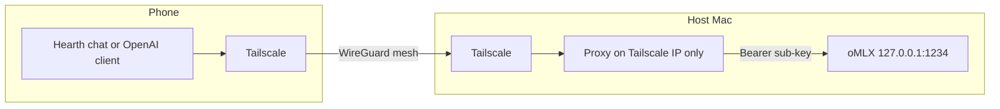

# Mobile remote access

Reach a Hearth host from an iPhone or Android without opening oMLX to the
LAN or the public internet. Design decision: ADR 0042. Laptop SSH tunnels
stay as they are (`docs/LAPTOP.md`).

## Verdict (2026-11-09)

- **Cline has no native iOS or Android app.** Desktop, IDE plugins, CLI, and
  Kanban only. Their documented phone path is Tailscale plus a browser on
  the Kanban board ([Cline blog, 2026-04-15](https://cline.bot/blog/cline-mobile-how-to-vibe-code-from-your-phone)).
- **MVP for Hearth:** chat with `main-brain` from the phone over a mesh
  overlay. A custom Hearth chat app is optional; any OpenAI-compatible
  client can work once the path exists.
- **Agent drive/review from the phone:** use Cline Kanban over the same
  overlay, not a Hearth coding IDE on day one. Bind Kanban to the Tailscale
  interface (or localhost plus a forward), not `0.0.0.0` on every NIC.
  Cline Pass / Usage-Billing remain optional and not private.

## Architecture

1. Install Tailscale on the host and the phone; same tailnet; MagicDNS on.
2. Keep oMLX on `127.0.0.1:1234`. Never Serve on Local Network.
3. Near term: a tiny reverse proxy on the host that listens **only** on the
   Tailscale address and forwards to loopback. Alternate: an SSH
   local-forward on the phone that mirrors `ai-tunnel`, then the client
   talks to `http://127.0.0.1:1234/v1`.
4. Register `phone-<name>` with `scripts/omlx.sh sub-key add`. Store the
   token in the platform keystore. Role stays `main-brain`.

Discovery survives ISP IP changes and CGNAT because the mesh, not the
public IP, is the address. Headscale or self-hosted NetBird can replace
Tailscale Inc later without changing the app or the proxy shape.

## Auth

| Layer | What it proves | Mechanism |
|---|---|---|
| Overlay | device may join the private network | Tailscale identity (Apple/Google IdP OK here) |
| API | device may call `main-brain` | per-phone oMLX bearer sub-key |
| Optional tunnel | same as a laptop | ed25519 key with `restrict` + `permitopen` |

- **Passkeys:** fine later to unlock the app or a pairing screen. Not a
  substitute for the bearer token on `/v1`.
- **Facebook / consumer SSO to the brain:** no.
- **Cloudflare Access in front of a public hostname:** not the MVP. Puts
  an HTTP edge on private prompts; native apps fight Access cookies.

Pairing should match laptops: host creates the sub-key, phone stores it
once (QR or paste). Revoke one phone without touching the others.

## Non-goals (v1)

- Porting Cline's agent harness into an App Store binary.
- Binding oMLX to the LAN or WAN.
- Federated SSO as the only gate to `:1234`.
- Replacing laptop SSH tunnels.
