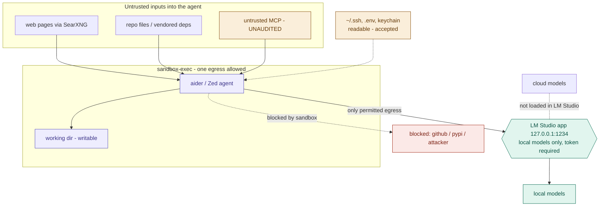

# Prompt injection threat model

Last updated: 2026-11-01. Controls in §4 verified on macOS 26.4 by
`scripts/sandbox-probe.sh` (10 passed, 0 failed).

## 1. The claim this document rests on

**Prompt injection cannot be detected reliably, and we do not try.**

As of 2026 the strongest published defences still miss roughly one in ten
optimisation-based attacks, and adaptive attacks bypass essentially every
recommended defence. OWASP's 2026 data has prompt injection as the leading
agentic-AI security failure in production, with coding agents driving most of
the new attack volume — **aider is named among the five agents responsible**,
and it is the one used daily here.

The consequence for design: there is no filter to install, no delimiter scheme
to adopt, and no classifier worth running. The only defences that hold are
**capability restrictions** — reducing what an agent is able to do, so that a
successful injection has nowhere to go.

Anything in this repo that looks like injection *detection* is a bug.

## 2. Why the existing privacy boundary does not help

This is the important structural point, and it is easy to get wrong.

Model placement is the control for **where data goes on purpose**. LM Studio
on `:1234` holds only local models, and only `ask-cloud` carries a cloud key, so
a prompt sent to a local role cannot route client data to Google. That boundary
is real and it works (ADR 0016; before that it was gateway key scope).

Injection attacks do not use that path at all.



Two boundaries, doing different jobs:

- **`sandbox-exec`** wraps the agent. One arrow leaves it, to `127.0.0.1:1234`.
  Everything else — `github`, `pypi`, an attacker's host, DNS itself — is cut.
- **LM Studio** is the only thing at the end of that arrow, and it holds only
  local models, so even intended traffic cannot reach a cloud model.

An injection that lands still reads whatever it likes (the dashed arrow from
secrets is deliberate) and can still write into the working directory. What it
cannot do is get anything out.

An injected agent that reads `~/.ssh/id_rsa` and POSTs it to an attacker
**never touches the model server**. Which models are loaded has no bearing on
that path.

So: the privacy boundary governs *intentional* routing. The containment
boundary in §4 governs *everything else*. They are different axes and neither
substitutes for the other.

| Threat | Model placement | Sandbox |
|---|---|---|
| A prompt sends client data to a cloud model | **caught** (unless you run `ask-cloud`) | not caught |
| An injected agent exfiltrates a key via curl | not caught | **caught** |
| An injected agent reads a file it shouldn't | not caught | not caught |
| An injected agent rewrites source in the repo | not caught | not caught |

Note the bottom two rows. They are not oversights; see §5.

## 3. Surfaces, ranked by capability rather than likelihood

Ranking by likelihood invites guessing. Rank by *what an injection could do if
it landed*, which is knowable.

| # | Surface | Untrusted content arrives via | If injected, it can | Risk |
|---|---|---|---|---|
| 1 | **aider** | files you `/add`, vendored deps, cloned repos, sample data | edit source, run commands, reach the network | **high** |
| 2 | **Zed agents** | same, plus tool results. Write and Ask have `fetch` and `search_web` off. The `web` profile is SearXNG search only (no file tools) | edit or read in Write; in Web, send the query text out. `confirm` is the gate | **high** |
| 3 | **untrusted MCP** | fetched docs / tools from a server not in `docs/MCP.md` | depends entirely on what the MCP exposes | unknown |
| 4 | **SearXNG** | arbitrary web pages; the query text leaves | Open WebUI can mislead you and, when search is on, send a query. Zed's `web` profile can search and nothing else. The tunnel publishes SearXNG with no login, so any process on a laptop can send a query | medium |

**Surface 3 is a server that is not registered in `docs/MCP.md`.** The live
web-search MCP server is registered there, with the tool it exposes written
down. The legal-research server is a worked setup example, not an installed
server. Anything else is still unknown.

**Surface 4.** Open WebUI's search is opt-in per message. The Zed `web`
profile can search and cannot read files. `confirm` on each tool call is
the gate. **The moment Open WebUI gains tools, functions, or code
execution, that UI becomes surface 1 with a web feed attached.** Treat
enabling them as a decision requiring an ADR, not a settings toggle.

## 4. What is actually enforced

`scripts/sandboxed.sh` runs an agent under a `sandbox-exec` profile. Verified
on macOS 26.4, 2026-08-02:

| Control | State |
|---|---|
| Egress to anything but `127.0.0.1:1234` | **blocked** — verified against 1.1.1.1 and the old `:4000` (2026-10-31) |
| DNS resolution | **blocked** — hostnames do not resolve |
| Writes outside the working directory | **blocked** — verified against `$HOME` |
| Writes inside the working directory | allowed |
| Reads | **unrestricted, deliberately** |

Usage:

```bash
scripts/sandboxed.sh aider                 # confine to $PWD
scripts/sandboxed.sh --dir ~/dev/x aider   # confine to a named repo
scripts/sandboxed.sh --print-profile       # audit the profile, any machine
scripts/sandbox-probe.sh                   # re-verify the controls hold
```

Re-run the probe after any macOS update. `sandbox-exec` is deprecated and Apple
could remove or change it without notice; the probe is how you find out that
happened deliberately rather than by being breached.

### Why reads are open

Restricting reads breaks dylib loading and every language runtime, and read
confinement is not what stops the attack. An agent under this profile **can
still read your SSH keys, `.env` files, and browser cookies.** It cannot send
them anywhere. Exfiltration needs a channel, and there is exactly one open
channel — LM Studio on `:1234`, which holds only local models.

This is a deliberate trade, not a limitation we failed to notice. Anyone
reading this document should be able to state it back: *the sandbox protects
against exfiltration, not against reading.*

### Why the working directory is writable

An agent that cannot write is not an agent. The residual risk is that an
injected agent **corrupts the repo it was invited into** — plausible, and not
mitigated by the sandbox. It is mitigated by git: commit before starting an
agent session, and `git diff` before accepting anything. That is a workflow
control and it depends on you, which is why it is written down here rather than
assumed.

### What the sandbox is not

`sandbox-exec` is deprecated, has known weaknesses, and this profile allows
broad `mach-lookup` and `process-exec` because nothing runs without them. A
determined attacker with code execution may find leverage there.

This is **not** a VM and not a security boundary of that grade. It raises the
cost of an attack and closes the one channel that turns a compromise into a
loss. Do not extend trust to it beyond that. If the threat model ever includes
a motivated attacker specifically targeting this machine, the answer is a Lima
VM or a separate user account, not a better SBPL profile.

## 5. Accepted, unmitigated risk

Recorded so nobody mistakes silence for safety.

1. **An injected agent can read any file the user can.** Mitigated only by the
   absence of an egress channel. If a future change opens egress — even to a
   package registry — this becomes live. That is why `--also-write` and any
   network widening need justification.
2. **An injected agent can corrupt its own repo.** Mitigated by git hygiene,
   not by the sandbox.
3. **Untrusted MCP servers are unaudited.** Unknown capability, real-data adjacency.
4. **No confirmation gates** beyond git commits. This costs nothing today
   because nothing in the stack can send mail or move money. It becomes urgent
   the day something can.

## 6. Cheapest next checks

In order of value per effort:

1. Audit what tools each MCP exposes to a model. Surface 3 is the only
   unknown on the list.
2. Run aider under the sandbox for a week of real work and record what it
   needed widened. A profile nobody can work under gets switched off.
3. Confirm Open WebUI still has tools disabled after any upgrade — its settings
   live in a database that overrides the environment, a trap already documented
   in `RUNBOOK.md`.
4. Known vulnerabilities in the Open WebUI and SearXNG images are monitored by
   Snyk (`scripts/snyk-monitor.sh`, RUNBOOK). That covers published CVEs in
   their packages, not their configuration or LM Studio itself.

## Sources

- [Prompt injection still drives most agentic AI security failures in production — Help Net Security / OWASP, June 2026](https://www.helpnetsecurity.com/2026/06/11/owasp-prompt-injection-ai-security-failures/)
- [Adaptive Evaluation of Out-of-Band Defenses Against Prompt Injection in LLM Agents (arXiv)](https://arxiv.org/pdf/2606.26479)
- [Prompt Injection Prevention for Coding Agents: Defenses That Hold in Production — Fiddler AI](https://www.fiddler.ai/blog/prompt-injection-prevention-coding-agents)
- [Clarify `sandbox-exec` deprecation timeline — apple/containerization issue #737](https://github.com/apple/containerization/issues/737)
- [Sandboxing Claude Code on macOS: What I Actually Found — Infralovers, Feb 2026](https://www.infralovers.com/blog/2026-02-15-sandboxing-claude-code-macos/)
