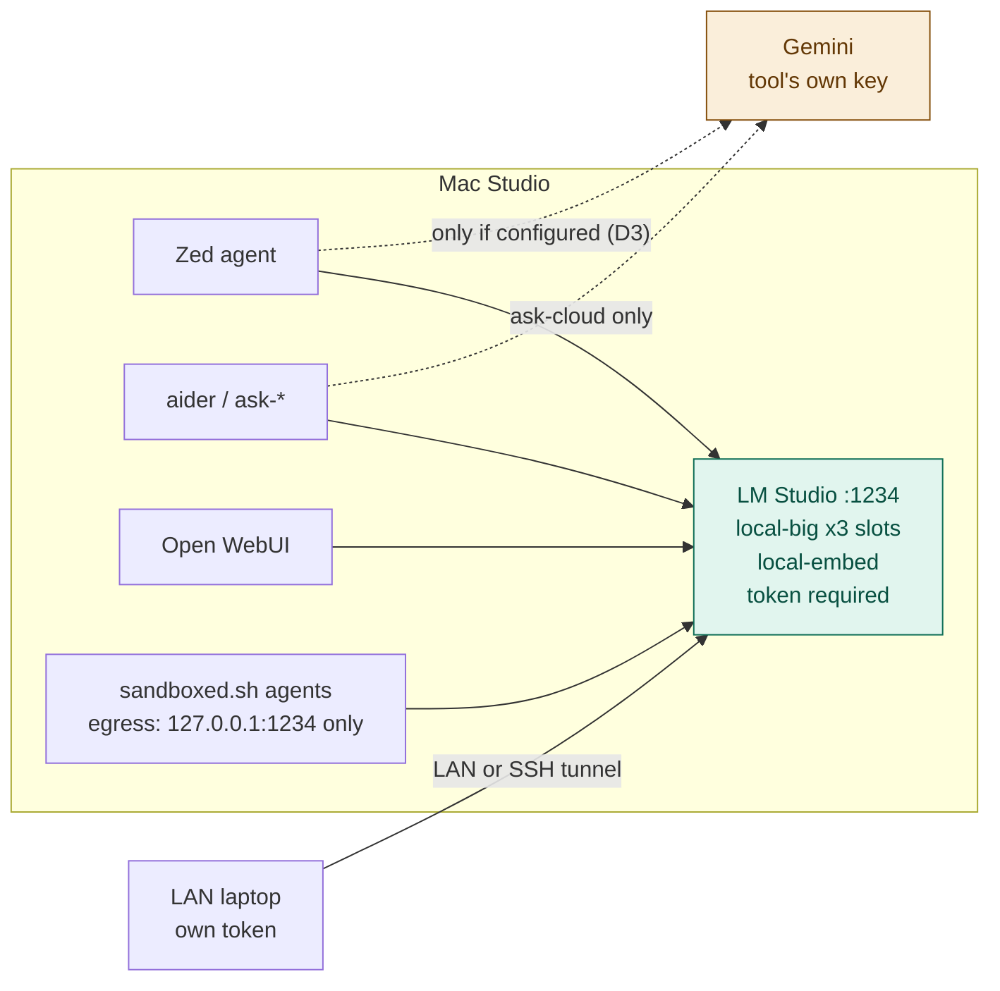

# ADR 0016 — Serve local models from LM Studio directly; retire the gateway

**Date:** 2026-10-31
**Status:** accepted 2026-10-31 by the operator. Built phase by phase per the
plan; superseded ADRs are marked when phase 5 lands.
**Supersedes on acceptance:** 0002 (Postgres), 0003 (Ollama localhost-only),
0008 (MCP through the gateway), 0011 (Ollama memory knobs), 0013 (local-big on
Ollama MLX), 0015 (stall handling / watchdog).
**Plan:** `docs/MIGRATION-LMSTUDIO.md`

## Context

Zed agent turns to `local-big` stall under concurrent completions and the
runner needs killing (ADR 0015). Reading the stack end to end, the causes sit
in the inference layer and in the gateway's retry policy, not in Zed:

| # | Failure | Where |
|---|---|---|
| F1 | One slot for every client. `OLLAMA_NUM_PARALLEL=1`, and Ollama's MLX runner serialises regardless (ollama#17280, #17924). Queue time counts against the gateway timeout, so a queued request looks dead | Ollama |
| F2 | `MAX_LOADED_MODELS=1`, so any `local-code` / `local-chat` call (aider editor model, WebUI default, the `local-code → local-big` fallback) evicts the 23 GB agent model; ~17 s to reload | Ollama + roles |
| F3 | Stall at 38–43 GB footprint in `MetalAllocator::malloc` against a ~48 GB wired limit. `OLLAMA_KV_CACHE_TYPE` / flash attention are llama.cpp-engine knobs and are probably ignored by the MLX runner (unmeasured) | Ollama MLX |
| F4 | Zed cancel leaves the upstream socket open; the runner keeps the GPU | gateway + Ollama |
| F5 | `local-code` retries 2 × 120 s behind the stuck request, then falls back to `local-big`, forcing a swap | LiteLLM config |
| F6 | XML tool-parse errors on long chains; streaming + tools hang; parallel tool-call `index: 0` | Ollama |
| F7 | Recovery is `mlx-watchdog.sh` killing the runner | symptom of F1–F4 |

The operator also measured roughly 600 ms of added latency through the
gateway. That is not the cause of the stalls, but it is cost paid on every
agent turn for features (per-key scope, spend caps, Postgres) that a single
operator plus one laptop can do without.

LM Studio 0.4.x serves MLX models with continuous batching and a fixed number
of concurrent predictions, exposes OpenAI- and Anthropic-compatible APIs, can
serve the LAN, and can require an API token in the `Authorization` header
(lmstudio.ai/docs/developer/core/server/settings, read 2026-10-31). Rapid-MLX
on the same weights measured 2.6 s on `bench/tool-smoke.py` against 17.3 s
cold on Ollama MLX (ADR 0012, 0013).

## Decision (proposed)

1. **LM Studio is the only local inference server**, on `:1234`, run headless
   at login. Ollama, LiteLLM, Postgres-for-LiteLLM and the MLX watchdog are
   retired after a soak period.
2. **One agent model, always resident**, loaded with a fixed identifier equal
   to its role name (`local-big`), 64K context per slot (raised to 128K by ADR 0017), 3 concurrent
   predictions, JIT loading off. `local-embed` stays resident beside it. Whether
   `local-code` and `local-chat` survive as separate models is decision D1 in
   the plan; the recommendation is to collapse them into `local-big` so
   nothing ever evicts the agent model.
3. **Role names survive** as LM Studio model identifiers, so Zed, aider and
   the laptop still ask for `local-big`, not a model name.
4. **Concrete model names live in exactly two files:** `config/roles.tsv`
   (machine-read: role, backend, model key, context, slots) and
   `docs/MODELS.md`. This replaces `litellm/config.yaml` in hard rule 1.
5. **LAN access** uses LM Studio's "Serve on Local Network" with "Require
   Authentication" on, one token per machine. CORS off. "Allow calling servers
   from mcp.json" off. Never port-forwarded; off-LAN is an SSH tunnel to `:1234`.
6. **Cloud is reached by each tool directly** with its own provider key, never
   through LM Studio, so nothing sent to `:1234` can leave the host.
7. **MCP servers move to the client** (Zed `context_servers`, stdio). The
   egress registry in `docs/MCP.md` stays.

## Consequences

**Gained**
- Concurrent agent turns without queuing behind one generation (to be proven
  by the concurrency bench before cutover — plan phase 1 gate).
- No model swapping on the agent path.
- One process to supervise instead of four (Ollama, LiteLLM, Postgres VM,
  watchdog). The ~600 ms gateway overhead is gone.

**Lost, stated plainly**
- **Privacy is no longer enforced by key scope.** What replaces it:
  - LM Studio holds only local models, so anything sent to `:1234` stays on
    the host by construction.
  - Cloud needs a separate provider key in the calling tool. Aliases keep
    cloud explicit (`ask-cloud` only).
  - Agents run under `sandboxed.sh` can reach only `127.0.0.1:1234`, so a
    sandboxed agent cannot reach cloud at all. That part stays structural.
  - What is lost: picking a cloud model in Zed's dropdown for sensitive work is
    no longer refused. Decision D3 decides whether Zed on the host gets a cloud
    provider at all.
- **No spend caps or per-request log.** Set a quota in the Google Cloud
  console for the Gemini key instead.
- **Tokens are not scoped to models.** Any valid token can use every loaded
  model. Acceptable while LM Studio serves local models only.
- **`audit-fallbacks.sh`, `audit-mcp-scope.sh` and the leak test go away**,
  because there is no router or scope to audit. `healthcheck.sh` gains a
  "request without a token is refused" check and a "LAN interface answers only
  with a token" check.
- **Digest drift detection** must be reimplemented against LM Studio's model
  files (hash the weights directory) or dropped. Decision D4.

**Not a goal: Cursor as a client.** Cursor sends custom-endpoint requests from
its own servers and rejects non-HTTPS base URLs (`docs/IDES.md`), so using it
against `:1234` would require exposing the Mac to the internet. That breaks
rule "never port-forward". Cursor stays an editor/agent that works on this
repo with its own cloud models; it does not consume local inference.

## Rollback

**None to the old stack since 2026-10-31.** The operator chose to skip the
soak: LiteLLM (pipx), Postgres (container, volume, image), Ollama (app,
service, 74 GB of weights), Rapid-MLX, llmster and their launchd agents were
deleted the same day. What remains:

- `~/hearth-backups/` (mode 700): `hearth-postgres-2026-10-31.sql` (full
  `pg_dumpall`, holds the old virtual keys), `config-litellm-2026-10-31.tgz`,
  `repo-litellm-dir-2026-10-31.tgz`, `ollama-app-support-2026-10-31.tgz`.
- Git history for `litellm/config.yaml` and the removed scripts.
- Client config backups: `*.pre-lmstudio-2026-10-31` next to `~/.zshrc`,
  `~/.zshenv.local`, `~/.aider.conf.yml`, `~/.config/zed/settings.json`.

Rebuilding the gateway would be a reinstall plus re-pulling the Ollama
weights, not a rollback.
