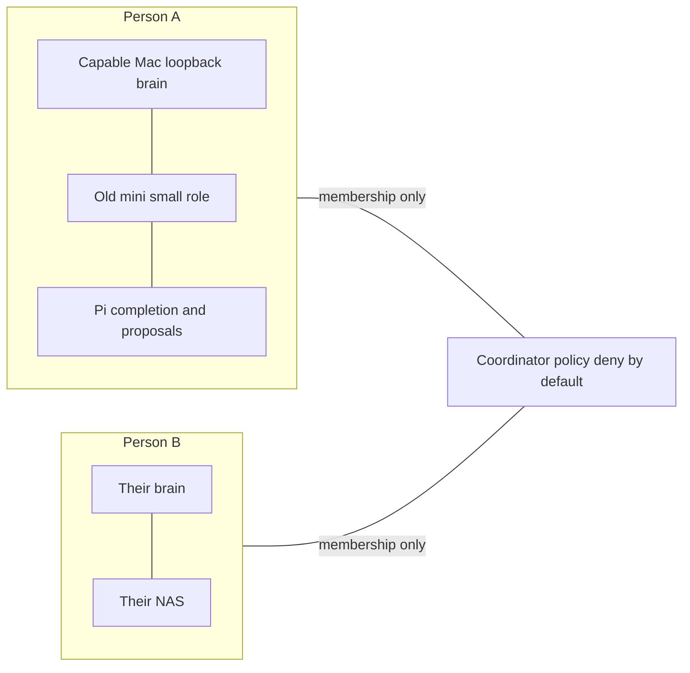

# ADR 0037 — Separate brains, joined on purpose

**Date:** 2026-11-08
**Status:** accepted 2026-11-08 by the operator. Decision only: no mesh, no new role, no mail or switch tool.

## Context

Fixed hardware — an old Mac mini, a Raspberry Pi, a NAS — should do small
jobs for the person who owns it: prompt completion, and proposing a task
such as sending mail or switching a device. Several people may each have
that hardware. A device must never run someone else's prompt. The path
may be the LAN or the internet. The serving picture today is one host on
`127.0.0.1:1234` and laptops over an SSH local-forward (`docs/LAPTOP.md`).

Checked 2026-11-08, three patterns in use elsewhere:

1. **Shard one model across the machines.** exo auto-discovers Apple nodes
   and splits with MLX. Its API listens on every interface with no login;
   the maintainers call that intentional and point operators at their own
   proxy. CVE-2026-50759 (2026-07-21) is an unauthenticated wipe of model
   instances on port 52415; that shape was still the tree in October 2026.
   Linux nodes are CPU-only, so a Pi does not join an MLX split. llama.cpp
   RPC is marked fragile and insecure by upstream, and the protocol is
   plaintext TCP. A Pi cluster measured slower than the same model on one
   Pi (about 2.2 tok/s split against 4.4 on the single board). Jeff
   Geerling's 2025 cluster found the same for RPC; distributed-llama is a
   different model zoo. Rookery wraps that RPC in Kubernetes and says not
   to expose port 50052. Sharding also puts a prompt's activations on
   every worker, so a NAS or a Pi in the house would be running part of
   whoever sent the prompt.
2. **Bind the API to the LAN.** The common advice is `0.0.0.0` or "expose
   to the network", with no login. This host already treats a LAN answer
   as a failed healthcheck. `docs/LAPTOP.md` is SSH local-forward only.
3. **One brain per person, jobs placed by machine.** The model stays on
   the machine that can hold it. A mini, Pi, or NAS runs a small job for
   that same person, or acts as a client of their brain.

The line through the coordinator is membership. Prompt bytes stay inside
one person.

## Decision

Three layers. This ADR does not bind a port, install a coordinator, add a
role, or send mail.

**Membership.** WireGuard is the crypto. The control plane is who gets a
key, who can see whom, and how two NATs meet. Plain WireGuard is enough
for two fixed hosts and becomes a pile of files once Pis and laptops come
and go. Tailscale's hosted control plane keeps the node list on their
servers. Headscale is the self-hosted control plane for the ordinary
Tailscale clients: one binary, the policy on hardware the operator runs.
NetBird is the alternative when a dashboard and an embedded identity
server matter more; it is several services, and the server side is AGPL.

Headscale with no policy is allow-all. A policy file that omits the
grants is also allow-all. Once a policy is loaded, user borders are not
applied on their own; only the policy remains. The rule is a user
reaching only their own devices (`autogroup:self`, or one grant per user
if that autogroup misbehaves). The policy needs tests: A reaches A's
brain, A does not reach B's brain, a new device reaches nothing until it
is enrolled to a person. Enrollment keys are single-use. Nodes expire.
The coordinator's admin port is not on the open internet. The coordinator
decides which keys are trusted and does not need to see prompts. If a
direct path fails, a relay carries WireGuard packets; the payload stays
encrypted. A household NAS is not a tagged node every user can reach. A
tagged node sits outside `autogroup:self`.

**Placement.** Inside one person, machines are roles, as `local-main`,
`local-deep`, and `local-edit` already are.

- The capable Mac keeps the resident brain on `127.0.0.1:1234`. That
  person's other devices reach it the way a laptop does: a forward to
  loopback, a per-device token, a key that cannot open a shell
  (`docs/LAPTOP.md`). More of their devices are more rows, not a listen
  address on the LAN.
- An old Mac mini is another oMLX for that person, on loopback, with its
  own small resident role. It is not a worker of the main Mac.
- A Pi or a NAS holds a small completion or classify role for that
  person, and can store weights. Prompt completion is the same idea as
  laptop `local-edit` (ADR 0033): the small model runs where the
  keystrokes are, and the tunnel can be down. A concrete model name waits
  for a bench and a row in `config/roles.tsv` and `docs/MODELS.md`. A Pi
  that only stores weights and never loads a model is still useful. A Pi
  that tensor-splits with the Mac is the pattern the measurements reject.

A call from the Pi to that person's Mac is a client call with their
token. It is not RPC of activations.

**Actions.** Confirmation gates matter the day something can send mail
(`docs/THREAT-MODEL.md` §5). Mail and switching a device are that day.
The small model may propose a name from a fixed list. A person confirms.
A fixed script runs, checks the same conditions again, and records the
result. The model never holds SMTP credentials or a token that can name
an arbitrary device. Home Assistant write-ups from 2026 match this
shape: conversation first, a small exposed set, no locks in the first
set, a separate control configuration, and an approval that expires. One
house-wide controller is not a tool of every person's model. Each brain
proposes actions only on that person's list. Sending mail still leaves
the house at SMTP; the draft stays local until the confirm.

**Rejected.**

- exo discovery, or any model API bound to all interfaces, as the join.
- llama.cpp `rpc-server` on the house LAN.
- A shared pool where one person's machine decodes another's prompt.
- A hosted-model fallback when a person's brain is down. The call fails,
  as it does today.
- Installing Headscale, NetBird, or a task runner in this step.

## Consequences

- `scripts/omlx.sh`, `docs/LAPTOP.md`, and the healthcheck's LAN-silent
  check are unchanged. oMLX stays on `127.0.0.1`.
- No new role until a mini or Pi is on the bench (`bench/tasks/` and
  `scripts/concurrency-bench.sh` against the incumbent, then
  `config/roles.tsv` and `docs/MODELS.md`).
- Enrollment, and a benched small role, are a later plan.
- The coordinator, when one exists, is a new sensitive host. This
  decision does not start it.
